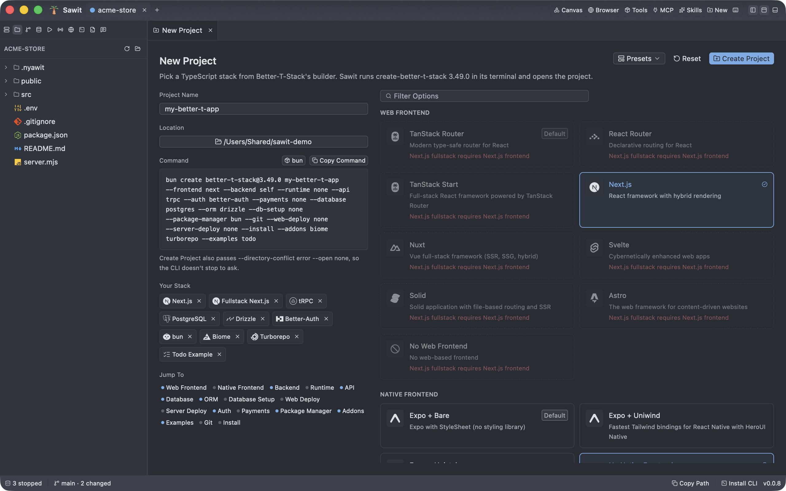
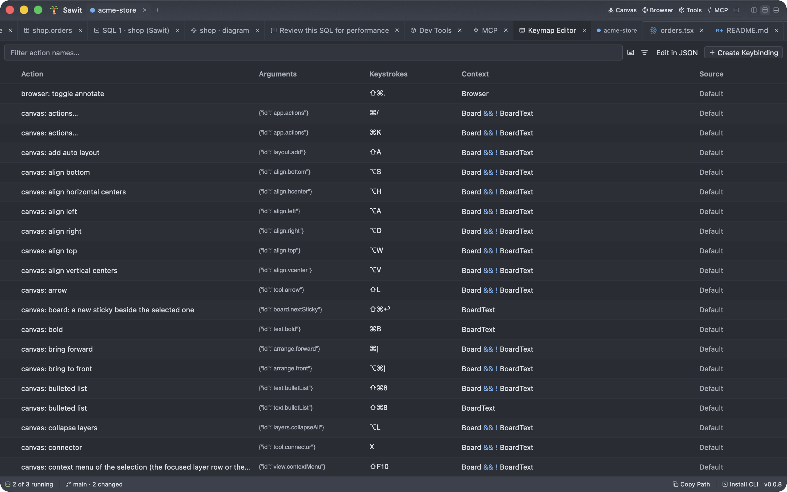

<p align="center">
  <picture>
    <source media="(prefers-color-scheme: dark)" srcset="assets/logo/sawit-wordmark-dark.svg">
    
  </picture>
</p>

<p align="center">
  <b>One native app for local development.</b><br>
  Run PostgreSQL without Docker, browse and query data, edit code, work in split terminals, test your app
  in a browser, draw on a canvas, and install dev tools, all from one window. AI agents can do the same
  through Sawit's MCP server.
</p>

<p align="center">
  
  
  
  
  
</p>

<p align="center">
  <a href="#install">Install</a> ·
  <a href="#features">Features</a> ·
  <a href="#keyboard-shortcuts">Shortcuts</a> ·
  <a href="#the-sawit-command">CLI</a> ·
  <a href="#mcp-for-ai-agents">MCP</a> ·
  <a href="#build--run">Build</a> ·
  <a href="#architecture--key-decisions">Architecture</a>
</p>

<p align="center">
  
  <br>
  <sub>▶︎ <a href="docs/media/demo.mp4">Watch the demo video (MP4)</a>: instance → port conflict → table → SQL → schema diagram → code + terminal → Markdown → ports → browser → network → git → dev tools → MCP → canvas</sub>
</p>

---

## Overview

Sawit is built for local development. That work usually takes Docker Desktop, a database client,
an editor, a terminal, a browser, a design tool, and a few installers, each a separate app. In Sawit
they all live in a single Rust binary of about **60 MiB** (see [Size & memory](#size--memory)), and AI
agents can drive it through the `sawit-mcp` server.
The UI is GPU-rendered with [GPUI](https://gpui.rs), and its look follows Zed (the "One Dark" palette).

<p align="center">
  
</p>

| | |
|---|---|
| 🐘 **Postgres without Docker** | Use binaries from Homebrew, Postgres.app, or `PATH`, or let Sawit download PostgreSQL 16/17/18. |
| 🛡️ **Port conflicts prevented** | Before starting, Sawit checks for processes already using the port, including Docker containers. |
| 🔍 **Safe data browsing** | The table grid uses a separate read-only connection. Passwords are stored in the macOS Keychain. |
| 📦 **Export, back up, import** | Tables and queries to CSV or Excel, `pg_dump` backups, CSV imports, and bulk delete or set on the rows you select. |
| 🗺️ **Schema diagrams** | Tables and foreign keys drawn as a diagram, and exported as DBML or SVG. |
| ✍️ **Full editor** | Tree-sitter parsing for the languages you open most and highlighting for about 200 more, formatters, Markdown/HTML/SVG/Mermaid preview, and image, PDF, and video viewers. |
| 🖥️ **A real terminal** | Full `alacritty_terminal` emulation, fullscreen with one click, and built-in split panes with a right-click pane menu. |
| 📡 **Ports & network** | See and stop every dev server you started, and diagnose your internet connection step by step. |
| 💬 **Prompt library** | Save the prompts you reuse, with tags and `{{variables}}` to fill in before copying. |
| 🌐 **Browser for agents** | A browser tab per project that opens your dev server, with device sizes and Web Inspector. Annotate the page for your agent, export a site's design system, and let AI agents drive it through `browser_*` MCP tools: click, type, snapshot, console, network and screenshots. |
| 🧰 **Dev tools in one click** | Install Homebrew, Bun, uv, Node.js, Rust, Claude Code, Codex and more with their official scripts, prerequisites first, and upgrade them when a newer release is out. |
| ⌨️ **psql-style CLI** | `sawit kyzn leads "phone is null"` queries a database, `sawit list` shows everything, `sawit bakar ports` stops dev servers, `sawit panen` exports, `sawit backup` dumps and `sawit pupuk` upgrades dev tools. |
| 🤖 **Ready for AI agents** | The `sawit-mcp` server (134 tools) and a catalog of MCP servers (GitHub on Sawit's own sign-in, AWS, Cloudflare, Neon, Figma, …), installed into Claude Code, Codex, Cursor, Zed and more with one click. |
| 🌱 **New projects from a stack** | Pick a TypeScript stack from Better-T-Stack's builder (TanStack, Next.js, Hono, Convex, Drizzle, Better Auth, …); Sawit shows what doesn't fit and why, runs `create-better-t-stack` in its terminal and opens the project. |
| ✨ **Agent skills** | Sawit's own Canvas Design, Superpowers, shadcn's improve, Cloudflare's skills, MCP Apps, unslop and more from their official sources, installed into Claude Code (every profile), Codex, Cursor and the other agents on your Mac, with npm, pnpm, Bun or Yarn. |

## Install

On an Apple Silicon Mac, run:

```bash
curl -fsSL https://raw.githubusercontent.com/bahrulbangsawan/sawit.dev/main/scripts/install.sh | sh
```

This installs the latest release into `/Applications` (or `~/Applications`). To install a given release instead, add
`SAWIT_VERSION=v0.0.8` (or another tag from [Releases](https://github.com/bahrulbangsawan/sawit.dev/releases)) before `sh`.
After that, the app updates itself. A running Sawit is quit before it is replaced, so run the command from another
terminal app: in Sawit's own terminal, the script stops and says so.

Sawit is not notarized yet, so if you open the `Sawit.dmg` from a browser download, macOS says it "could not verify
Sawit is free of malware." Use the script above. Or open Sawit once, choose **Done**, then **Open Anyway** in
**System Settings → Privacy & Security**, or run `xattr -dr com.apple.quarantine /Applications/Sawit.app`. Since
macOS 15, right-click → **Open** no longer gets past the warning.

## Features

### Welcome screen


A new window opens on a welcome screen, like Zed's: **Open Folder…**, **New Project…**, **New PostgreSQL
Instance…** and **Open Terminal** on the left, and your recent folders, instances and database connections on the right.
Picking anything lays the window out for that job. **Continue Without a Project** goes straight to the workspace.

The window is split into a sidebar with ten tabs (**Instances**, **Files**, **Git**, **Database**, **Run**, **Ports**,
**Network**, **SSH**, **Config Files**, **Prompts**), a tabbed center area, a terminal dock at the bottom, and a status bar. The status bar shows how many
instances are running (a click shows them), the Git branch, the project path with a button that copies it, **Install CLI**
while the `sawit` command isn't installed, and the version.

### Local PostgreSQL instances


- A list of instances with name, version, port, data directory, and status. It has **Start / Stop / Restart**
  buttons (via `pg_ctl`) and a **live log**.
- Postgres binaries from Homebrew, Postgres.app, or `PATH` are **detected automatically**. They can also be
  **downloaded by Sawit** (PostgreSQL 16/17/18), so a project needs neither Docker nor Homebrew.
- Existing data directories (for example a Homebrew cluster) can be added with **Add Existing Data Directory…**.
- The **`.env`** button writes `DATABASE_URL=postgres://postgres@localhost:<port>/postgres` to the project's `.env`,
  so TanStack Start, Next.js, Rails, and other apps connect right away.
- New instances listen only on `localhost`, with the `postgres` superuser and `trust` authentication
  (local use only).
- From the terminal: `sawit list instances`, `sawit nyalakan` (start, with the same port check) and
  `sawit bakar instances` (stop).

### Port conflict detection before start


Before starting, Sawit checks who is already listening on the port: another process, a Homebrew service,
a Docker container (with its name), Postgres.app, or another Sawit instance. It also catches the hardest
case to track down, a **shadowed** port: one process binds `127.0.0.1:5433` while another binds
`*:5433`, so clients silently connect to the wrong database. Start is held and the cause is
explained. A conflict on the same address can't be forced.

### Database & table browser


- **Connections** from a `DATABASE_URL`, a `.env` file, or a running Sawit instance (**Connect Instances**).
  Passwords are stored in the **macOS Keychain**, never in a file.
- **TLS** follows `sslmode` in the URL: `disable`/`prefer`/`require` behave like libpq, and
  `verify-ca`/`verify-full` check the certificate (`sslrootcert`, `sslcert` and `sslkey` are supported).
  Poolers (PgBouncer, Supavisor, Neon) work.
- Connections open when first used, **reconnect with backoff** after a drop, and close after a while unused or
  while the app is in the background. A wrong password is not retried.
- **Tree** of connection → schema → table/view → columns & types. The tree is virtual and stays smooth with
  thousands of tables. Tables without `SELECT` permission are disabled and say why.
- **Paged read-only grid**: 50 rows per page, ordered by primary key so pages stay stable,
  over a separate read-only connection. **Show** in the toolbar picks 100, 250, 500 or 1000 rows a page instead,
  for every table, and Sawit remembers it. The first page shows before the row count finishes.
  Counting stops after 3 seconds; after that an estimate is shown.
- **Select rows** with their checkboxes, or every row the search and filters match, then **Delete Rows** or set a
  column to one value. Sawit says how many rows change and asks first.
- **Export** the table, or only the rows that match, to **CSV or Excel**. Rows are written as they arrive, so a big
  table never has to fit in memory. Excel stops at its limit of 1,048,576 rows.
- Right-click a connection, schema or table in the tree to **Back Up** with `pg_dump` (plain SQL, or the format
  `pg_restore` reads; Sawit picks the newest installed PostgreSQL that can dump the server), **Import CSV…** into a
  table, **Empty Table…**, **Refresh Materialized View**, or **Delete…** (**Delete with Dependents** adds `CASCADE`).
- From the terminal: `sawit panen`, `sawit backup` and `sawit tanam`
  (see [Databases, ports and instances from the terminal](#databases-ports-and-instances-from-the-terminal)).

#### Cloudflare D1 and SQLite

- **Every connection shows its kind's logo** beside the status dot: PostgreSQL's elephant, Cloudflare D1, SQLite.
  The tooltip and the accessible name say the kind too ("PostgreSQL 16 · kyzn", "Cloudflare D1 (local) · DB"), so
  the logo is never the only way to tell. **+** in the sidebar adds a PostgreSQL URL, a Workers project's D1
  databases, or a **SQLite file**, each with its logo.
- **D1 databases appear on their own** for each Workers project of the window (a `wrangler.toml`,
  `wrangler.json(c)` or `cloudflare.config.ts`), under **Cloudflare D1** after the saved connections: each
  binding's **local** database first (the binding and database names), then the same database **remote**, marked
  as such. Importing a `.env` looks in its folder too.
- A binding's local database is the SQLite file Miniflare keeps for it,
  `.wrangler/state/v3/d1/miniflare-D1DatabaseObject/<id>.sqlite` (or under `--persist-to` from the dev script).
  Sawit works out `<id>` as Miniflare does (workerd's Durable Object id for the database id, else the binding
  name), so it never guesses: local D1 files no binding names are listed under **Unmatched local D1 databases**.
- The table grid, filters, sorting, row search, exports, the schema tree, diagrams and the SQL editor work on them
  as on PostgreSQL. What only a PostgreSQL server has (`pg_dump` backups, CSV imports, materialized views,
  instances, roles) isn't offered.
- **Safe beside a running dev server.** While `wrangler dev`, Vite or `cf dev` runs, workerd owns the file. Sawit
  reads it read-only (through workerd's `-wal`), holds nothing open between reads, and sends changes through the
  dev server's **Local Explorer**, so workerd makes them. With no dev server running, changes go straight to the
  file. Either way Sawit asks first, as it does before PostgreSQL changes, and the toolbar, the SQL editor and the
  question say which way a change goes. A dev server that holds the file without a Local Explorer blocks writes
  rather than fighting it. The `-wal` and `-shm` files workerd leaves stay as they were; Sawit leaves none of its
  own.
- **Remote D1** goes through your own Wrangler login (`wrangler d1 execute --remote`); Sawit never reads Wrangler's
  credentials. Reads run as they are; a change is marked **remote (production)** and asked about first.

### SQL editor


- <kbd>⌘</kbd><kbd>↩</kbd> runs the selected text, or the whole editor if nothing is selected.
- Shows results, duration, rows affected, and errors with `DETAIL`/`HINT`.
- At most 10,000 rows are shown. Results are streamed; remaining rows are not held in memory.
- A running query can be canceled with the **Cancel** button, in both the SQL editor and the table.

### Schema diagrams


- Click the diagram icon next to a schema to see its tables, keys and foreign keys as a diagram.
- Zoom in and out, or switch to **DBML** to read the same schema as text (for dbdiagram.io and dbdocs).
- Copy the DBML, or save it as `.dbml` or the diagram as `.svg`.
- Zoomed out, each table shows just its name, wrapped at underscores so long names stay readable.
- Diagrams are drawn by [Pele](https://pele.run), the renderer from Obsidian, running offline inside the app.

### Project code editor

- Open a project with `sawit <folder>`, the welcome screen, or the folder icon in the **Files** tab.
  See [The `sawit` command](#the-sawit-command). A folder named through a symlink opens as the folder it leads to,
  so it is one project however it is named.
- **Virtual file tree** with a logo per file type. The tree updates when files are created or deleted
  from the terminal.
- **Tree-sitter parsing** for Rust, TypeScript, TSX, JavaScript/JSX, JSON, Python, Go, Bash/zsh, TOML, YAML,
  Markdown, HTML, CSS, SQL, C and Java, colored by each grammar's own highlight queries. Code inside a Markdown
  fence, an HTML `<script>` or `<style>`, or a Rust macro is parsed as the language it is in.
- **Highlighting for about 200 more languages** (syntect), including Dockerfile, Makefile, C++, Swift, Ruby, PHP,
  Kotlin, Vue and Svelte. Both parse off the UI thread; while you type, the edited lines are recolored at once and
  the rest of the file after a pause.
- Soft wrap without horizontal scrolling, Zed-style toolbar (breadcrumb, `Ln, Col`, language).
- <kbd>⌘</kbd><kbd>S</kbd> saves atomically (symlinks stay symlinks). Files changed on disk are
  reloaded; if there are unsaved changes, Sawit warns you instead.
- **Formatter** <kbd>⇧</kbd><kbd>⌘</kbd><kbd>I</kbd>:
  - Prettier for JS/TS/JSON/CSS/SCSS/Less/HTML/Vue/Markdown/YAML/GraphQL.
  - sql-formatter (PostgreSQL dialect) for SQL.
  - Taplo for TOML; rustfmt, gofmt, Ruff, shfmt, and clang-format for other languages.
  - A copy in the project's `node_modules/.bin` is used first (so the project's version and config apply), then
    `PATH`, then `npx`/`bunx`.
  - Formatting can be reverted with a single undo.

### Previews & viewers


- **Markdown, HTML, and SVG**: Code / Split / Preview modes with a live preview. Relative
  images and tables are shown too.
- **Diagrams (Mermaid syntax)**: ` ```mermaid ` blocks in Markdown become diagrams, and `.mmd` files preview as
  their diagram. [Pele](https://pele.run) draws them, offline, in every type it supports (flowchart, swimlane,
  sequence, class, state, ER, Gantt, git graph, pie, mindmap, kanban, timeline, journey, quadrant, XY, requirement,
  Sankey, architecture, C4, block, agentflow, railroad, tree view, Cynefin, Wardley, event modeling, use case, Venn,
  Ishikawa, packet, radar, treemap, info); mermaid.js isn't used, so ZenUML and other Mermaid plugins aren't
  drawn. **Save Diagram as SVG…** exports one. Colors follow the app theme.
- **Code blocks** in previews get a **Copy** button. Shell blocks (`bash`, `zsh`, `sh`, …) also get **Run**,
  which types the commands into a shell waiting at its prompt in the same window's terminal, or a new terminal tab
  when every shell is running something.
- **Images** in PNG/JPEG/WebP/GIF/HEIC/AVIF and more, with fit-to-screen or 100% mode, pixel size and file size.
- **PDF** rendered to fit the pane with CoreGraphics, zoom 50–300%. Only visible pages are rendered.
- **Video** via AVPlayer, with sound. <kbd>Space</kbd> to play/pause, plus seek and mute.

### Terminal

- Bottom dock with tabs. Each tab opens a login shell or an SSH session.
- Each tab can hold split panes. <kbd>⌘D</kbd> splits right, <kbd>⇧⌘D</kbd> splits down, and <kbd>⌥⌘</kbd> + an arrow
  key moves between panes. <kbd>⇧⌘↩</kbd> zooms the focused pane of a split (and maximizes the dock when the tab has
  one pane). Splitting and dragging a divider stop at 20 columns by 4 rows; shrinking the dock or the window can still
  make panes smaller.
- <kbd>⌘]</kbd> and <kbd>⌘[</kbd> go to the next and previous pane, left to right and then down, wrapping round, as in
  iTerm2. At a shell prompt, <kbd>⇧⇥</kbd> goes to the next pane too. While a program runs in the pane (Claude Code,
  which switches modes with <kbd>⇧⇥</kbd>, vim, a REPL, an SSH session), <kbd>⇧⇥</kbd> goes to the program, and so
  it does in a tab of one pane.
- The pane you type in has an accent border, and its header has the active tab's colours and a bold title. The other
  panes sit back: their headers are muted and their text slightly dimmed. When you type elsewhere (an editor, the
  sidebar), the pane you were in keeps its header and bold title, with a quieter border, so you can see where typing
  goes when you come back.
- Right-click a pane (or Shift+right-click, even while a program uses the mouse) for the pane menu: Rename pane
  (<kbd>⌘I</kbd>), Split right (<kbd>⌘D</kbd>), Split down (<kbd>⇧⌘D</kbd>), Zoom (<kbd>⇧⌘↩</kbd>), Send right-clicks
  to pane (<kbd>⌥⌘R</kbd>), and Close pane (<kbd>⌥⌘W</kbd>). The menu shows each item's key, and the keys act on the
  pane you're typing in; change them in the Keymap Editor. A pane's name shows in its header; in a tab of one pane,
  which has no header, Rename pane names the tab.
- Right-click a tab for its menu: **Rename Tab** (<kbd>⇧⌘I</kbd>, or double-click the tab), Move to Project, Remove from
  Group, and Close. A tab's name stays whichever pane has focus, and when you split it; clear the name to show the
  focused pane's title again. `app_state` lists the tab by its name.
- While a coding agent runs in a pane, its logo takes the place of the terminal glyph in the pane's header and on the
  tab: Claude Code, Codex, Gemini CLI, OpenCode, Amp, Cursor Agent, GitHub Copilot, Goose, Qwen Code, Kiro, Junie,
  Aider, Crush, Factory Droid, Warp, Cline, Kilo Code and oh-my-pi. A split tab shows every agent running in its panes,
  each once, left to right as the panes read (past three, the first two and "+N"), whichever pane has focus and while
  the tab is in the background. Hover the logos to see which pane runs which; screen readers hear "Claude Code and Codex
  running". The agent is told from its process, even when it is a Node, Bun or Python script, so renaming the pane
  doesn't change it, and the glyph comes back when it exits. Over SSH only the title the remote agent sets can say so
  ("✳ Claude Code"). On an SSH or Run panel tab, a green dot on the logos marks the live session or running script, as
  the green glyph does. `app_state` reports each pane's agent (`agent: "claude-code"`).
- Drop files on a terminal, from Finder or the file tree, to type their paths, quoted where they need it. Claude Code
  takes a dropped image as an attachment (`[Image #1]`). This works right after you type, too.
- The **Maximize Terminal** button fills the window with the terminal; click it again to restore the layout you had.
- Full emulation via `alacritty_terminal`: 256/truecolor, alt-screen, SGR mouse, bracketed paste,
  and resize.
- Drag to select text; it's copied when you release the mouse. Shift+drag selects even while a program
  (vim, Claude Code) uses the mouse.
- New terminals start in the project folder. Shells idle at their prompt move to the first project you open in the
  window.
- What an agent runs in the terminal (`terminal_run`, `app_run_script`, `app_ssh_connect`) never takes the keyboard,
  and never goes into the shell you're typing in, even at its prompt: `terminal_run` then uses another idle shell or a
  new tab. Its terminal comes forward unless you're typing in a terminal, and then it runs in the background. The agent
  is told which terminal and pane it got, and its keys (`terminal_input`) go only to a terminal it names. A tab it
  asks for (`new_tab`) without a folder starts in the agent's own project, even while the window shows another.
- An agent can split a pane too (`terminal_split`, right or down), to run a dev server or a test watcher beside your
  shell. The new half never takes the keyboard, and the split stops at 20 columns by 4 rows, as <kbd>⌘D</kbd>'s does.
  Its `terminal_close` ends what runs there, so it needs `confirm: true` while a program runs in that terminal or
  you're typing in it.
- Terminals end with the app and with their window. So quitting, closing a window and **Restart to Update** ask
  first while a terminal runs a command or an SSH session, and name them. Shells waiting at their prompt don't count.

### Dev tools


- Open **Dev Tools** (**Pages** menu) for package managers (Homebrew, nvm, pnpm, npm, uv), languages and runtimes
  (Node.js, Bun, Deno, Python, Rust), AI agents (Claude Code, Codex, OpenCode, Amp, …) and terminal apps (Zed,
  Starship, the Fly.io CLI, Cloudflare's `cf`, PureMac, …).
- Each tool shows whether it's installed, its version and where it lives, and the exact command that installs it.
  An app's version comes from its `Info.plist`.
- **PureMac** ([momenbasel/PureMac](https://github.com/momenbasel/PureMac)), the open source Mac cleaner, installs
  from its Homebrew cask as its README says (`brew install --cask puremac`, Homebrew first), upgrades with
  `brew upgrade --cask puremac` when Homebrew has a newer version, and uninstalls with `brew uninstall --cask
  puremac`. A copy dragged into Applications from its disk image shows its version and "Installed outside
  Homebrew", with no Upgrade, Reinstall or Uninstall, here, in `upgrade_dev_tools` and in `sawit pupuk` alike.
  Zed or Cap found as an app without the command their install script links into it (dragged in from a disk
  image, kept up to date by the app itself) is "Installed outside its install script" and left alone the same way.
- The tools npm installs for every project (Gemini CLI, Cloudflare's `cf`) have a package manager menu beside their
  command: **npm** (`npm install -g cf`), **pnpm** (`pnpm add -g cf`), **bun** (`bun add -g cf`) or **yarn**
  (`yarn global add cf`, Yarn 1). It lists only the ones installed, and the command shown changes with it before
  anything runs. The pick is remembered, for the Skills and MCP pages too. An upgrade uses the package manager that
  installed the copy found, and the trash button removes it with that one (`bun remove -g cf`).
- Search the list, narrow it with the **Installed**, **Updates** and **Not Installed** tabs or to one category, and
  sort it by category, by name or by what needs attention. It shows eight tools a page; **Show** under the list
  picks 8, 16, 32 or 64 a page, or all of them, and the page keeps the tool you selected in sight. Sawit remembers
  the size, across restarts too.
- The keyboard starts in the search (⌘F goes back to it); ↩ there moves to the first tool, ↑ and ↓ select, and ↩
  installs, upgrades or retries the selected one. It never removes anything: a failed uninstall's **Retry** asks
  before it runs that uninstall again.
- When npm or GitHub has a newer release, an installed tool shows `11.21.0 → 12.16.1` and an **Upgrade** button;
  **Upgrade All** upgrades every one of them. Upgrades use the tool's own command (`bun upgrade`, `uv self update`,
  `claude update`, …), or its install script again.
- **Install** one, tick several and **Install N**, or **Install Missing (N)**. Each runs its official install
  script in your login shell (zsh when that is fish, nu, PowerShell or tcsh, which can't run these scripts), one at
  a time, with prerequisites first (nvm before Node.js, uv before Python). If the shell can't say which tools are
  installed, the page says so instead of showing them as not installed.
- Homebrew asks for your password, so it runs in the terminal. Open a new terminal tab afterwards so it sees the
  new `PATH`.
- The trash button uninstalls a tool, asking first and naming the installed tools that need it: they stop working,
  except an app from a Homebrew cask, which keeps working but won't get updates through Homebrew any more. It
  removes only the copy that the tool's own installer, Homebrew (`brew uninstall`) or npm (`npm uninstall -g`) put
  in place; a copy installed another way is left alone, and the page says so if it's still found afterwards.
  Homebrew's own uninstaller asks for your password, so it runs in the terminal.
- Closing the tab or its window, quitting and **Restart to Update** ask first while something installs, and stop it.
  One tool is installed, upgraded or removed at a time, whether from this page, an agent, `sawit pasang`,
  `sawit pupuk` or `sawit cabut`.
- From the terminal: `sawit list tools`, `sawit pasang bun uv`, `sawit pupuk` and `sawit cabut bun`.

### Skills

- Open **Skills** from the **Pages** menu for agent skills from their official sources:
  - **Canvas Design** by Sawit ([skills/sawit-canvas-design](https://github.com/bahrulbangsawan/sawit.dev/tree/main/skills/sawit-canvas-design)):
    Sawit's own design standard for interfaces made on its canvas, with a checklist to run before a design is done;
    agents on Sawit's MCP server read the same text with `canvas_design_guide`, without installing anything.
    It ships inside Sawit and installs **Built In**, offline: Sawit writes the `sawit-canvas-design` skill out into its
    data folder (`bundled-skills/sawit-canvas-design`) and copies that folder into each agent's skills folder, so it
    installs this Sawit's version. Its name isn't `canvas-design`, which is Anthropic's skill: an agent's folder counts
    as Sawit's only when its `SKILL.md` names `sawit-canvas-design`, and Sawit never replaces or removes another.
    An agent whose copy differs from this Sawit's version (edited there, or an update is available) shows
    **Differs from Sawit**; installing or updating over it keeps that copy in Sawit's data folder, under
    `skill-backups/<agent>/sawit-canvas-design` (replacing an older one), where no agent loads it as a second skill,
    and says so. The commands stop before they remove anything
    when the folder Sawit writes out isn't there, as when they're copied and run without Sawit.
  - **Interface Skills** and **Make Interfaces Feel Better** by Jakub Krehel ([jakub.kr/skills](https://jakub.kr/skills)):
    `better-ui`, `better-typography`, `interface-review`, `state-machine`, `teardown` and more, with the `skills` CLI
    (`npx skills add jakubkrehel/skills`).
  - **unslop** by Damir Sokolovsky ([heydamir/unslop](https://github.com/heydamir/unslop)): cloned and its
    `skills/unslop` folder copied into each agent's skills folder, as its README says.
  - **Animate** ([cth9191/animate](https://github.com/cth9191/animate)): the Claude Code plugin
    (`claude plugin install animate@animate`), or its skill folder copied by hand.
  - **Superpowers** by Jesse Vincent ([obra/superpowers](https://github.com/obra/superpowers)): the plugin from the
    official Claude plugin marketplace (`superpowers@claude-plugins-official`).
  - **improve** by shadcn ([shadcn/improve](https://github.com/shadcn/improve)): the `improve` skill, which audits a
    codebase and writes plans for cheaper models to execute, with the `skills` CLI as its README says
    (`npx skills add shadcn/improve`), or as the Claude Code plugin from its own marketplace
    (`claude plugin install improve@improve`).
  - **MCP Apps** ([modelcontextprotocol.io](https://modelcontextprotocol.io/extensions/apps/build)):
    `create-mcp-app` and its three siblings, as the `mcp-apps` plugin or with the `skills` CLI.
  - **cf CLI** and **Cloudflare Skills** ([developers.cloudflare.com/cf](https://developers.cloudflare.com/cf/agents/)):
    the `cf-cli` skill alone, or all of `cloudflare/skills` as the `cloudflare` plugin (which also adds Cloudflare's
    MCP server) or with the `skills` CLI. `cf` itself installs from the Dev Tools page.
- The page finds the skills folder of each agent on your Mac: Claude Code's (every profile, `~/.claude/skills` and each
  `CLAUDE_CONFIG_DIR` folder such as `~/.claude-work/skills`), `~/.agents/skills` (Codex, Cline, Warp, Zed), Cursor,
  Gemini CLI, GitHub Copilot, opencode and the rest, and Codex's older `~/.codex/skills`. Each pack shows how many of
  them have it, and a Claude Code profile has it too when its plugin is installed there.
- **Install** (or **Manage**) opens the pack's sheet: pick how it installs when its source offers more than one way,
  tick the agents, and read the exact commands before they run. A `skills` CLI install has a package manager menu,
  **npm** (`npx -y skills add …`), **pnpm** (`pnpm dlx skills add …`), **bun** (`bunx skills add …`) or **yarn**
  (`yarn dlx skills add …`, Yarn 2 and later), listing only the ones installed. It runs globally (`-g`) for the agents
  ticked (`-a claude-code -a codex`) without questions (`-y`); another Claude Code profile gets its own run with its
  `CLAUDE_CONFIG_DIR`. A plugin adds its marketplace to the profile when it isn't there yet, then installs; it goes
  only into Claude Code.
- **Update** fetches the latest where the pack is installed (a plugin's `claude plugin update`, else the install
  again). **Remove from N** and the row's trash button ask first and show what runs: the plugin uninstalled where
  it's installed, and the pack's own skill folders (or links) deleted from the agents ticked, nothing else.
- Everything runs in your login shell, one pack at a time, with its output under the row. Search the list, narrow it
  with the **Installed** and **Not Installed** tabs or to one category, and sort it; from the keyboard as on the
  Dev Tools page. Closing the tab or its window and quitting ask first while something installs, and stop it.
- From the terminal: `sawit list skills`. Agents use `list_skills`, `install_skill` and `uninstall_skill`.

### New project



- **New Project** in the **Pages** menu (<kbd>⌃</kbd><kbd>⌘</kbd><kbd>N</kbd>), **New Project…** on the welcome
  screen or in the File menu opens a page to start a TypeScript project with
  [Better-T-Stack](https://github.com/AmanVarshney01/create-better-t-stack)'s builder: one section of cards per
  category (web and native frontend, backend, runtime, API, database, ORM, database setup, web and server deploy,
  auth, payments, package manager, addons, examples, Git, install), with every option of
  `create-better-t-stack` 3.49.0. **Presets** has MERN, PERN, T3 and Uniwind, and **Reset** goes back to the
  default stack.
- Options that don't fit the stack stay on the page, greyed, with the reason as their tooltip. A pick that needs
  others to change (Convex brings its own database, Workers needs Hono) changes them and says what it changed under
  the command, as the builder does. The rules are Better-T-Stack's own, ported to Rust and tested against its code.
- On the left: the project's name and the folder it goes in (beside the open project, else `~/Developer`, else
  home), the command with **Copy Command** and the package manager that runs it (npm, pnpm or bun, the ones
  installed), the stack as tags (× takes one out) and the categories to jump to.
- **Create Project** runs the command in a terminal tab of its own, never over a folder that exists, and opens the
  folder as a project once it has a `package.json`. It passes `--directory-conflict error --open none` (and
  `--manual-db` for a cloud database that would ask how to set it up) so the CLI doesn't stop to ask. If it fails,
  the terminal says why and **Try Again** runs it again. Closing the tab or its window, and quitting, ask first
  while it creates.
- ⌘F filters the cards, ↑ and ↓ move through them and ↩ picks one. The page remembers the last stack, folder and
  package manager.
- From the terminal: `sawit new` opens the page, `sawit new shop --template t3` prints the command for a stack
  (with `create-better-t-stack`'s own flags), and `--create` creates it here. Agents use `stack_options`,
  `stack_check` and `stack_create`.

### Browser


- Open **Browser** from the **Pages** menu for the project's web browser tab (WebKit; each project has its own). With
  nothing typed, it opens the project's running dev server. The toolbar has back, forward, reload, an address
  field (text that isn't a URL is searched), the device menu, **Annotate**, **Design**, **Open in Default Browser**
  and the Web Inspector.
- Cookies and storage are kept per project, so being signed in to one app doesn't leak into another.
- A link to another app (`mailto:`, `zoommtg:`, …) asks before it opens. After **Cancel**, the page's links to other
  apps do nothing until you reload it or open another page.
- **Keys**: once you click the page (or press Enter in the address field), <kbd>⌘</kbd><kbd>C</kbd>,
  <kbd>⌘</kbd><kbd>X</kbd>, <kbd>⌘</kbd><kbd>V</kbd> and <kbd>⌘</kbd><kbd>A</kbd> act in the page, through the
  **Edit** menu. Sawit's own shortcuts (<kbd>⌘</kbd><kbd>W</kbd>, <kbd>⌘</kbd><kbd>T</kbd>,
  <kbd>⌘</kbd><kbd>1</kbd>–<kbd>⌘</kbd><kbd>9</kbd>…) still work there, before the page sees them.
- **Device sizes**: the device menu lays the page out as an iPhone 15, Pixel 8, iPad mini, iPad Pro 11″, Laptop or
  Desktop, scaled to fit the tab. **Rotate** turns the device, and **Responsive** fills the tab again. The device
  button shows the device in use (its name, or the size an agent set), and the menu ticks it, and **Rotate** while
  it's turned. While the menu is open the page steps aside for it and comes back at the size you picked.
- **Annotate** (<kbd>⇧</kbd><kbd>⌘</kbd><kbd>.</kbd>): point at the page and write what should change.
  - Hovering outlines the element under the pointer, with a label of its tag, classes and size. <kbd>↑</kbd> or
    <kbd>[</kbd> walks to the parent, <kbd>↓</kbd> or <kbd>]</kbd> back to the child, and <kbd>⌥</kbd>-click picks
    the parent of what is under the pointer.
  - A click opens a note on the page, beside the element: what it is (its role, name and size), the kind (**Fix**,
    **Change**, **Question** or **Copy**, which also hands the agent its HTML) and your comment. <kbd>↩</kbd> saves it
    (<kbd>⇧</kbd><kbd>↩</kbd> for a new line), <kbd>Esc</kbd> or a click elsewhere cancels it, and <kbd>Esc</kbd>
    again stops picking. Its arrows pick the parent or the child before you save.
  - Each saved note leaves a numbered marker on its element. Click a marker to reopen its note, edit it or
    **Remove** it; with a marker focused, <kbd>⌫</kbd> removes it. The panel lists every note by page, with the
    page's title, and stays in step with the markers: edit a comment or the kind in either place.
  - Each note carries what an agent needs to find and change the element: a selector meant to last, its DOM path,
    tag and attributes (`data-testid`, `aria-*`, `href`, `src`, `alt`, `role`…), its accessible role and name, its
    text, its box in the viewport and on the page, its main computed styles, the elements around it, the page's
    route, and a screenshot. In a dev build it also names the component and its source file (React, Vue, Svelte,
    Astro, and the `data-source` attributes of inspector plugins).
  - A note's card folds to one line (its number, kind, element and the first line of the note, all of it on hover)
    and opens again with a click, <kbd>↩</kbd> or <kbd>Space</kbd>; **Collapse all** and **Expand all** fold a page's
    notes. A new note opens, and from the fourth on it folds the ones before it.
  - **Send to Claude Code** (or Codex, Gemini CLI, whichever agent runs) sends the notes to the agent running in a
    Sawit terminal as one message in its chat: a single paste, then Return. With several agents running, the button's
    menu lists each by its logo and terminal, the one you last typed to ticked as the default. An agent that has
    exited gets nothing, and a plain shell or an SSH session never does. With no agent running, **Open Claude Code**
    starts one in a new terminal in the project with the notes as its first message, in an interactive session that
    can ask before it edits; its menu lists the agent CLIs installed (Claude Code, Codex, Gemini CLI, OpenCode).
    **Copy** copies the notes as Markdown. Both can add the page's console errors.
    Screenshots, and the notes an opened agent starts with, go to `.nyawit/annotations/`. **Clear** asks first when
    it would take several notes or one not yet sent, and a cleared or removed note can be brought back with **Undo**
    for a few seconds.
- **Design**: five tabs, each with its own empty and loading state; the refresh button beside them reads the page
  again after it changed.
  - **Inspect**: hover an element to read its box model, typography (in its own face when this Mac has it), colors
    with their contrast, layout, border and effects, and hover and focus states; click to pin it, and hold
    <kbd>⌥</kbd> over another element to measure the gap. Click any value to copy it, or copy the element as CSS,
    Tailwind or HTML.
  - **Colors**: every color by role, with its opacity apart (`#132643 60%`) and how often it is used, and the page's
    main text colors checked on its background. Click a color to copy its hex; its menu copies `rgb()`, `oklch()`,
    the page's own variable or the Tailwind class.
  - **Fonts**: each family named once in its own face, its weights, its sizes and line heights rounded to a short
    scale (the exact values a click away), and buttons that copy its `font-family`, copy its Tailwind theme line or
    save its files.
  - **Assets**: images, SVG, icons, video and Lottie, each with a preview, its size and where the page uses it.
    Click one to flash it on the page; **Save** one, or **Save all** of them.
  - **System**: the derived design system (palette ramps and semantic colors, font families, type scale, spacing,
    radius, shadows, breakpoints and the page's own variables), every value copyable. **Export** writes
    `DESIGN.md`, DTCG tokens, a Tailwind v4 theme, shadcn/ui variables, sample components and the assets to
    `.nyawit/design/<host>/` (with no project, to `~/Downloads/sawit-design/<host>/`); a dev server's folder keeps its
    port, as `localhost-5173`. Exporting again replaces that folder, a `DESIGN.md` you edited included; an agent's
    export does that only when it passes `replace: true`.
- AI agents drive it through the `browser_*` MCP tools: open pages, read the page as an accessibility outline,
  click, type, pick options, press keys, scroll, wait for text, run JavaScript, and read the console, failed
  requests and screenshots. They can also set a device size, read your annotations, and inspect, read or export
  the page's design. An agent uses its own project's browser (the project it names, else the one it runs in),
  even while you look at another project of the window, and in the background: only opening a page, a
  screenshot or a device size brings it forward.
- From the terminal: `sawit browse` opens the project's dev server here, `sawit browse 5173` a port, and
  `sawit https://example.com` any page.
- In the requests an agent reads, the secrets Sawit recognizes read `[redacted]`: what you type into a password
  field, and the values of fields named like secrets (password, token, API key, authorization, cookie, session, …)
  in URLs and bodies. A secret under another name, or inside free text, isn't recognized.

### Canvas


- Open **Canvas** from the **Pages** menu, or press <kbd>⌃</kbd><kbd>⌘</kbd><kbd>C</kbd>, for a native whiteboard
  and design canvas (its engine is [FigCraft](https://github.com/storytold/figcraft)). It saves by itself.
- **Boards and design files**: the project's canvas is a board, for sticky notes, shapes with text, connectors,
  marker drawing, stamps and sections. A `.sawit` file opened from the **Files** tab gets its own canvas tab,
  as a board or as a design file (frames, vectors, auto layout and components), and saves back to the same file.
- **Tools and the toolbar**: the toolbar floats at the bottom of the canvas, and each tool's tooltip shows its key.
  A button with a ^ beside it holds several tools: it shows the one you used last, and the ^ lists them all with
  their keys.
  - A board has Move and Hand, Marker, Highlighter and Eraser, Sticky notes in eight colours, Shapes, Connectors
    (straight, elbow or curved), Text and Text on a path, Frame, Section and Slice, Rectangle, Line, Arrow, Ellipse,
    Polygon and Star (with **Place image…** at the end of their list), Pen and Pencil, Stamps, and a picker for
    templates and tables. A bar over the selection offers its colour, shape, text size and connector style and ends.
  - Every choice shows a picture beside its name: the stamps' badges, the shapes' outlines, a straight, elbow or
    curved line for the connector styles, and the arrowhead itself for a connector's ends. On the bar over a
    connector, the line style and the two ends are pictures alone, in the order of the line: the start's
    arrowheads face left and the end's face right, and pointing at one names it ("Start: None", "End: Triangle
    arrow"). The bar shows **Mixed** in words when the selected items differ.
  - A design file has Move, Scale and Hand, Frame, Section and Slice, the same shapes and Place image…, Pen and
    Pencil, and Text and Text on a path. The board's own tools (stickies, shapes with text, connectors, ink, stamps)
    aren't there: they only work on a board.
  - Keys: <kbd>V</kbd> move, <kbd>H</kbd> hand, <kbd>F</kbd> or <kbd>A</kbd> frame, <kbd>⇧</kbd><kbd>S</kbd>
    section, <kbd>S</kbd> slice, <kbd>R</kbd> rectangle, <kbd>L</kbd> line, <kbd>⇧</kbd><kbd>L</kbd> arrow,
    <kbd>O</kbd> ellipse, <kbd>⇧</kbd><kbd>6</kbd> polygon (<kbd>^</kbd>), <kbd>⇧</kbd><kbd>8</kbd> star
    (<kbd>*</kbd>), <kbd>⇧</kbd><kbd>⌘</kbd><kbd>K</kbd> place image, <kbd>P</kbd> pen, <kbd>⇧</kbd><kbd>P</kbd>
    pencil, <kbd>T</kbd> text, <kbd>⇧</kbd><kbd>T</kbd> text on a path, and on a board <kbd>M</kbd> marker,
    <kbd>U</kbd> highlighter, <kbd>E</kbd> eraser, <kbd>Q</kbd> sticky, <kbd>B</kbd> shape, <kbd>X</kbd>
    connector, <kbd>W</kbd> stamp.
- **Layers and Design panels**: the layers panel on the left (<kbd>⌥</kbd><kbd>1</kbd>) lists the pages and layers.
  Click to select, double-click to rename, hide or lock a layer, drag layers to reorder or nest them, and filter by
  name. The Design panel on the right (<kbd>⌥</kbd><kbd>8</kbd>) edits the selection: position and size, auto layout,
  appearance, fill, stroke, effects, typography and export. A board opens with both panels hidden and a design file
  with both shown, and the top bar toggles them. Its menus picture their choices too: the blend modes by group
  (darken, lighten, contrast, difference, colour), the stroke inside, on or outside the edge, fixed, hug and fill
  sizing, the four effects, and the export formats.
- **Menus and shortcuts**: the ≡ button opens the main menu, and a right-click opens the context menu.
  <kbd>⌘</kbd><kbd>K</kbd> (or <kbd>⌘</kbd><kbd>/</kbd>) opens the **Actions** palette, which finds any menu command
  by name, and <kbd>⌃</kbd><kbd>⇧</kbd><kbd>?</kbd> lists every shortcut. A command that has nothing to act on is
  greyed out in the menus and left out of the palette (Frame selection, Group or Align with nothing selected, Undo
  with nothing to undo), and its key does nothing. So are the few items that need a dialog the canvas doesn't have
  yet (Create link, Offset path, Move to page, Batch rename, Color profile, Nudge amount) and Revert to saved, which
  never applies since the canvas saves as you go. A refusal that does show says why in plain words. While the
  canvas has the keyboard,
  <kbd>⌘</kbd><kbd>K</kbd> belongs to the palette, so the chords that start with it (the tab chords,
  <kbd>⌘</kbd><kbd>K</kbd> <kbd>⌘</kbd><kbd>S</kbd> for the Keymap Editor, and any you add) don't work there. The
  same goes for a chord you add that starts with another key the canvas uses alone.
- **Where files live**: the project's canvas is `.nyawit/canvas.sawit` in its folder. With no project it is
  `canvas.sawit` in Sawit's data folder. Exports go to `.nyawit/exports/`, or to `exports/` in the data folder
  with no project or for a canvas file outside a project's `.nyawit/` (a `.sawit` opened from the Files tab, say),
  and Sawit shows them in Finder. **Save as…** (<kbd>⇧</kbd><kbd>⌘</kbd><kbd>S</kbd>) writes a `.sawit` copy
  anywhere. `.nyawit/` has its own `.gitignore`, so nothing in it is committed until you delete that file.
- **Copies it keeps beside the file** (`<file>` is the canvas file's whole name, such as `canvas.sawit`):
  - A save that leaves the canvas empty, or follows an agent's `canvas_clear` or a `canvas_load` that put another
    canvas in its place, first keeps the board the file held as `<file>.bak`. The four before it move along to
    `<file>.bak.1` … `<file>.bak.4`, and the oldest goes.
  - The save after an agent's deletion (`canvas_delete`, or a `canvas_command` such as `edit.delete` or
    `page.delete`) keeps the board as `<file>.del.bak` instead, with four of its own before it (`<file>.del.bak.1`
    … `<file>.del.bak.4`), so a run of small deletions never pushes out a board a clear or a load kept.
    `canvas_load` reads any of these back. Your own deletions keep none: <kbd>⌘</kbd><kbd>Z</kbd> undoes them.
  - A file that opens with something the canvas can't save back (it says what) is first copied to
    `<file>.lossy.bak`.
  - A save that would replace what another app or window wrote to the file since is refused, and the canvas says
    why. If the tab then closes, or Sawit quits, with edits it couldn't save, they're kept in
    `<name> (unsaved <date>).sawit` beside the file (`-2`, `-3`… when that name is taken), or in `unsaved/` in
    Sawit's data folder when nothing can be written there. The canvas doesn't announce these copies, so look for
    them there.
  - Outside `.nyawit/` (a `.sawit` opened from the Files tab in a repository, or one an agent names with
    `file`), these files show in `git status`, and staging everything (`git add -A`) puts them in the next commit:
    full copies of the file, images included. Add `*.sawit.*bak*` to the repository's `.gitignore` to keep the
    backups out.
- **From the old canvas**: a project that has only its old `.nyawit/canvas.excalidraw` opens it imported the first
  time. The `.excalidraw` file is never changed, and the canvas says what the import left out (the hand-drawn look
  doesn't carry over). An `.excalidraw` file in the Files tab opens the same way and saves as `<name>.sawit`
  beside it.
- Agents draw on it through the `canvas_*` MCP tools. Before they design, build or review UI there, the server's
  instructions and the tools that make UI send them to `canvas_design_guide`: Sawit's design standard, the text of the
  [Canvas Design](#skills) skill, which they follow and whose checklist they run before they call a design done.
  `canvas_add_diagram` (`canvas_add_mermaid` is its deprecated old name) turns a diagram written in Mermaid syntax
  into **editable shapes**: boxes, connectors joined to them, and labels. Pele, the renderer the rest of the app
  uses, lays the diagram out, and every type it draws comes in,
  each in the way that keeps it editable where editing makes sense (see the table below). Icons and text Pele turned
  (a lane's title, an axis's) come in as small pictures. The diagram is rendered off the UI thread, and one past
  Pele's limits (2,000 edges, 50,000 characters) is refused at once instead of stalling the window. `canvas_command` runs any
  other canvas command by its id. With no `project`, an agent draws on the canvas of the project it works in, with
  Sawit open or closed. With Sawit closed, that is, within the agent's git repository, the nearest folder up from
  the agent's whose `.nyawit/` holds a canvas, else the repository's root (outside a repository, the agent's own
  folder); a diagram it renders with no path goes to that project's `.nyawit/diagrams/`. A `.nyawit/` with no canvas
  in it, or one above the repository, doesn't count. `file` names any other canvas file instead, such as a design
  file in the repository: the agent works on it in its own canvas tab, which opens without taking your keyboard,
  or on the file while Sawit is closed. An `.excalidraw` file is imported once into the `.sawit` file beside it,
  as the Files tab opens it.

How each diagram type comes onto the canvas:

| Type | Comes in as | Why |
| --- | --- | --- |
| Flowchart, swimlane, sequence, class, state, ER, mindmap, kanban, block, requirement, C4 (all five), git graph, timeline | Shapes | Nodes, edges and boxes: what a canvas draws. |
| Architecture | Shapes | Groups and services are boxes, links connectors; each service's icon is a small picture. |
| Agentflow | Shapes | Steps, decisions and tools are shapes, each agent's flow a group, joined by connectors. |
| Use case | Shapes | Actors, use cases and system boundaries, joined by connectors. |
| Event modeling | Shapes | Commands, events and views are boxes in their lanes, joined by connectors. |
| Ishikawa | Shapes | The head, the categories and each cause are texts and lines to rewrite. |
| Packet | Shapes | Each field is a box holding its name; the bit numbers are texts. |
| Quadrant chart | Shapes | Quadrants are boxes, points dots with their labels. |
| Tree view | Shapes on a picture | File names are texts; the guides between them a picture under them. |
| Railroad (all four syntaxes) | Shapes on a picture | Terminals and rules are boxes and texts; the tracks, which branch and loop, a picture under them. |
| Wardley map | Shapes on a picture | Components, links and moves are shapes; the axes and stages a picture under them. |
| Cynefin | Shapes on a picture | Each domain's names and items are shapes; the curved, see-through regions a picture under them. |
| Venn | Shapes on a picture | The labels are texts; the see-through sets, whose overlaps would hide each other as shapes, a picture. |
| Journey, pie, Gantt, XY, Sankey, radar, treemap, info | One picture | Charts: where a shape sits and how big it is is the data, so moving one would only misstate it. |

A picture is an SVG the canvas imports as its own layers, drawn as Pele drew it.

### Agent cursors

When AI agents drive the canvas or the browser through `sawit-mcp`, you see each one at work, the way a multiplayer
canvas shows other people. Every agent has its own pointer in its own colour, with a pill that carries its name and
what it is doing: "Claude Code  adding 3 stickies", "Codex  typing in Email". Several agents at once each get their
own cursor.

- **Who is who.** Each `sawit-mcp` process is one agent session. Claude Code, Codex and Cursor each start their own
  per session, and a session's subagents share it. The session's name comes from the client (`clientInfo` in MCP
  `initialize`), and it keeps one colour and one label for as long as Sawit runs. A second session of the same
  client is told apart by its project ("Codex · shop") or numbered ("Claude Code 2"). The pill always carries the
  name, so colour is never the only way to tell agents apart. Ops from an older `sawit-mcp`, which doesn't say who
  it is, show as "Agent".
- **Canvas.** The pointer goes to where the op landed: the corner of what the agent added, or the middle of what it
  changed (one layer, or several, as a selection's middle). It glides there, and the layers it touched are
  outlined in its colour for a moment. An agent never takes your selection or your keyboard, and never moves your
  view. When it works off screen, a chip in its colour sits at the canvas's edge pointing its way; click it to go
  there. An op that takes a moment (a Mermaid diagram, an image or file brought in, a long `command.batch`) shows a
  placeholder at once where its result will land, with a soft shimmer. The placeholder is replaced by the result,
  or shows an error mark for a moment if the op failed.
- **Browser.** For `browser_click`, `browser_hover`, `browser_type`, `browser_select_option`, `browser_scroll` and
  `browser_press_key`, the pointer glides to the element's centre and rings it in the agent's colour. A click
  ripples where it lands, and a field the agent types into shows its caret before the text arrives. The action
  waits at most 120 ms for the glide (not at all under Reduce motion). On `browser_navigate`, the toolbar says
  "Claude Code is opening /checkout…" until the page has loaded. The cursors live in the page overlay's closed
  shadow root: they take no clicks, change no layout, and stay out of the agent's own `browser_screenshot` and
  `browser_snapshot`.
- **Fading.** An agent's cursor fades after 5 seconds without an op and goes after 30 seconds.
- **On or off.** View ▸ Hide Agent Cursors, the pointer button in the canvas's top bar and the browser's toolbar,
  or <kbd>⌃</kbd><kbd>⌘</kbd><kbd>A</kbd> turn them off or on for every window. Sawit remembers the choice in
  `agent-cursors.json` in its folder. Setting `"agent_cursors_in_screenshots": true` there keeps them in agents'
  screenshots.
- **Motion and screen readers.** With Reduce motion on (System Settings ▸ Accessibility ▸ Display), pointers jump
  instead of gliding, and nothing shimmers or ripples. The cursors are hidden from VoiceOver. Instead, the canvas
  and the browser announce what agents did in a polite status line, such as "Claude Code added 3 stickies", at most
  once every 2 seconds per agent.

Agents that work on the canvas while Sawit is closed have no cursor: there is nothing on screen to show it on.

### Git


- The **Git** tab shows the branch with fetch, pull and push, a commit message box (<kbd>⌘</kbd><kbd>↩</kbd>
  commits, **Amend** rewrites the last commit), and staged, changed and conflicted files. Click a file for its diff.
- The **Commit Graph** page draws branches, merges and tags with their authors and dates.
- Agents get the same through `git_status`, `git_diff`, `git_commit` and the other git tools.

### GitHub

- **Sign in to GitHub** once, from the title bar, the Welcome screen, the **GitHub** page or any "Sign In to
  GitHub" beside a GitHub button: every GitHub feature in Sawit uses that one sign-in. You type a code on
  github.com (Sawit never sees your password), and the sign-in is kept in the macOS Keychain, nowhere else.
- Until you sign in, the GitHub buttons are off and say why ("Sign in to GitHub to clone your repositories"),
  with Sign In to GitHub beside them, and the GitHub page shows the sign-in card. Signing in turns them all on at
  once, in every window; nothing signs in by itself.
- Once signed in, the title bar shows your avatar and login. Its menu shows your name and login, lists the pages
  (as the footer's **Pages** menu does), and is where you **Sign Out**, which turns every
  GitHub feature off again. If GitHub stops accepting the sign-in (you revoked it, or it expired), Sawit signs you
  out everywhere and says so once.
- The **GitHub** page: the repository's pull requests and issues with their timelines; comment, close, reopen and
  merge them, open new ones; and your repositories to clone. **Save Shell Files to GitHub** (Config Files) uses the
  same sign-in.
- Push, pull and fetch use your own Git credentials first (SSH keys, the macOS Keychain helper, `gh`), so they work
  signed out and with any remote. For an HTTPS remote on github.com that nothing else answers for, Sawit lends git
  the sign-in through a credential helper scoped to `https://github.com`, which reads it from that one git run's
  environment: it never shows on a command line, nor is it written to git's config.
- Sawit asks GitHub for `repo` (your repositories, pull requests, issues, push and pull over HTTPS, the shell files'
  private repository), `workflow` (pushing commits that change `.github/workflows`, which GitHub refuses
  without it) and `read:user` (your name and avatar). A sign-in from before Sawit asked for `workflow` says so,
  with **Sign In Again**.
- Release notes and the update check read public GitHub pages and need no sign-in.
- **GitHub's MCP server** on the MCP page uses the same sign-in: your AI clients get it each time they connect,
  and no client's config holds the token (see [MCP for AI agents](#github-mcp-server)).
- Agents can't sign in for you: `app_state` reports `github: {signed_in, login}`, and `app_open_page github` while
  you're signed out shows you the sign-in card and tells the agent to wait for you.

### Listening ports


- One row per command you started (`npm run dev`, `bun run dev`, `pnpm dev`, a database, …), with its ports
  and project folder. **Dev** shows the servers you started; **All** shows every app that listens on a port.
- Click a port (`:5173`) to open it in the **Browser** tab; <kbd>⌘</kbd>-click opens it in your default browser.
- **Stop** a row to stop the whole command, launcher and children, so nothing respawns. Select several rows to
  stop them together. Anything still running after a moment can be **force-stopped**.
- Filter by port, command or folder. The list refreshes every few seconds.
- A Cloudflare Workers dev server that serves Local Explorer gets a **Local Explorer** button beside its ports
  (see [Cloudflare Local Explorer](#cloudflare-local-explorer)).
- From the terminal, `sawit list ports` lists them and `sawit bakar ports` stops the dev servers
  (see [Databases, ports and instances from the terminal](#databases-ports-and-instances-from-the-terminal)).

### Cloudflare Local Explorer

[Local Explorer](https://developers.cloudflare.com/workers/local-development/local-explorer/) is the page a Workers
dev server serves on its own origin at `/cdn-cgi/local/explorer`. You can browse and edit the data of your Worker's
local bindings there (KV, R2, D1, Durable Objects, Workflows, sent email), trigger crons and read logs and traces.
`wrangler dev`, `vite` with the Cloudflare plugin and `cf dev` serve it. Sawit finds it and puts it a click away:

- **What Sawit detects.** A project (or a workspace package, or a folder right inside it) is a Worker when it has
  a `wrangler.toml`, `wrangler.json` or `wrangler.jsonc`, a `cloudflare.config.ts`, or `@cloudflare/vite-plugin` in
  its `package.json`. Sawit reads the bindings the config declares (JSON with comments, TOML, and the literal parts
  of `cloudflare.config.ts`) and the version of Wrangler or the Vite plugin in `node_modules`. It never runs them.
- **Which servers run one.** Every few seconds, each dev server the **Ports** tab lists that may be a Workers one
  (Wrangler, `workerd`, Vite, `cf`, or a folder with a Worker config) is sent `GET /cdn-cgi/local/explorer/api` on
  127.0.0.1 or ::1. A server that answers with an OpenAPI document serves an explorer. Answers are kept per port and
  process, so a server is asked again only once it restarts or after a while. Sawit never asks addresses other than
  loopback.
- **Ports tab.** A dev server with an explorer gets a **Local Explorer** button with the Cloudflare logo. It opens
  the explorer in the project's **Browser** tab; <kbd>⌘</kbd>-click opens it in your default browser.
- **Browser.** On a page of a dev server that serves one, the toolbar shows an **Explorer** button that goes to it.
  On the explorer itself the button is pressed and goes back to the app.
- **Run tab.** A project with Workers gets a **Local Explorer** section at the top of the Run tab, with a row for
  each Worker showing its bindings. While the dev server runs, **Open** shows the explorer. While it doesn't,
  **Run** starts the script that serves it (`wrangler dev`, `vite`, `cf dev`). If the installed tool is too old,
  the row says which version is needed and shows the upgrade command, in the project's package manager
  (`pnpm add -D wrangler@latest`). You can copy it or run it in a terminal; Sawit never runs it on its own.
- **Keyboard.** <kbd>⌃</kbd><kbd>⌘</kbd><kbd>E</kbd> (`workspace: open local explorer`, in the Keymap Editor) opens
  the active project's explorer. With none running, it shows the Run tab.
- **Versions.** Local Explorer needs Wrangler 4.118.0 or later, or the Cloudflare Vite plugin 1.50.0 or later.
  Invoking Cron Triggers from it needs Wrangler 4.139.0 or later, or the Vite plugin 1.60.0 or later.
- **Agents.** `local_explorer` lists the running explorers (URL, API, port, process, the Workers each runs) and the
  project's Workers with their bindings, versions and the script that starts them. `local_explorer_request` calls
  an explorer's API on loopback, under `/cdn-cgi/local/explorer/api` only. GET reads. POST, PUT, PATCH and DELETE
  can change local data (and, through a binding marked remote, your Cloudflare account's), so they need
  `confirm: true`. From the terminal, `sawit list explorer` shows the same as `local_explorer`.

### Network diagnosis


- **Run Diagnosis** checks, in order: your network connection, your router, DNS, the internet (1.1.1.1 and 8.8.8.8),
  and whether a Wi-Fi sign-in page (hotels, cafés, airports) is blocking traffic.
- Each check shows its result and latency, and the verdict says in plain words what's wrong and what to do,
  for example "Connected to the network, but not the internet" or "The internet works, but DNS doesn't".
- **Ping a host**: type a host name or IP address to send 4 pings and see the reply time and packet loss.
- Uses the system `ping` and `route`; no admin rights needed.

### Prompt library


- Save the prompts you reuse with a title, tags and a body. Everything saves automatically.
- Search by text or `#tag`. Favorites and the prompts you use most come first.
- Write `{{variables}}` in a prompt, fill them in its tab, and **Fill & Copy**. Copy a prompt as is from the list.
- Stored in `prompts.json` in Sawit's data folder.

### Config files

- The **Config Files** tab lists the shell startup files on this Mac (`~/.zshrc`, `/etc/profile`, …), dimming the
  ones your login shell doesn't read.
- It also lists the config files of every coding agent installed (Claude Code and Codex with each of their
  profiles, Gemini CLI, Qwen Code, opencode, Amp, GitHub Copilot CLI, Cursor, Windsurf, Kiro, Goose, Crush and
  Claude Desktop), on this Mac and in the window's projects: `~/.claude/settings.json`, `.codex/config.toml`,
  `AGENTS.md`, … Each agent's files come highest priority first, saying where they apply (managed, project,
  user, …) and what they hold. Each other profile (`~/.claude-work`, a `CLAUDE_CONFIG_DIR` or `CODEX_HOME`
  elsewhere) is a group of its own, "Claude Code · work": profiles are alternatives, not layers.
- Search by file, path, description or agent. Click a file to edit it.
- From the terminal, `sawit list config` lists the same files for the current folder's project; agents get them
  from `list_config_files`. Both give paths and what each file is, never what it holds.
- Right-click a file to reveal it in Finder, open it in its default app, duplicate it (`.zshrc copy`, a quick
  backup), copy its path, move it to the Trash or delete it. The Files tab's shortcuts work here too.
- **Save Shell Files to GitHub** commits your own startup files to a private repository (`sawit-shell-config`),
  with your [GitHub sign-in](#github) (until you sign in it's off, with Sign In to GitHub beside it). Each save
  that would send a line that looks like a secret (an API key, a token, a password, in any shell's syntax) names
  those lines and asks first.

### Tabs & layout

- Right-click a tab for Close, Close Others, Close Left/Right, Close Clean, Close All, Make Tab
  Read-Only, and Pin Tab. A read-only tab takes no typing and <kbd>⌘</kbd><kbd>S</kbd> doesn't save it, but
  **Save** in the question on closing it or quitting does.
- Bulk close leaves pinned and unsaved tabs alone. Closing an unsaved file
  asks for confirmation.
- Quitting, closing a window and **Restart to Update** ask too, and offer to save every unsaved file first
  (**Save All**, **Don't Save**, **Cancel**). A quit that can't ask (the Dock's Quit, logging out, the install script)
  keeps the unsaved changes instead, and the next launch reopens those files with the changes back in, unsaved. If a
  file changed on disk in the meantime, Sawit warns you that saving would overwrite it. If it can't be edited any more
  (it became binary or unreadable, say), its tab says where the changes are kept.
- The instance tab can be closed, and it reappears when an instance is selected.
- The sidebar, terminal, and tab area can be hidden or shown from the title bar buttons or
  with shortcuts (see below).
- Every panel has a designed empty state that says what goes there and offers the next step, and every
  error says what happened with a way to try again or copy the message.

### Updates & changelog

- Click the version in the status bar for the **Changelog** page: the running version, update status,
  notes of a newer release, and the full history.
- Sawit checks [GitHub Releases](https://github.com/bahrulbangsawan/sawit.dev/releases) on launch and
  every hour. New versions download in the background. Once ready, a **Restart to Update** button appears in the
  title bar: the app quits, `Sawit.app` is replaced, and it reopens. It asks first while a terminal runs something,
  a file has unsaved changes or Dev Tools installs something, since quitting ends, closes or stops them. A downloaded
  update also installs when you quit. Builds from `cargo` only open the releases page.
- AI agents keep the `sawit-mcp` they started with until their session ends, so after an update, restart their
  sessions (or reconnect their Sawit MCP server) to give them the new version's tools. An older server can't name
  the panes of a split terminal, for one.

## Keyboard shortcuts



These are the defaults. Most shortcuts can be changed in the **Keymap Editor**
(<kbd>⌘</kbd><kbd>K</kbd> <kbd>⌘</kbd><kbd>S</kbd>, **Keymap Editor** in the **Pages** menu,
Sawit ▸ Keymap Editor, or an agent's `app_open_page` with `keymap`). It lists each binding of every
feature, including the workspace, panels, editors, terminal, Git, inputs, and the native canvas's
commands, with its action, arguments, keys, context and source. From it you can change, add, remove
or restore a binding, find bindings by their keys, and see which ones clash. Your changes go to
`~/Library/Application Support/sawit/keymap.json` in Zed's keymap format (*Edit in JSON*,
<kbd>⌘</kbd><kbd>E</kbd> in the editor). You can also edit that file by hand: Sawit applies it within a
second of saving. A change made in the editor writes the whole file again, without your comments.

While Sawit runs, `sawit list keys` (or `sawit list pintasan`) prints every shortcut in a terminal: its keys, what it
runs, where, and whether it's a default, yours or turned off. AI agents get the same list from `keymap_list` (what a
key does, or which key runs an action) and change bindings with `keymap_bind` and `keymap_unbind`, with the editor's
checks. When keymap.json has comments, an agent's change needs `confirm: true`, since it writes the file again
without them.

A few keys aren't bindings, so the editor can't change them: the terminal's <kbd>⌘</kbd><kbd>C</kbd> and
<kbd>⌘</kbd><kbd>V</kbd>, the video viewer's <kbd>Space</kbd>, and on the canvas <kbd>Space</kbd> to pan, the
arrows and the number keys, and the keys of the text it edits (<kbd>⎋</kbd>, <kbd>↩</kbd>,
<kbd>⌘</kbd><kbd>Z</kbd>, <kbd>⌘</kbd><kbd>A</kbd> and <kbd>⌘</kbd><kbd>↩</kbd> among them). The editor's
Keystrokes field records every key but a plain <kbd>↩</kbd>, which saves, and a plain <kbd>⎋</kbd>, which
stops recording: bind those two in keymap.json. On a keyboard layout that types some keys elsewhere (German,
French…), the defaults move where macOS menus put them.

| Action | Shortcut |
|---|---|
| Keymap Editor | <kbd>⌘</kbd><kbd>K</kbd> <kbd>⌘</kbd><kbd>S</kbd> |
| Open folder | <kbd>⌘</kbd><kbd>O</kbd> |
| New Project page | <kbd>⌃</kbd><kbd>⌘</kbd><kbd>N</kbd> |
| New window | <kbd>⇧</kbd><kbd>⌘</kbd><kbd>N</kbd> |
| Run SQL (selection or all) | <kbd>⌘</kbd><kbd>↩</kbd> |
| Save file | <kbd>⌘</kbd><kbd>S</kbd> |
| Format document | <kbd>⇧</kbd><kbd>⌘</kbd><kbd>I</kbd> |
| Show/hide sidebar | <kbd>⌘</kbd><kbd>B</kbd> |
| Show/hide terminal | <kbd>⌘</kbd><kbd>J</kbd> |
| Show/hide tabs & tables | <kbd>⇧</kbd><kbd>⌘</kbd><kbd>J</kbd> |
| Show/hide agent cursors | <kbd>⌃</kbd><kbd>⌘</kbd><kbd>A</kbd> |
| Close active tab | <kbd>⌘</kbd><kbd>W</kbd> |
| Close Others | <kbd>⌥</kbd><kbd>⌘</kbd><kbd>T</kbd> |
| Close Left / Close Right | <kbd>⌘</kbd><kbd>K</kbd> <kbd>E</kbd> / <kbd>⌘</kbd><kbd>K</kbd> <kbd>T</kbd> |
| Close Clean (tabs without changes) | <kbd>⌘</kbd><kbd>K</kbd> <kbd>U</kbd> |
| Close All | <kbd>⌘</kbd><kbd>K</kbd> <kbd>W</kbd> |
| Pin Tab | <kbd>⌘</kbd><kbd>K</kbd> <kbd>⇧</kbd><kbd>↩</kbd> |
| Files / Config Files: reveal in Finder | <kbd>⌥</kbd><kbd>⌘</kbd><kbd>R</kbd> |
| Files / Config Files: open in default app | <kbd>⌃</kbd><kbd>⇧</kbd><kbd>↩</kbd> |
| Files / Config Files: duplicate | <kbd>⌘</kbd><kbd>D</kbd> |
| Files / Config Files: copy path | <kbd>⌥</kbd><kbd>⌘</kbd><kbd>C</kbd> |
| Files / Config Files: move to Trash (asks first) / without asking / delete | <kbd>⌫</kbd> / <kbd>⌘</kbd><kbd>⌫</kbd> / <kbd>⌥</kbd><kbd>⌘</kbd><kbd>⌫</kbd> |
| Files: new file / new folder | <kbd>⌘</kbd><kbd>N</kbd> / <kbd>⌥</kbd><kbd>⌘</kbd><kbd>N</kbd> |
| Files: rename | <kbd>F2</kbd> |
| Files: cut / copy / paste | <kbd>⌘</kbd><kbd>X</kbd> / <kbd>⌘</kbd><kbd>C</kbd> / <kbd>⌘</kbd><kbd>V</kbd> |
| Files: undo / redo | <kbd>⌘</kbd><kbd>Z</kbd> / <kbd>⇧</kbd><kbd>⌘</kbd><kbd>Z</kbd> |
| Files: copy relative path | <kbd>⌥</kbd><kbd>⇧</kbd><kbd>⌘</kbd><kbd>C</kbd> |
| Files: find in folder | <kbd>⌥</kbd><kbd>⇧</kbd><kbd>⌘</kbd><kbd>F</kbd> |
| Terminal: split right / split down | <kbd>⌘</kbd><kbd>D</kbd> / <kbd>⇧</kbd><kbd>⌘</kbd><kbd>D</kbd> |
| Terminal: move to the pane left / right / above / below | <kbd>⌥</kbd><kbd>⌘</kbd> + <kbd>←</kbd> <kbd>→</kbd> <kbd>↑</kbd> <kbd>↓</kbd> |
| Terminal: next pane / previous pane (wrapping) | <kbd>⌘</kbd><kbd>]</kbd> / <kbd>⌘</kbd><kbd>[</kbd> |
| Terminal: next pane, at a shell prompt only (else the program gets it) | <kbd>⇧</kbd><kbd>⇥</kbd> |
| Terminal: zoom pane (one pane: maximize the terminal) | <kbd>⇧</kbd><kbd>⌘</kbd><kbd>↩</kbd> |
| Terminal: rename pane / rename tab | <kbd>⌘</kbd><kbd>I</kbd> / <kbd>⇧</kbd><kbd>⌘</kbd><kbd>I</kbd> |
| Terminal: send right-clicks to pane (on/off) | <kbd>⌥</kbd><kbd>⌘</kbd><kbd>R</kbd> |
| Terminal: close pane (the last one closes the tab) | <kbd>⌥</kbd><kbd>⌘</kbd><kbd>W</kbd> |
| Open the project's Cloudflare Local Explorer | <kbd>⌃</kbd><kbd>⌘</kbd><kbd>E</kbd> |
| Quit | <kbd>⌘</kbd><kbd>Q</kbd> |

The canvas's keys are FigCraft's, which follow Figma's (the sheet, <kbd>⌃</kbd><kbd>⇧</kbd><kbd>?</kbd>, lists them).
Sawit adds keys for the canvas commands FigCraft leaves without one, and for those whose FigCraft key Sawit keeps
(<kbd>⌃</kbd><kbd>⌘</kbd><kbd>M</kbd>, <kbd>⌥</kbd><kbd>⌘</kbd><kbd>O</kbd>, <kbd>⌘</kbd><kbd>J</kbd>,
<kbd>⇧</kbd><kbd>⌘</kbd><kbd>J</kbd>). They are defaults like any other, so the Keymap Editor changes them:

| Canvas command | Shortcut |
|---|---|
| Polygon / Star / Text on a path tools | <kbd>⇧</kbd><kbd>6</kbd> / <kbd>⇧</kbd><kbd>8</kbd> / <kbd>⇧</kbd><kbd>T</kbd> |
| Copy as SVG / CSS / text | <kbd>⌥</kbd><kbd>⇧</kbd><kbd>⌘</kbd><kbd>C</kbd> / <kbd>⌃</kbd><kbd>⇧</kbd><kbd>⌘</kbd><kbd>C</kbd> / <kbd>⌃</kbd><kbd>⌥</kbd><kbd>⌘</kbd><kbd>C</kbd> (Copy as PNG is <kbd>⇧</kbd><kbd>⌘</kbd><kbd>C</kbd>) |
| Export selection as SVG / frames to PDF | <kbd>⌥</kbd><kbd>⇧</kbd><kbd>⌘</kbd><kbd>E</kbd> / <kbd>⌃</kbd><kbd>⇧</kbd><kbd>⌘</kbd><kbd>E</kbd> (Export is <kbd>⇧</kbd><kbd>⌘</kbd><kbd>E</kbd>) |
| Select all with same fill / stroke / effect / text / font / instance / properties | <kbd>⌃</kbd><kbd>⇧</kbd> and <kbd>F</kbd> / <kbd>S</kbd> / <kbd>E</kbd> / <kbd>T</kbd> / <kbd>O</kbd> / <kbd>I</kbd> / <kbd>P</kbd> |
| Use as mask / release mask | <kbd>⌃</kbd><kbd>⌥</kbd><kbd>M</kbd> / <kbd>⌃</kbd><kbd>⌥</kbd><kbd>⇧</kbd><kbd>M</kbd> |
| Outline stroke / join / smooth join | <kbd>⌃</kbd><kbd>⌥</kbd><kbd>O</kbd> / <kbd>⌃</kbd><kbd>J</kbd> / <kbd>⌃</kbd><kbd>⇧</kbd><kbd>J</kbd> |
| Simplify vector / reverse path / crop image | <kbd>⌃</kbd><kbd>⌥</kbd><kbd>S</kbd> / <kbd>⌃</kbd><kbd>⌥</kbd><kbd>R</kbd> / <kbd>⌃</kbd><kbd>⌥</kbd><kbd>C</kbd> |
| Remove frame / hide other layers | <kbd>⌥</kbd><kbd>⇧</kbd><kbd>⌘</kbd><kbd>G</kbd> / <kbd>⌥</kbd><kbd>⇧</kbd><kbd>⌘</kbd><kbd>H</kbd> |
| Rotate 90° left / right / 180° | <kbd>⌥</kbd><kbd>⇧</kbd><kbd>L</kbd> / <kbd>⌥</kbd><kbd>⇧</kbd><kbd>R</kbd> / <kbd>⌥</kbd><kbd>⇧</kbd><kbd>T</kbd> |
| Round to pixels / rasterize | <kbd>⌥</kbd><kbd>⇧</kbd><kbd>P</kbd> / <kbd>⌥</kbd><kbd>⇧</kbd><kbd>⌘</kbd><kbd>P</kbd> |
| Pack horizontal / vertical | <kbd>⌃</kbd><kbd>⌥</kbd><kbd>⇧</kbd><kbd>H</kbd> / <kbd>⌃</kbd><kbd>⌥</kbd><kbd>⇧</kbd><kbd>V</kbd> |
| Uppercase / lowercase / title case / original case | <kbd>⌥</kbd><kbd>⇧</kbd><kbd>⌘</kbd> and <kbd>U</kbd> / <kbd>L</kbd> / <kbd>T</kbd> / <kbd>N</kbd> |
| Create multiple components / combine as variants | <kbd>⌥</kbd><kbd>⇧</kbd><kbd>⌘</kbd><kbd>K</kbd> / <kbd>⌃</kbd><kbd>⌥</kbd><kbd>K</kbd> |
| Reset instance / push changes to main / restore main | <kbd>⌥</kbd><kbd>⇧</kbd><kbd>⌘</kbd><kbd>B</kbd> / <kbd>⌃</kbd><kbd>⌥</kbd><kbd>⌘</kbd><kbd>P</kbd> / <kbd>⌃</kbd><kbd>⌥</kbd><kbd>⌘</kbd><kbd>R</kbd> |
| Show outlines for selection / soft-proof sRGB | <kbd>⌥</kbd><kbd>⇧</kbd><kbd>⌘</kbd><kbd>O</kbd> / <kbd>⌃</kbd><kbd>⌥</kbd><kbd>P</kbd> |
| Snap to geometry / to objects | <kbd>⌥</kbd><kbd>⇧</kbd><kbd>⌘</kbd><kbd>'</kbd> / <kbd>⌃</kbd><kbd>⇧</kbd><kbd>⌘</kbd><kbd>'</kbd> |
| Zoom to 50% / 200% | <kbd>⌥</kbd><kbd>⇧</kbd><kbd>-</kbd> / <kbd>⌥</kbd><kbd>⇧</kbd><kbd>=</kbd> |

The Preferences menu's settings, the two Outlines options, Boolean groups ▸ Flatten (it is Flatten,
<kbd>⌘</kbd><kbd>E</kbd>), Revert to saved and the items that need a dialog have no key; the Keymap Editor lists them
as unbound, and any of them can be given one there.

## The `sawit` command

Like `zed`, Sawit can be opened from the terminal. Install the command with the **Install CLI** button in the status bar
(shown only while the command is not installed) or the **Sawit → Install ‘sawit’ Command in PATH…** menu item.
Both create a symlink `/usr/local/bin/sawit` to the app and ask for an admin password if that folder is owned by
root.

Besides opening files, the command can query databases like `psql`, export, back up and import tables, list
instances, databases, ports, dev tools, MCP servers, skills and config files, start or stop instances, stop dev servers, and
install, upgrade or uninstall dev tools, all without the app (see
[below](#databases-ports-and-instances-from-the-terminal)).

```bash
sawit                    # open/activate Sawit
sawit .                  # open this folder as a project
sawit src/main.rs:42:5   # open a file at line 42, column 5 (grep/rustc output format is also accepted)
sawit new.sql            # a file that doesn't exist opens empty; ⌘S creates it
sawit -n ~/code/other    # always in a new window
sawit -r ~/code/other    # replace the project in the frontmost window
sawit -- -notes.md       # after --, every argument is a path, even one that starts with -
ls -la | sawit -         # open stdin as a file
git config --global core.editor "sawit --wait"   # wait until the file tab is closed
sawit browse             # this project's running dev server, in Sawit's browser tab (also: intip)
sawit browse 5173        # a port on localhost, or any address: sawit browse example.com
sawit https://example.com   # a URL on its own opens in the browser too
sawit new                # the New Project page (also: semai)
sawit new shop --template t3     # print the create-better-t-stack command for a stack; --create runs it here
```

- If Sawit is already running, paths are sent to it over a Unix socket and the command returns right away.
  If not, Sawit is launched first, detached from the terminal.
- A folder that is already open is just focused. A new folder fills a window that has no project yet, or
  opens a new window. Files go to the window whose project contains them, or to the frontmost window.
- `--wait` returns after all opened files are closed (or the app quits).
- `--foreground` runs the app in that terminal itself (for debugging). `sawit --help` lists
  all options.
- `sawit browse` opens the page in the browser of the open project that holds the current folder (else the front
  window's), as an agent's `browser_navigate` does, and brings Sawit forward. With no address it opens the dev server
  running in the current folder, else in that project; with several there it lists them for you to pick a port.

### Databases, ports and instances from the terminal

These work without the app (the output is in Indonesian and pokes fun at karhutla, the forest fires behind the palm-oil
plantations Sawit is named after):

```bash
sawit kyzn                                   # list the tables
sawit kyzn leads                             # first 100 rows
sawit kyzn leads "phone is null"             # filter: SELECT * FROM leads WHERE phone is null
sawit kyzn leads "select * from leads where phone is null"   # any SQL, like psql
sawit kyzn "delete from leads where id = 3"  # SQL that writes is shown and asks first (-y: no question)
sawit list                                   # instances, databases, ports and saved connections
sawit list db                                # or: instances, ports, connections, tools, mcp, config, keys, explorer
sawit bakar ports                            # "burn" dev servers: confirm, SIGTERM, then SIGKILL
sawit bakar ports 3000 5173 -y               # whatever listens on these ports, without asking
sawit bakar instances                        # stop running Sawit instances (data is kept)
sawit nyalakan                               # "light up": start every stopped instance, port checked first
sawit nyalakan kyzn --ulang                  # restart one (asks first while it runs; -y skips)
sawit panen kyzn leads leads.xlsx            # "harvest": export a table to Excel (or .csv)
sawit panen kyzn "select * from leads where phone is null" nophone.csv   # export a query (read-only)
sawit backup kyzn kyzn.dump                  # pg_dump the database (.dump/.backup for pg_restore, else SQL)
sawit backup kyzn crm.leads leads.sql        # one schema or one table
sawit tanam kyzn leads leads.csv             # "plant": load a CSV file into a table, all rows or none
sawit list tools                             # dev tools and whether they're installed
sawit pasang bun uv                          # "plant": install dev tools, prerequisites first (asks; -y skips)
sawit pupuk                                  # "fertilize": upgrade every tool with a newer release (asks; -y skips)
sawit pupuk bun -y                           # upgrade one tool without asking
sawit cabut bun                              # "uproot": uninstall a dev tool, its installer's copy only (asks; -y skips)
sawit list mcp                               # the MCP page: servers and the AI clients that have them
sawit list skills                            # the Skills page: skill packs, how each installs, the agents that have them
sawit list config                            # shell startup files and coding agents' config files
sawit list keys                              # every shortcut and what it runs (asks the running app)
sawit list explorer                          # Cloudflare Local Explorers running, and this folder's Workers
sawit github token --header                  # the GitHub sign-in as {"Authorization":"Bearer …"}, for an AI client's header helper
```

- `<db>` is looked up in this order: a Sawit instance or saved connection with that name, a database with that name in
  a saved connection, `DATABASE_URL` in `.env` in the current folder or one above it, then the databases of every
  Postgres running locally. A unique prefix also works (`kyzn` finds `kyzn_crm`). If a file or folder with that name
  exists, it's opened instead. To open a folder named after a subcommand (`list`, `bakar`, `panen`, `backup`,
  `tanam`, `pasang`, `pupuk`, `cabut`, …), use `sawit ./list`.
- Every word has an English and an Indonesian name: `list`/`ls`/`daftar`, `bakar`/`stop`, `nyalakan`/`start`,
  `browse`/`intip`, `panen`/`export`/`ekspor`, `backup`/`dump`/`cadangkan`, `tanam`/`import`/`impor`,
  `pasang`/`install`, `pupuk`/`upgrade` and `cabut`/`uninstall`. So do the targets, for `list`: `all`/`semua`,
  `instances`/`instance`/`kebun`, `db`/`dbs`/`database`/`databases`/`blok`, `ports`/`port`/`lahan`,
  `connections`/`connection`/`conn`/`koneksi`/`konsesi`, `tools`/`tool`/`alat`/`perkakas`, `mcp`/`colokan`,
  `config`/`configs`/`konfig`, `keys`/`key`/`keymap`/`shortcuts`/`pintasan` and
  `explorer`/`explorers`/`cloudflare`/`cf`/`jelajah`/`penjelajah`; for `bakar`: `ports`/`port`/`lahan`
  and `instances`/`instance`/`kebun`; and the flags: `-y`/`--yes`/`--ya` and `--ulang`/`--restart`. `sawit --help`
  lists them all.
- `panen` and `backup` ask before replacing an existing file; `-y` replaces it without asking. Without a terminal
  they refuse instead of prompting. `panen` with SQL runs it read-only.
- SQL runs read-only first, as the `query` MCP tool runs it. SQL that writes (or several statements, which can't be
  tried read-only) is shown and asks before it runs; `-y` runs it without asking, and without a terminal it refuses
  unless given `-y`.
- Table output goes to stdout, while the "connected to" line and timing go to stderr, so `sawit kyzn leads | less`
  stays clean. Up to 10,000 rows are printed per result.
- `nyalakan` starts instances as their **Start** button does: when another process holds the port, it explains who
  and leaves the instance stopped (exit 1); it never forces a start. One already running is just noted. `--ulang`
  (`--restart`) restarts the running ones too, after asking (`-y` skips; without a terminal it needs `-y`); a no
  leaves them running and still starts the stopped ones.
- `bakar ports` with no ports only takes dev servers (tools such as `npm run dev`, `vite` or `bun`). It skips databases,
  Docker, Sawit's instances and protected tools (Claude, MCP servers, language servers, Electron), the same rules as
  the `kill-dev` script. Without a terminal it asks for `-y` instead of prompting.
- `pasang` runs each tool's official install script, the same as the app's **Tools** page. It lists what will run and
  asks first (`-y` skips the question; without a terminal it needs `-y`). Homebrew asks for a password, so `pasang`
  prints its command for you to run instead.
- `list tools` marks a tool with a newer release as `terpasang 0.12.1 → 0.13.6`. `pupuk` with no tools upgrades all
  of those, the same as **Upgrade All**; named tools are upgraded unless they're already the latest. It asks first
  like `pasang`, and without a terminal it needs `-y`.
- `cabut` uninstalls the tools named, the same as the **Tools** page's trash button: only the copy each one's own
  installer, Homebrew or npm put in place (`list tools` shows where each was found), the tools that need another
  first. It lists every command and the installed tools that need what goes, and asks first like `pasang` (`-y`
  skips the question; without a terminal it needs `-y`). Homebrew's uninstaller asks for a password, so `cabut`
  prints it for you to run. Afterwards it says if a tool is still found, because that copy was installed another
  way.
- `list tools`, `list mcp`, `list config`, `list keys` and `list explorer` show only when asked, not in a plain
  `sawit list`. `list explorer` asks the dev servers for Cloudflare's Local Explorer as the **Ports** tab does, and
  lists the Workers of the current folder's project with their bindings and what their Wrangler or Vite plugin
  needs. `list mcp`
  names each server's address, how it signs in (an environment variable by its name, never its value) and the clients
  and profiles that have it. `list config` is the **Config Files** tab for the current folder's project, dimming the
  shell files your login shell doesn't read. `list keys` is the only one that needs the app: the default shortcuts
  live in it, so without Sawit running it says so (and where your keymap.json is) instead of starting it.
- `sawit github token` hands the app's GitHub sign-in to an AI client for [GitHub's MCP
  server](#github-mcp-server); the MCP page writes it into the clients' configs, so you rarely run it yourself.
  `--header` prints `{"Authorization":"Bearer <token>"}`, the JSON object of headers Claude Code's `headersHelper`
  and Codex's `http_headers_helper` read. `--exec <program> [args …]` runs the program (the `mcp-remote` bridge)
  in its place, with `Bearer <token>` in its `SAWIT_GITHUB_AUTHORIZATION` variable: never on a command line. It
  reads the Keychain item the app signs in to each time, the scratch one under a `SAWIT_HOME` of its own. Signed
  out, it prints nothing on stdout, says how to sign in on stderr and exits 1. `sawit github` alone, or
  `sawit ./github`, opens a folder named github; `github` is never taken for a database. **Any program that can
  run this command as you gets the token**: the same as the Keychain item itself, which macOS's `security` tool
  reads without asking.

## MCP for AI agents


The `sawit-mcp` binary (stdio) lets AI agents do what a person can do in Sawit. Its 134 tools work **without the app**,
except the app-control ones, which drive the running app (`launch_app` starts it). Those act on the window that has
the agent's project open (or the one `project` names), else the frontmost window. An agent's browser and canvas are
its own project's, even while you look at another project of that window.

Every op `sawit-mcp` sends the app says which agent session sent it: the client's name and version from MCP
`initialize`, an id made once per `sawit-mcp` process, and the project the session works in. The app shows each
agent's cursor where it works ([Agent cursors](#agent-cursors)). `app_state` lists them in `agents`: each agent at
work in the last 30 seconds, with its `id`, `name` (its label on screen), `color`, `surface` (`canvas` with its
`file`, or `browser` with its `project`), `action` (what it did last, such as "adding 3 stickies") and
`seconds_ago`. The field is optional: an older `sawit-mcp` sends none, and an older app ignores it.

| Area | Tools |
|---|---|
| Instances | `list_instances`, `create_instance`, `start_instance` (refused with an explanation when the port is in use), `stop_instance`, `restart_instance`, `remove_instance`, `instance_logs`, `check_port`, `list_postgres_binaries` |
| Databases | `list_connections`, `detect_databases` (with `project_dir`, the project's Cloudflare D1 databases too, each with its `kind`: `postgres`, `d1-local`, `d1-remote` or `sqlite`), `list_databases`, `create_database`, `drop_database`, `describe_schema`, `describe_table`, `query` (**always read-only**, up to 500 rows), `execute_sql` (read-write), `save_connection`, `remove_connection`, `write_env` |
| Export, backup, import | `export_table`, `export_query` (CSV or Excel), `backup_database` (`pg_dump`), `import_csv`, `drop_relation`, `truncate_table`, `refresh_materialized_view` |
| Cloudflare D1, SQLite | `query`, `execute_sql`, `describe_schema`, `describe_table`, `list_databases`, `export_table`, `export_query` and `schema_diagram` take a D1 or SQLite id from `detect_databases` as `target` (`d1-local:DB@/path/to/project`, `d1-remote:shop@/path/to/project`, `sqlite:/path/to/file.sqlite`), with the same rules: `query` opens the file read-only; `execute_sql` writes through the running dev server's Local Explorer, else straight to the file, and says which; a write to a remote (production) D1 database needs `confirm: true`. The PostgreSQL-only tools refuse a D1 target and say why |
| Diagrams | `render_diagram` (a diagram in Mermaid syntax, any type Pele draws, to SVG; `render_mermaid` is its deprecated old name), `schema_diagram` (Mermaid, DBML or SVG) |
| Ports | `list_ports`, `stop_processes` |
| Cloudflare Local Explorer | `local_explorer` (the explorers Workers dev servers serve: URL, API, port, process and Workers; and the project's Workers with their bindings, Wrangler or Vite plugin version, upgrade command and the script that starts them), `local_explorer_request` (one call to an explorer's API on loopback, under `/cdn-cgi/local/explorer/api`; long answers are cut) |
| Network | `diagnose_network`, `ping` |
| SSH | `list_ssh_hosts`, `add_ssh_host`, `update_ssh_host`, `remove_ssh_host`, `probe_ssh_host`, `ssh_exec` |
| Run commands | `list_scripts`, `save_command`, `remove_command` |
| Git | `git_status`, `git_log`, `git_diff`, `git_show`, `git_branches`, `git_stage`, `git_unstage`, `git_commit`, `git_switch` |
| Prompts | `list_prompts`, `get_prompt`, `create_prompt`, `update_prompt`, `delete_prompt`, `fill_prompt` |
| Files | `search_files` |
| Config files | `list_config_files` (the Config Files tab's shell and coding-agent config files, as paths: never their contents) |
| Dev tools | `list_dev_tools` (with newer releases, where each was found and its uninstall command), `install_dev_tools` (`package_manager`: npm, pnpm, bun or yarn for the tools npm installs globally), `upgrade_dev_tools` (with the package manager that installed the copy), `uninstall_dev_tools` (the copy its own installer, Homebrew or the package manager put in place) |
| MCP servers | `list_mcp_servers`, `install_mcp_server` (`package_manager`: a local server and the remote bridge run with `npx -y`, `pnpm dlx`, `bunx` or `yarn dlx`; `github` is refused with "Sign in to GitHub in Sawit first" while Sawit is signed out, since agents can't sign in for you), `uninstall_mcp_server` |
| New project | `stack_options` (every category, option and preset, and the default stack), `stack_check` (a stack by `create-better-t-stack`'s flag names, resolved: what the compatibility rules change, every disabled option and why, the command), `stack_create` (in `<location>/<name>`, never over a folder that exists; in a Sawit terminal that opens the project when the app runs, else here) |
| Skills | `list_skills` (each pack, its skills, source and install commands per package manager, and the agents that have it), `install_skill` (into the agents given: the skills CLI with `package_manager`, a Claude Code plugin, a clone and copy, or built in for the `sawit-canvas-design` skill Sawit ships, which installs this Sawit's version), `uninstall_skill` |
| App control (app running) | `launch_app`, `app_state` (with `github: {signed_in, login}`), `app_open`, `app_focus`, `app_show_panel`, `app_layout`, `app_maximize_terminal`, `app_open_page` (canvas, browser, mcp, tools, skills, changelog, git_graph, github: the sign-in card while signed out, instance, keymap, new_project), `app_activate_tab`, `app_close_tab`, `app_run_list`, `app_run_script`, `app_stop_script`, `app_ssh_connect`, `app_open_table`, `app_open_sql` (with `run`), `app_open_diagram`, `app_open_prompt`, `app_instance` (select, start, stop, restart), `app_network_diagnose` |
| Terminal (app running) | `terminal_run`, `terminal_split` (a pane split right or down, with a command in the new half), `terminal_read`, `terminal_input`, `terminal_close` (`terminal_run`, `terminal_split`, `app_run_script` and `app_ssh_connect` return the tab and `pane` they used; `terminal_input` needs the tab, and a split tab needs its pane; `app_state` names the coding agent running in each tab and pane, as `agent`: `claude-code`, `codex`, …) |
| Keymap (app running) | `keymap_list` (every binding: what a key does, which key runs an action, what clashes), `keymap_bind`, `keymap_unbind` (with the Keymap Editor's checks; `restore` brings back a default) |
| Browser (app running) | `browser_navigate` (with no URL: the project's dev server), `browser_snapshot`, `browser_click`, `browser_type`, `browser_select_option`, `browser_press_key`, `browser_hover`, `browser_scroll`, `browser_wait_for`, `browser_evaluate`, `browser_console`, `browser_network`, `browser_screenshot`, `browser_resize` (a device or a size), `browser_annotations` (the user's notes as Markdown: each element's selector, path, attributes, role, box, styles, neighbours, source file and screenshot), `browser_inspect` (one element's design), `browser_design` (the page's colors, fonts, assets and tokens), `browser_export_design` (to `.nyawit/design/<host>/`; replacing an earlier export needs `replace: true`) |
| Canvas | `canvas_design_guide` (Sawit's design standard for UI on the canvas, the text of the Canvas Design skill: agents read it before they design, build or review UI there, and run its checklist before they call a design done; `section` gives one section with the checklist), `canvas_get` (the top-level layers of the page on show), `canvas_add_elements`, `canvas_add_diagram` (a diagram in Mermaid syntax as editable shapes; `canvas_add_mermaid` is its deprecated old name), `canvas_update`, `canvas_delete`, `canvas_clear` (the page on show), `canvas_load`, `canvas_export` (the page on show, as SVG or PNG), `canvas_command` (any command of the canvas engine, by id: `page.list` and `node.get` reach the other pages), `canvas_commands` (lists them; pass a `filter` to see what each takes). The tools that make UI and the server's instructions send agents to `canvas_design_guide` first. Each of the others takes `file`, a `.sawit` file (a design file, say) or an `.excalidraw` file to work on instead of the project's canvas, in a canvas tab of its own. All of them work on the saved canvas file when the app is closed; then each call starts from that file, so no undo or selection carries over to the next: pass `canvas_command` the ids, or its steps in one `command.batch` |

Destructive tools say so and need an explicit confirmation: `drop_database`, `drop_relation`, `truncate_table`,
`uninstall_mcp_server`, `uninstall_skill`, `remove_connection`, `remove_ssh_host`, `delete_prompt` and
`remove_command` take the name or id again as `confirm` (so do `remove_instance` when it deletes the data, and
`update_ssh_host` when it moves a host off password sign-in, which deletes its saved password). `install_dev_tools`,
`upgrade_dev_tools`, `install_skill` and `stack_create` need `confirm: true` because they run install scripts or
download from the internet; so do `uninstall_dev_tools` (it deletes the
tools' files), `stop_processes`, `local_explorer_request` for anything but GET (it writes to a dev server's
local KV, R2, D1, Durable Objects or Workflows), and `write_env` when it would replace a different `DATABASE_URL`. `terminal_close`
needs `confirm: true` while a program runs in that terminal or you're typing in it, and `keymap_bind` and
`keymap_unbind` need it when keymap.json has comments. `browser_export_design` replaces an earlier export of the same
host only with `replace: true`. Passwords never appear in a result. Every tool
also carries MCP's hints (`readOnlyHint`, `destructiveHint`, `openWorldHint`), for clients that let read-only tools
through or ask before destructive ones.

**MCP Servers** in the **Pages** menu installs it, along with a catalog of other servers: GitHub, AWS, Cloudflare, Neon,
Postman, Figma, Mobbin, Exa and more. Search the catalog, narrow it with the **Installed**, **Not Installed** and **Needs
Sign-In** tabs or by where a server runs (built in, remote, on this Mac), and sort it. **Show** under the list sets how
many servers a page holds (8 to 64, or all), as on the Tools page, and Sawit remembers it. From the keyboard: ⌘F
searches, ↩ in the search moves to the first server, ↑ and ↓ select, ↩ opens the server's sheet, and ↩ there
installs. Servers that need an account sign in through the client's own sign-in, which the page can start for Claude
Code and Codex; GitHub's uses Sawit's own GitHub sign-in ([below](#github-mcp-server)). The page finds the AI clients on this Mac: Claude Code (every profile, including `CLAUDE_CONFIG_DIR`
folders), Codex (and `CODEX_HOME` profiles), Claude Desktop, Cursor, Windsurf, Gemini CLI, Zed, opencode and VS
Code. It installs into each with one click and shows where each config lives. The AWS server shows the Region your
clients have it in, and an install in another Region reads as installed there. It finds `claude`, `codex` and `npx`
where the Dev Tools page finds them (`~/.local/bin`, nvm's Node.js, …), not only on the PATH apps get. Claude Code
and Codex are changed through their own CLI when it's installed. Claude Desktop and LM Studio start without your
shell's PATH, so their `npx` entries say which folder has `node` (VS Code, Cursor, Zed and the like read your shell's
PATH, and their entries leave it alone); clients that reach remote servers only through
`npx` (Claude Desktop, LM Studio and others) say so when Node.js isn't installed. A server that runs a package
(api-anything, REA) and the `mcp-remote` bridge can run with another package manager: the sheet's **Run with** menu
lists the ones installed, **npm** (`npx -y rea-agents@6.3.0 mcp`), **pnpm** (`pnpm dlx …`), **bun** (`bunx …`) or
**yarn** (`yarn dlx …`, Yarn 2 and later), shows the command it writes into each client's config, and remembers the
pick. For Claude Desktop and LM Studio the entry's `PATH` then names that program's folder and the folder of your
`node`. An entry written with any of them reads as the same server. Other configs are edited in place,
keeping other settings, their order and the file's indentation (a TOML file keeps its comments too; a JSON file with
comments is left for you to edit, with the entry to paste), and each file is copied next to it (`.sawit-backup`)
before every change. Updating an entry changes only where it points: what you added to it (Cline's auto-approved
tools, `env`, timeouts, …) stays. **Remove from N** in a server's sheet asks first, like its row's trash button.
`sawit list mcp` shows the same list in a terminal.

To add Sawit's own server by hand:

```bash
claude mcp add sawit -- /Applications/Sawit.app/Contents/MacOS/sawit-mcp
```

### GitHub MCP server

The catalog's **GitHub** entry is [GitHub's official server](https://github.com/github/github-mcp-server)
(`https://api.githubcopilot.com/mcp/`: repositories, issues, pull requests, Actions, code search), and it runs on
Sawit's [one GitHub sign-in](#github). The token stays in the Keychain: no client's config holds it, and it's never
on a command line. Each client is given a command that hands it over as the client connects, `sawit github token`
by the app's absolute path (`/Applications/Sawit.app/Contents/MacOS/sawit`):

| Clients | How they get the sign-in |
|---|---|
| Claude Code (every profile) | `headersHelper: '…/sawit' github token --header`, run each time it connects (written with `claude mcp add-json --scope user`) |
| Codex (every profile) | `http_headers_helper = "'…/sawit' github token --header"` in `config.toml`, run each time it connects (Codex releases from August 2026 on; its CLI has no flag for it, so the file is edited) |
| Cursor, Zed, Windsurf, Gemini CLI, opencode, Claude Desktop, LM Studio and the others | the `mcp-remote` bridge, started by `'…/sawit' github token --exec npx -y mcp-remote <url> --header 'Authorization:${SAWIT_GITHUB_AUTHORIZATION}'`: Sawit puts the header in the bridge's environment and the bridge fills it in. They have no header helper of their own, and GitHub's server offers its OAuth sign-in only to GitHub's own hosts. Needs Node.js, like every bridge |
| VS Code, VS Code Insiders, GitHub Copilot CLI | the bare URL: they sign in to GitHub themselves, with their own GitHub account |

- The **Install** on GitHub's row is off until you sign in to GitHub, saying "Sign in to GitHub to install", with
  **Sign In to GitHub** beside it; so is the sheet's Install. `install_mcp_server` refuses `github` the same way.
- Signing out uninstalls nothing. The clients that get Sawit's sign-in then can't reach GitHub (the helper prints
  nothing and says to sign in), the row says so, and **Manage** still opens to remove the server.
- A sign-in without a scope the server needs (`repo` for nearly every tool, `workflow` for changing files under
  `.github/workflows`) shows on the row with **Sign In Again**. Sawit's sign-in doesn't ask for `read:org`,
  `notifications`, `gist` or `project`, so the server's team and organization, notification, gist and project tools
  answer with a scope error.
- An entry another `sawit` hands the sign-in to (an older build, an app since moved) reads as out of date;
  installing again points it here. Codex sends a `bearer_token_env_var` token, or one from `codex mcp login`, in
  place of the helper's, so Sawit removes the former from the entry; log out of the latter yourself.
- **What this exposes:** any program that can run `sawit github token` as you gets the token. That is the same
  exposure as the Keychain item it comes from, which any program of yours can read with macOS's `security` tool
  without being asked.

## Build & run

Prerequisites:

- Rust. The version is pinned in `rust-toolchain.toml` (1.99.1) and installed automatically by rustup.
- Xcode **Command Line Tools** only. Full Xcode is not needed because Metal shaders are compiled at runtime
  (`runtime_shaders`).
- Docker and Homebrew are not required.

```bash
cargo run -p sawit -- --foreground             # the app, with logs in the terminal
cargo run -p sawit -- --foreground ~/code/app  # open a project folder directly
cargo build --release                          # target/release/sawit and target/release/sawit-mcp
scripts/bundle-macos.sh                        # target/release/Sawit.app (with icon) for /Applications;
                                               # its sawit-mcp is a symlink to sawit (one binary)
```

App data is stored in `~/Library/Application Support/sawit/`:

- `instances.toml`, `profiles.toml`, `prompts.json` and `recent.toml`
- `keymap.json`, your key bindings over the defaults (the Keymap Editor writes it)
- `new-project.json`, the New Project page's last stack, folder and package manager
- `clusters/` and `logs/`
- `bin/` for downloaded binaries
- `run/` for sockets
- `sawit.sock`, where the `sawit` command talks to the running app

Set `SAWIT_HOME=/path` to use a different folder (development/test).

**Coming from PG Desk?** Sawit was called PG Desk before v0.0.3. On first launch it moves
`~/Library/Application Support/pgdesk/` to `…/sawit/`, along with your instances and connections. Saved
passwords move to the new Keychain entry the first time they are used. Installing the MCP server
from the MCP page replaces the old `pgdesk` entry in each client. Run **Install CLI** again to get the
`sawit` command, and delete the old `/usr/local/bin/pgdesk` link. Updating from PG Desk 0.0.2 can't
happen in the app: download `Sawit.dmg` once from Releases.

### End-to-end tests

`e2e/` drives the real app the way a person does: each test starts its own Sawit, finds its window and
presses its buttons, fills its fields and reads them back through the macOS accessibility tree, with
[agent-desktop](https://github.com/vercel-labs/agent-desktop) (Vercel Labs). Sawit's control socket sets
things up and reads state back (`app_state`, `terminal_read`); the UI under test is always driven
through accessibility.

```bash
e2e/run.sh                      # build target/debug/sawit, then every test that doesn't move the pointer
e2e/run.sh --filter terminal    # the tests whose name matches (a regular expression)
e2e/run.sh --headed             # also the tests that move the real pointer: drags, right-clicks, a file drop
e2e/run.sh --keep               # keep every test's artifacts, not only the failed ones'
e2e/run.sh --no-build --idle 0  # use the binary as it is; don't wait for the Mac to be idle (a VM, CI)
cd e2e && npm test              # the same as e2e/run.sh
```

A full run takes about 10 minutes with a debug build: each test starts a Sawit of its own.
It needs Node.js 22 or later and npm. `run.sh` installs agent-desktop into `e2e/node_modules` from
`e2e/package-lock.json` (nothing global), and for `--headed` builds the drag source in
`e2e/tools/drag-source.swift` with the Command Line Tools' `swiftc`.

**Permissions.** agent-desktop reads other apps through the **Accessibility** permission of the app it
runs in: grant it to your terminal (Terminal, iTerm2, VS Code, …) in System Settings > Privacy & Security
> Accessibility, and to `e2e/node_modules/agent-desktop/bin/agent-desktop` if it is listed there too.
**Screen & System Audio Recording** for the same app is optional: without it a failed test keeps no
screenshot. The suite never asks for a permission or changes one; `run.sh` stops and names the one
missing.

**While it runs it uses the Mac.** Each test brings its Sawit window to the front and makes it as large
as the screen. Buttons, menu items and fields are pressed and filled through accessibility actions,
without the pointer; key presses (Return, ⌘S, the text typed into a terminal or the editor, and Return on
a focused dropdown button, which is how one opens without a click) are real key events, sent to that
Sawit process only, so they never land in another app. They do count as input for the Mac's idle clock.
The tests run with `--headed` move the real pointer (drawing on the canvas, right-click menus, dropping
a file on the terminal), so they need a Mac nobody is using, or a separate user session or VM. A run
first waits until the keyboard and mouse have been idle for 60 s, waits again (15 s) before each test
while someone is using the Mac, and puts back the app that was in front.

**Isolation.** Each test gets a temp folder holding a home, a Sawit data folder and a fixture project (a
few files, a git repository of one commit, `.nyawit/`, and a static site served on a loopback port). Sawit
starts as `env -i HOME=… SAWIT_HOME=… TMPDIR=… PATH=/usr/bin:/bin:/usr/sbin:/sbin target/debug/sawit
--foreground <project>`, so it reads and writes none of your data, agent configs or saved logins, and never
hands off to the Sawit you have open. Its control socket is found from its own pid (`lsof -p`), never by
looking around `/tmp`. Teardown always runs: the app is killed by its pid, the site closed, the temp folder
removed. The Tools page still sees what Homebrew installed in `/opt/homebrew`, which isn't in any home, so
the harness refuses to press anything that installs, updates or removes (and any button without a name).

**When a test fails** its artifacts are kept in `e2e/artifacts/<run>/<test>/`: `window.png`, `ax-tree.json`
(the window's accessibility tree), `app-state.json`, `app.log`, `agent-desktop.log` (every command the test
ran), and `project/` as the test left it.

**Writing a test.** A spec in `e2e/specs/` declares `sawitTest(name, opts, async (ctx) => …)`; `ctx.win`
finds elements by role and accessible name (`win.click({ role: "button", name: "Tools" })`,
`win.setValue(…)`, `win.waitFor(…)`, `win.press("cmd+s")`, `win.typeKeys("echo hi")`), and `ctx.call`
sends a control request to this test's Sawit. Waits poll a condition with a deadline, never a fixed
sleep. A dropdown button (Show 8, a device, Run with npm, a canvas flyout) opens with
`win.openMenu(…)`, focus then Return, as from the keyboard: GPUI's dropdowns have no accessibility press.
A right-click menu needs a real right-click (`--headed`): macOS's accessibility "show menu" doesn't
reach GPUI. An element a test can't find by name is an accessibility bug to fix in Sawit (give it a role
and a name), not a reason to click at coordinates.

## Versions & releases

- Versions start at **0.0.1** and bump one patch on **every push to `main`**. The history is in
  [`CHANGELOG.md`](CHANGELOG.md) and on the in-app **Changelog** page.

Release flow (enable once per clone with `git config core.hooksPath .githooks`; the relative path has each
worktree run its own checkout's hook):

1. `git push` of `main`, from a checkout of `main`, runs `.githooks/pre-push` → `scripts/release.sh`: the
   version in `Cargo.toml` is bumped (the first release stays 0.0.1), a new `CHANGELOG.md` section is written
   from commit messages (grouped as `feat`/`fix`/`perf`/other; `docs`, `test`, `chore`, `ci`, `build`, `style`
   and `refactor` commits, and any with a `docs` or `site` scope (the sawit.dev website, which deploys on its
   own), are left out unless they are all there is), then a `chore(release): vX` commit and a `vX` tag are
   created. `scripts/release.sh --dry-run` prints that section without changing anything.
2. Once that push has gone through, the release commit and tag are pushed too, in the background, with any
   earlier release tag a failed push left behind. A push of `main` with nothing new to release takes such a tag
   along as well. The log is the main checkout's `.git/sawit-release.log`, whichever worktree pushed
   (`$(git rev-parse --git-common-dir)/sawit-release.log`). A failure shows a notification. Git runs the hook
   for `git push --dry-run` too: a dry run of `main` cuts the release in the checkout and pushes nothing, and
   the next push of `main` takes it along. To read the notes first, use `scripts/release.sh --dry-run`.
3. The tag triggers `.github/workflows/release.yml`: the app is built on a macOS runner and published as a
   GitHub Release (`Sawit-X-macos-arm64.zip` for the updater, `Sawit.dmg`, notes from `CHANGELOG.md`).

The release is cut on `HEAD`, so `main` is pushed from a checkout of `main`. A push of `main` from anywhere else
(another branch, a detached `HEAD`) would release nothing, so the hook refuses it and prints, with full paths,
the steps to push from a worktree of `main` instead. From the checkout's root, they are
`git worktree add ../sawit-main main` and `git -C ../sawit-main push origin main`, then, once the release is out
(`git ls-remote --tags origin vX` lists its tag), `git worktree remove ../sawit-main`. Or set
`SAWIT_SKIP_RELEASE=1` to push without a release. `scripts/release.sh` runs on `main` only, too
(`SAWIT_RELEASE_ANY_BRANCH=1` cuts a release on another branch on purpose).

## Test

```bash
cargo test --workspace                    # unit + integration (starts a temporary Postgres cluster if binaries are available)
cargo test --workspace -- --include-ignored   # + real binary download, Keychain and live network checks
cargo clippy --workspace --all-targets -- -D warnings
```

Integration tests use whichever Postgres binaries are found (Homebrew, Postgres.app, `PATH`, or downloaded).
If no binaries are found, the tests are skipped with a message.

## Architecture & key decisions

```
crates/core   sawit-core — no GPUI, tested with plain cargo test
  ports, owners, probe   lsof/ps/docker → conflict analysis & explanation, listening dev servers
  pgctl, control         status/initdb/start/stop/restart + log tail
  binaries, download     binary detection + download via postgresql_archive
  instances, recent      TOML registry, app paths, validation, recent folders
  nyawit                 a project's .nyawit/ folder: its canvas, exports, diagrams, annotations and design exports
  db                     profiles, DATABASE_URL/.env, TLS, schema, paging, SQL, read-only, diagrams,
                         bulk edits, CSV/Excel export, pg_dump backups, CSV import
  keychain               passwords in the macOS Keychain
  mermaid                diagrams in Mermaid syntax → SVG with Pele 1.13 in embedded QuickJS
  files, format, media, pdf   folder listing, safe reads, atomic saves, formatters, image & PDF rendering
  terminal               PTY + alacritty_terminal → snapshot, keyboard/mouse encoding
  network                connection diagnosis and ping
  prompts                prompt library and {{variables}}
  git, github            status, diff, log graph, commits, branches; GitHub pull requests and checks
  github_token           `sawit github token`: the GitHub sign-in handed to AI clients for GitHub's MCP server
  ssh, shell_config      saved SSH hosts and ~/.ssh/config; shell startup files
  agent_config           coding agents' config files on this Mac and in projects
  scripts, search        a project's run scripts and saved commands; text search in a folder
  dev_tools              the Tools page catalog, detection, latest releases, install, upgrade and uninstall
  browser                the browser tab's agent ops and page scripts, device sizes, console and network logs
  annotations, date      Annotate's notes, their Markdown and screenshot names; calendar dates
  site_design            the Design panel's colors (OKLCH, contrast, ramps), tokens, Tailwind classes and export files
  mcp_clients, mcp_catalog, mcp_auth   MCP install into AI clients, the server catalog, client sign-in
  app_control, update, cli    control socket for agents, self-update, the sawit command
  kebun                  sawit <db>, list, bakar, panen, backup, tanam, pasang, pupuk, cabut (no app needed)
  stack_builder          Better-T-Stack's options, presets, compatibility rules and command (New Project page)
  new_project, semai     a project's create: location, checks, remembered stack; sawit new (no app needed)
  rt                     Tokio runtime on its own thread
crates/board  sawit-board — the canvas's document logic around the FigCraft engine; no GPUI, tested with
              plain cargo test (its GPUI views are in crates/app/src/board)
crates/app    sawit — GPUI UI only (draws & forwards input)
crates/mcp    sawit-mcp — stdio MCP server on top of core and board
```

<details>
<summary><b>Technical decisions and their reasons</b></summary>

| Decision | Reason |
|---|---|
| `gpui-kit =0.8.1` (not `gpui` 0.2.2 on crates.io) | gpui-component 0.8.1 is built on the `gpui-pre =0.3.10` snapshot; gpui-kit pins the matching set. All APIs were checked against the `v0.8.1` tag source (notes: `docs/notes/gpui-kit-0.8.1-api.md`). |
| Rust 1.99.1 pinned | `gpui-pre-macos 0.3.10` uses APIs that are not stable in 1.97. |
| Tokio on a separate thread + `futures` channels | The UI thread never waits on I/O; results are awaited in `cx.spawn`. Proven in a spike: 29 UI ticks & 33 frames during a 3-second query. |
| `tokio-postgres` (not `sqlx`) | Lighter, with `simple_query_raw` for streaming free-form SQL. |
| `postgresql_archive` (not `postgresql_embedded`) | Only download+extract is needed; `postgresql_embedded` pulls in `sqlx` and manages its own lifecycle. |
| `lsof -F` + `ps` + `docker ps` | No root needed; an IPv6 wildcard is treated as dual-stack (when in doubt, warn). |
| PATH from the login shell at startup | Apps opened from Finder get a minimal PATH; without this, `docker` and `brew` are not found. |
| Terminal: `alacritty_terminal` + canvas | Like Zed's terminal; core produces snapshots, the app only draws. `HERDR_*`/`TMUX`/`ZELLIJ*` variables from the parent process are dropped so programs don't refuse to run as "nested". |
| Highlighting: tree-sitter, then syntect | Tree-sitter for the 16 languages developers open most: it reparses only what an edit changed, parses embedded languages (Markdown fences, `<script>`, macros) on their own, and folds along the syntax tree. Each grammar is compiled into the binary, so C++, Swift, Ruby and PHP (1–4 MiB each) stay on syntect, which covers about 200 languages at a small size. Sawit runs both off the UI thread; gpui-component's own tree-sitter highlighter parses on it. |
| Diagrams: Pele in QuickJS | Diagrams in Mermaid syntax, every type Pele draws, and schema diagrams render offline, without a browser engine or mermaid.js. |
| Network checks: system `ping` and `route` | No raw sockets, so no admin rights; a plain HTTP check detects Wi-Fi sign-in pages. |
| Keychain via `/usr/bin/security` | Sawit is ad-hoc signed, so each build is a new app to macOS and asked for the login password again; items the `security` tool saves, it reads back without asking. |
| Icons: only the ones used | The full Lucide bundle adds about 1 MiB. |
| TLS: rustls + `ring` | `ring` is already there for binary downloads, so no second crypto library is added. |
| Logo: hand-made SVG | An elephant (PostgreSQL) from two circles, one ear curve, and one trunk stroke, above a prompt cursor (editor + terminal); One Dark colors. `assets/logo/`. |

</details>

## Size & memory

Measured on an Apple Silicon MacBook (M3, macOS 26.6.1) on 2026-11-01, release build (`lto = "fat"`, `strip`):

| | |
|---|---|
| `sawit` | 60.5 MiB (single file, no JVM/Chromium/Node runtime; includes the MCP server, reached as `sawit-mcp` through a symlink, the FigCraft canvas engine and the canvas's Inter fonts) |
| `Sawit.app` installed · DMG · update zip | 63.6 MB · 22.7 MB · 29.9 MB |
| Idle memory (1 window, 1 terminal tab, 10 seconds after launch) | RSS 114 MB · physical footprint 73 MB (peak 121 MB during startup); the same a minute later |
| The same with an empty canvas open | Physical footprint 160 MB; up to 380 MB for about half a minute after the first canvas opens, which reads the system's fonts |
| Memory with a large canvas board open (776 layers, measured on 2026-10-31) | RSS 532 MiB |
| Clean release build | 12 min 8 s, on a busy machine |

Figures for other apps are not listed because they have not been measured on the same machine.

## Known limitations

- macOS only (depends on Keychain, `lsof`, AVPlayer, CoreGraphics, and Postgres.app).
- The grid changes rows in bulk (delete, or set one column); single cells are edited through the SQL editor.
- Paging uses `OFFSET/LIMIT`. Tables without a primary key (and views) use physical order, which is stable
  as long as the data doesn't change.
- With transaction-mode poolers, session settings (`SET`) are not guaranteed to persist. The table browser still only
  runs `SELECT`.
- Schema diagrams show tables only; views have no keys to relate.
- Commands typed into a shell for you (Run in Terminal, a preview's Run, an agent's `terminal_run`) go to a shell
  waiting at its prompt. Sawit can't tell that prompt from a question the shell asks itself, such as `read`, zsh's
  `rm *` confirmation or a plugin's update prompt while a new shell starts: the command then answers the question.

## Credits

- Sawit includes [FigCraft](https://github.com/storytold/figcraft), Copyright (c) 2026 ArtCraft Team and the FigCraft
  contributors, licensed under MIT OR Apache-2.0. See [`NOTICE`](NOTICE).
- Sawit includes four crates of [craft-libs](https://github.com/storytold/craft-libs), which FigCraft builds on,
  Copyright (c) 2026 ArtCraft Team and the craft-libs contributors, licensed under MIT OR Apache-2.0. See
  [`NOTICE`](NOTICE).
- Sawit embeds [Inter](https://github.com/rsms/inter), Copyright 2020 The Inter Project Authors, licensed under the
  SIL Open Font License 1.1. See [`NOTICE`](NOTICE).
- Sawit embeds [Pele](https://pele.run) 1.13.0 (https://github.com/obsidianmd/pele), Copyright (c) 2026 kepano,
  licensed under MIT, which draws every diagram written in Mermaid syntax. See [`NOTICE`](NOTICE).
- The browser tab's page picker adapts [Visual Annotator](https://github.com/wernerstrauch/visual-annotator),
  Copyright (c) 2026 wernerstrauch, licensed under MIT. See [`NOTICE`](NOTICE).
- Sawit opens SQLite files and Cloudflare D1's local databases with [rusqlite](https://github.com/rusqlite/rusqlite),
  Copyright (c) 2014 The rusqlite developers, licensed under MIT, which builds in [SQLite](https://www.sqlite.org)
  (public domain). The database logos are PostgreSQL's (PostgreSQL Trademark Policy), Cloudflare D1's (CC BY 4.0)
  and SQLite's (public domain); see [`assets/db_logos/SOURCES.md`](assets/db_logos/SOURCES.md) and
  [`NOTICE`](NOTICE).
- The code editors parse with [tree-sitter](https://github.com/tree-sitter/tree-sitter), Copyright (c) 2018 Max
  Brunsfeld, and its grammars for Rust, TypeScript/TSX, JavaScript, JSON, Python, Go, Bash, TOML, YAML, Markdown,
  HTML, CSS, SQL ([tree-sitter-sql](https://github.com/derekstride/tree-sitter-sql)), C and Java, each licensed under
  MIT. See [`NOTICE`](NOTICE) for each grammar's authors.
- The New Project page ports the stack builder of [Better-T-Stack](https://github.com/AmanVarshney01/create-better-t-stack)
  (its options, presets, compatibility rules and command, from revision `a9bd456ccc9d`, CLI 3.49.0), Copyright (c)
  2025 Better T Stack, licensed under MIT. See [`NOTICE`](NOTICE). Its stack logos are
  [Simple Icons](https://simpleicons.org) (CC0); see [`assets/stack_logos/SOURCES.md`](assets/stack_logos/SOURCES.md).

<sub>Screenshots and video in `docs/media/` were recorded from a release build with demo data (separate `SAWIT_HOME`,
Homebrew PostgreSQL 16).</sub>
