<p align="center">
  <picture>
    <source media="(prefers-color-scheme: dark)" srcset="assets/logo/sawit-wordmark-dark.svg">
    
  </picture>
</p>

<p align="center">
  <b>Postgres, an editor, and a terminal in one native macOS app, without Docker.</b><br>
  Run local PostgreSQL instances, browse data, write SQL, edit project code, watch your dev servers,
  and open a terminal from a single window.
</p>

<p align="center">
  
  
  
  
  
</p>

<p align="center">
  <a href="#install">Install</a> ·
  <a href="#features">Features</a> ·
  <a href="#keyboard-shortcuts">Shortcuts</a> ·
  <a href="#the-sawit-command">CLI</a> ·
  <a href="#mcp-for-ai-agents">MCP</a> ·
  <a href="#build--run">Build</a> ·
  <a href="#architecture--key-decisions">Architecture</a>
</p>

<p align="center">
  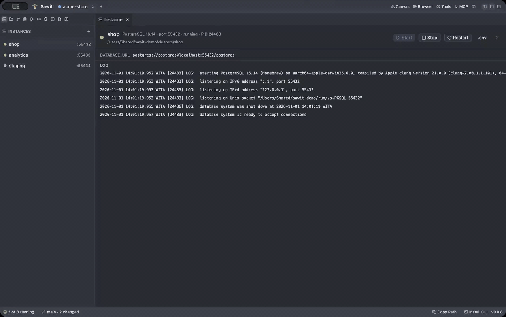
  <br>
  <sub>▶︎ <a href="docs/media/demo.mp4">Watch the demo video (MP4)</a>: welcome → instance → port conflict → table → SQL → schema diagram → code + terminal → Markdown → ports → network → git → dev tools → MCP → canvas</sub>
</p>

---

## Overview

Sawit is built for local development with PostgreSQL. This work usually needs Docker Desktop,
a database client, an editor, a terminal, and a few command-line tools as separate apps. In Sawit
they all live in a single Rust binary of about **60 MiB** (see [Size & memory](#size--memory)).
The UI is GPU-rendered with [GPUI](https://gpui.rs), and its look follows Zed (the "One Dark" palette).

<p align="center">
  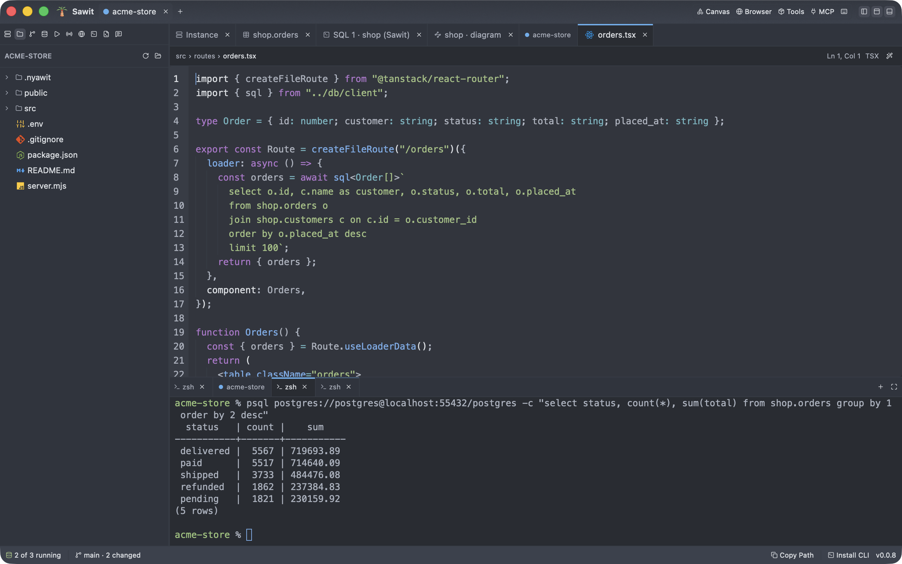
</p>

| | |
|---|---|
| 🐘 **Postgres without Docker** | Use binaries from Homebrew, Postgres.app, or `PATH`, or let Sawit download PostgreSQL 16/17/18. |
| 🛡️ **Port conflicts prevented** | Before starting, Sawit checks for processes already using the port, including Docker containers. |
| 🔍 **Safe data browsing** | The table grid uses a separate read-only connection. Passwords are stored in the macOS Keychain. |
| 📦 **Export, back up, import** | Tables and queries to CSV or Excel, `pg_dump` backups, CSV imports, and bulk delete or set on the rows you select. |
| 🗺️ **Schema diagrams** | Tables and foreign keys drawn as a diagram, and exported as DBML or SVG. |
| ✍️ **Full editor** | Highlighting for about 200 languages, formatters, Markdown/HTML/SVG/Mermaid preview, and image, PDF, and video viewers. |
| 🖥️ **A real terminal** | Full `alacritty_terminal` emulation, fullscreen with one click, and built-in split panes with a right-click pane menu. |
| 📡 **Ports & network** | See and stop every dev server you started, and diagnose your internet connection step by step. |
| 💬 **Prompt library** | Save the prompts you reuse, with tags and `{{variables}}` to fill in before copying. |
| 🌐 **Browser for agents** | A browser tab per project that opens your dev server, with device sizes and Web Inspector. Annotate the page for your agent, export a site's design system, and let AI agents drive it through `browser_*` MCP tools: click, type, snapshot, console, network and screenshots. |
| 🧰 **Dev tools in one click** | Install Homebrew, Bun, uv, Node.js, Rust, Claude Code, Codex and more with their official scripts, prerequisites first, and upgrade them when a newer release is out. |
| ⌨️ **psql-style CLI** | `sawit kyzn leads "phone is null"` queries a database, `sawit list` shows everything, `sawit bakar ports` stops dev servers, `sawit panen` exports, `sawit backup` dumps and `sawit pupuk` upgrades dev tools. |
| 🤖 **Ready for AI agents** | The `sawit-mcp` server (117 tools) and a catalog of MCP servers (AWS, Cloudflare, Neon, Figma, …), installed into Claude Code, Codex, Cursor, Zed and more with one click. |

## Install

On an Apple Silicon Mac, run:

```bash
curl -fsSL https://raw.githubusercontent.com/bahrulbangsawan/sawit.dev/main/scripts/install.sh | sh
```

This installs the latest release into `/Applications` (or `~/Applications`). To install a given release instead, add
`SAWIT_VERSION=vX.Y.Z` (a tag from [Releases](https://github.com/bahrulbangsawan/sawit.dev/releases)) before `sh`.
After that, the app updates itself. A running Sawit is quit before it is replaced, so run the command from another
terminal app: in Sawit's own terminal, the script stops and says so.

Sawit is not notarized yet, so if you open the `Sawit.dmg` from a browser download, macOS says it "could not verify
Sawit is free of malware." Use the script above. Or open Sawit once, choose **Done**, then **Open Anyway** in
**System Settings → Privacy & Security**, or run `xattr -dr com.apple.quarantine /Applications/Sawit.app`. Since
macOS 15, right-click → **Open** no longer gets past the warning.

## Features

### Welcome screen

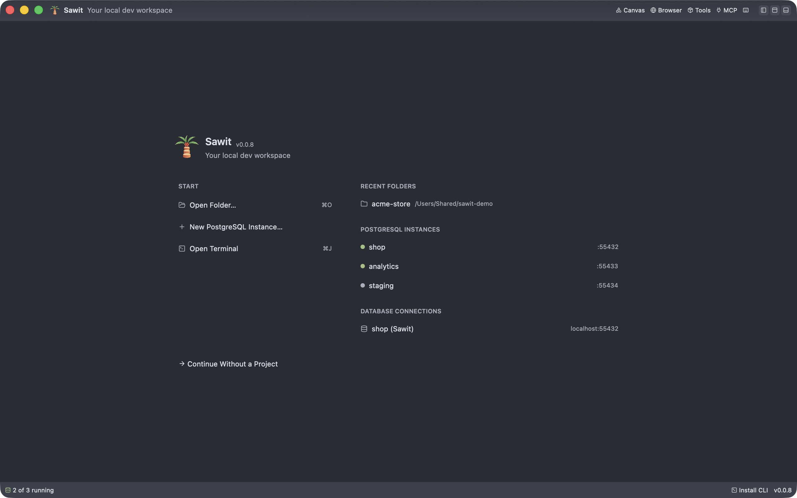

A new window opens on a welcome screen, like Zed's: **Open Folder…**, **New PostgreSQL Instance…** and
**Open Terminal** on the left, and your recent folders, instances and database connections on the right.
Picking anything lays the window out for that job. **Continue Without a Project** goes straight to the workspace.

The window is split into a sidebar with ten tabs (**Instances**, **Files**, **Git**, **Database**, **Run**, **Ports**,
**Network**, **SSH**, **Config Files**, **Prompts**), a tabbed center area, a terminal dock at the bottom, and a status bar. The status bar shows how many
instances are running (a click shows them), the Git branch, the project path with a button that copies it, **Install CLI**
while the `sawit` command isn't installed, and the version.

### Local PostgreSQL instances

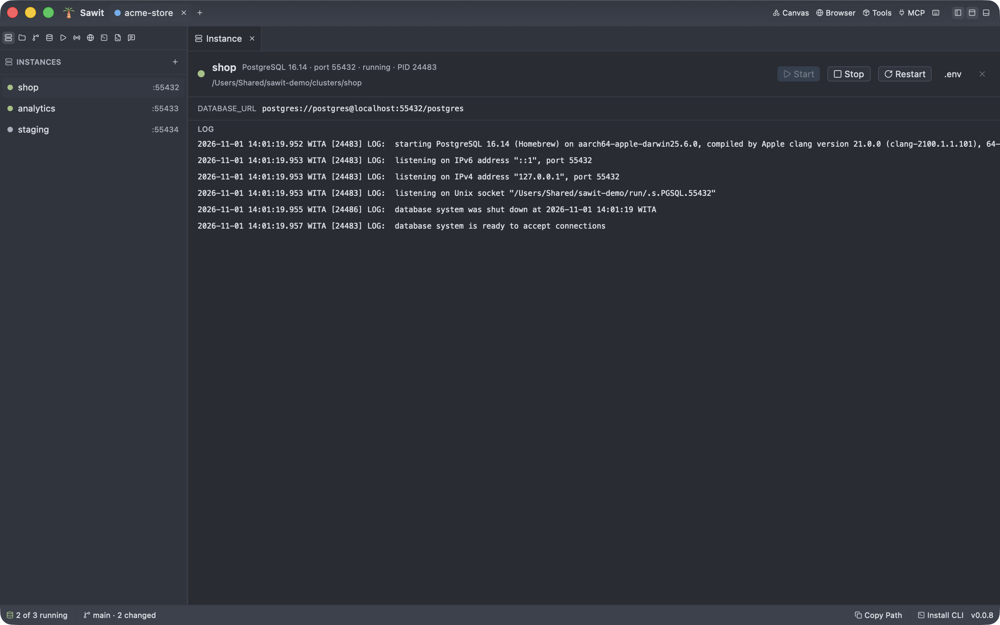

- A list of instances with name, version, port, data directory, and status. It has **Start / Stop / Restart**
  buttons (via `pg_ctl`) and a **live log**.
- Postgres binaries from Homebrew, Postgres.app, or `PATH` are **detected automatically**. They can also be
  **downloaded by Sawit** (PostgreSQL 16/17/18), so a project needs neither Docker nor Homebrew.
- Existing data directories (for example a Homebrew cluster) can be added with **Add Existing Data Directory…**.
- The **`.env`** button writes `DATABASE_URL=postgres://postgres@localhost:<port>/postgres` to the project's `.env`,
  so TanStack Start, Next.js, Rails, and other apps connect right away.
- New instances listen only on `localhost`, with the `postgres` superuser and `trust` authentication
  (local use only).

### Port conflict detection before start

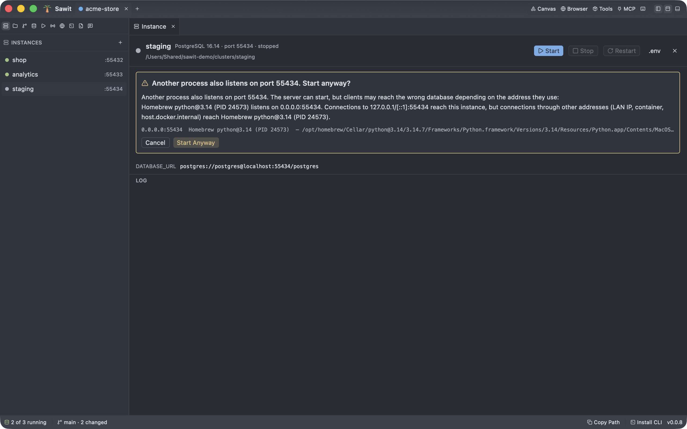

Before starting, Sawit checks who is already listening on the port: another process, a Homebrew service,
a Docker container (with its name), Postgres.app, or another Sawit instance. It also catches the hardest
case to track down, a **shadowed** port: one process binds `127.0.0.1:5433` while another binds
`*:5433`, so clients silently connect to the wrong database. Start is held and the cause is
explained. A conflict on the same address can't be forced.

### Database & table browser

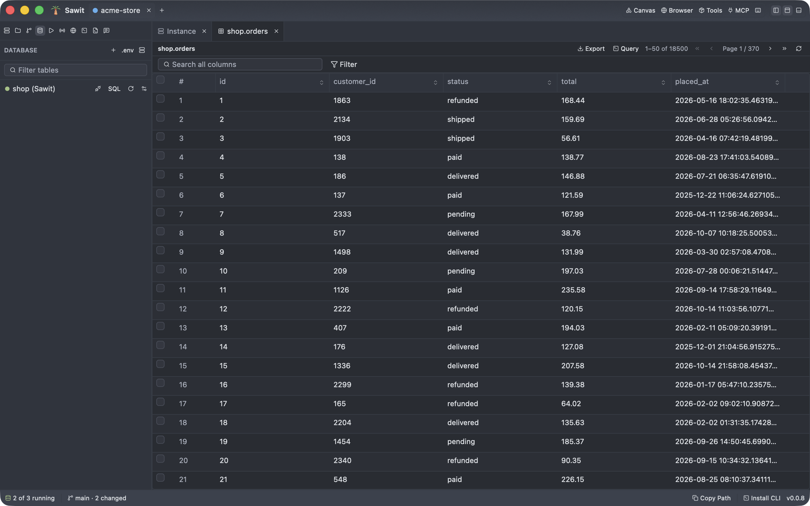

- **Connections** from a `DATABASE_URL`, a `.env` file, or a running Sawit instance (**Connect Instances**).
  Passwords are stored in the **macOS Keychain**, never in a file.
- **TLS** follows `sslmode` in the URL: `disable`/`prefer`/`require` behave like libpq, and
  `verify-ca`/`verify-full` check the certificate (`sslrootcert`, `sslcert` and `sslkey` are supported).
  Poolers (PgBouncer, Supavisor, Neon) work.
- Connections open when first used, **reconnect with backoff** after a drop, and close after a while unused or
  while the app is in the background. A wrong password is not retried.
- **Tree** of connection → schema → table/view → columns & types. The tree is virtual and stays smooth with
  thousands of tables. Tables without `SELECT` permission are disabled and say why.
- **Paged read-only grid**: 50 rows per page, ordered by primary key so pages stay stable,
  over a separate read-only connection. The first page shows before the row count finishes.
  Counting stops after 3 seconds; after that an estimate is shown.
- **Select rows** with their checkboxes, or every row the search and filters match, then **Delete Rows** or set a
  column to one value. Sawit says how many rows change and asks first.
- **Export** the table, or only the rows that match, to **CSV or Excel**. Rows are written as they arrive, so a big
  table never has to fit in memory. Excel stops at its limit of 1,048,576 rows.
- Right-click a connection, schema or table in the tree to **Back Up** with `pg_dump` (plain SQL, or the format
  `pg_restore` reads; Sawit picks the newest installed PostgreSQL that can dump the server), **Import CSV…** into a
  table, **Empty Table…**, **Refresh Materialized View**, or **Delete…** (**Delete with Dependents** adds `CASCADE`).
- From the terminal: `sawit panen`, `sawit backup` and `sawit tanam`
  (see [Databases, ports and instances from the terminal](#databases-ports-and-instances-from-the-terminal)).

### SQL editor

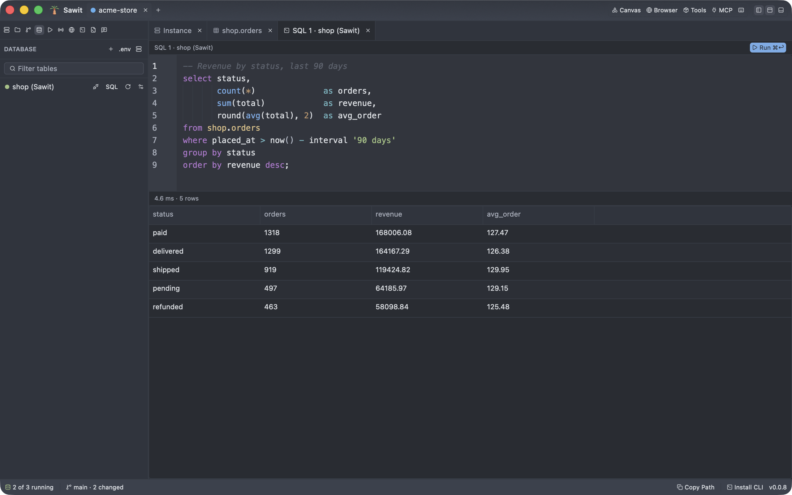

- <kbd>⌘</kbd><kbd>↩</kbd> runs the selected text, or the whole editor if nothing is selected.
- Shows results, duration, rows affected, and errors with `DETAIL`/`HINT`.
- At most 10,000 rows are shown. Results are streamed; remaining rows are not held in memory.
- A running query can be canceled with the **Cancel** button, in both the SQL editor and the table.

### Schema diagrams

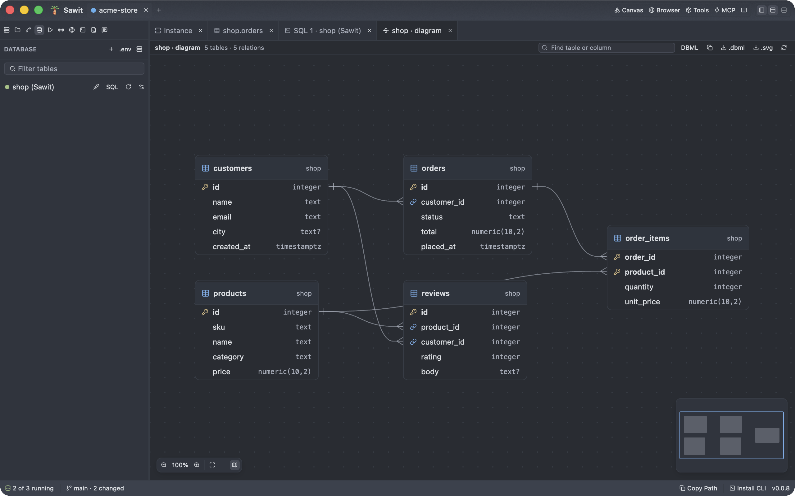

- Click the diagram icon next to a schema to see its tables, keys and foreign keys as a diagram.
- Zoom in and out, or switch to **DBML** to read the same schema as text (for dbdiagram.io and dbdocs).
- Copy the DBML, or save it as `.dbml` or the diagram as `.svg`.
- Zoomed out, each table shows just its name, wrapped at underscores so long names stay readable.
- Diagrams are drawn by [Pele](https://pele.run), the renderer from Obsidian, running offline inside the app.

### Project code editor

- Open a project with `sawit <folder>`, the welcome screen, or the folder icon in the **Files** tab.
  See [The `sawit` command](#the-sawit-command). A folder named through a symlink opens as the folder it leads to,
  so it is one project however it is named.
- **Virtual file tree** with a logo per file type. The tree updates when files are created or deleted
  from the terminal.
- **Highlighting for about 200 languages** (syntect), including Dockerfile, Makefile, Vue, Svelte, Kotlin, and more.
- Soft wrap without horizontal scrolling, Zed-style toolbar (breadcrumb, `Ln, Col`, language).
- <kbd>⌘</kbd><kbd>S</kbd> saves atomically (symlinks stay symlinks). Files changed on disk are
  reloaded; if there are unsaved changes, Sawit warns you instead.
- **Formatter** <kbd>⇧</kbd><kbd>⌘</kbd><kbd>I</kbd>:
  - Prettier for JS/TS/JSON/CSS/SCSS/Less/HTML/Vue/Markdown/YAML/GraphQL.
  - sql-formatter (PostgreSQL dialect) for SQL.
  - Taplo for TOML; rustfmt, gofmt, Ruff, shfmt, and clang-format for other languages.
  - A copy in the project's `node_modules/.bin` is used first (so the project's version and config apply), then
    `PATH`, then `npx`/`bunx`.
  - Formatting can be reverted with a single undo.

### Previews & viewers

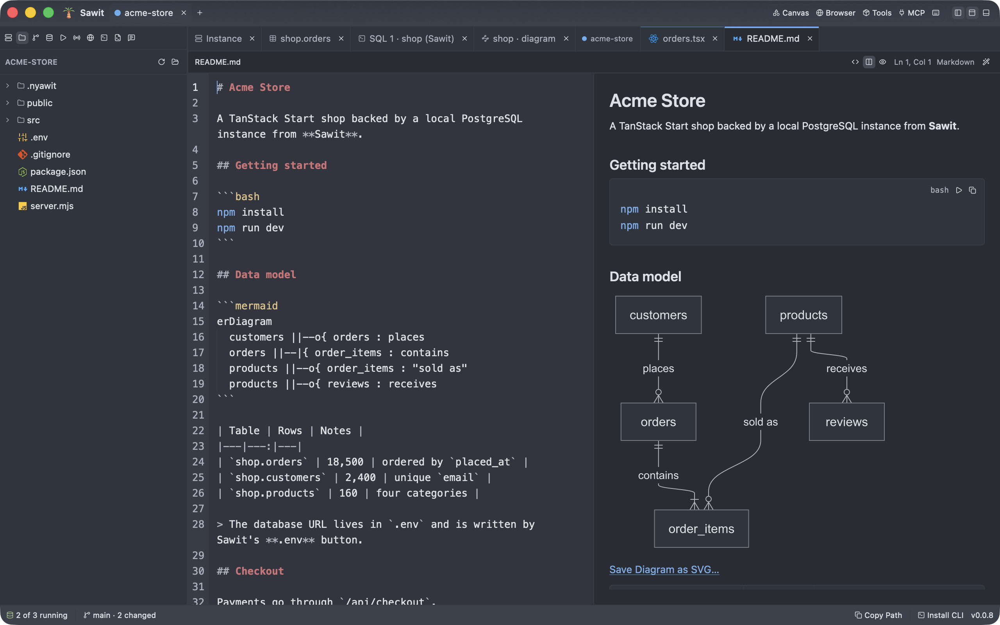

- **Markdown, HTML, and SVG**: Code / Split / Preview modes with a live preview. Relative
  images and tables are shown too.
- **Mermaid**: ` ```mermaid ` blocks in Markdown become diagrams, and `.mmd` files preview as their diagram.
  **Save Diagram as SVG…** exports one. Colors follow the app theme.
- **Code blocks** in previews get a **Copy** button. Shell blocks (`bash`, `zsh`, `sh`, …) also get **Run**,
  which types the commands into a shell waiting at its prompt in the same window's terminal, or a new terminal tab
  when every shell is running something.
- **Images** in PNG/JPEG/WebP/GIF/HEIC/AVIF and more, with fit-to-screen or 100% mode, pixel size and file size.
- **PDF** rendered to fit the pane with CoreGraphics, zoom 50–300%. Only visible pages are rendered.
- **Video** via AVPlayer, with sound. <kbd>Space</kbd> to play/pause, plus seek and mute.

### Terminal

- Bottom dock with tabs. Each tab opens a login shell or an SSH session.
- Each tab can hold split panes. <kbd>⌘D</kbd> splits right, <kbd>⇧⌘D</kbd> splits down, and <kbd>⌥⌘</kbd> + an arrow
  key moves between panes. <kbd>⇧⌘↩</kbd> zooms the focused pane of a split (and maximizes the dock when the tab has
  one pane). Splitting and dragging a divider stop at 20 columns by 4 rows; shrinking the dock or the window can still
  make panes smaller.
- Right-click a pane (or Shift+right-click, even while a program uses the mouse) for the pane menu: Rename pane,
  Split right, Split down, Zoom, Send right-clicks to pane, and Close pane.
- The **Maximize Terminal** button fills the window with the terminal; click it again to restore the layout you had.
- Full emulation via `alacritty_terminal`: 256/truecolor, alt-screen, SGR mouse, bracketed paste,
  and resize.
- Drag to select text; it's copied when you release the mouse. Shift+drag selects even while a program
  (vim, Claude Code) uses the mouse.
- New terminals start in the project folder. Shells idle at their prompt move to the first project you open in the
  window.
- What an agent runs in the terminal (`terminal_run`, `app_run_script`, `app_ssh_connect`) never takes the keyboard,
  and never goes into the shell you're typing in, even at its prompt: `terminal_run` then uses another idle shell or a
  new tab. Its terminal comes forward unless you're typing in a terminal, and then it runs in the background. The agent
  is told which terminal and pane it got, and its keys (`terminal_input`) go only to a terminal it names.
- Terminals end with the app and with their window. So quitting, closing a window and **Restart to Update** ask
  first while a terminal runs a command or an SSH session, and name them. Shells waiting at their prompt don't count.

### Dev tools

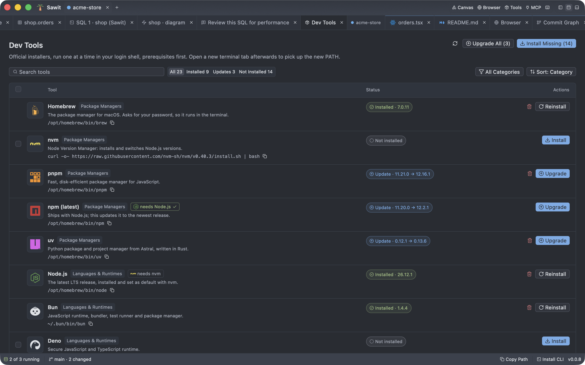

- Click **Tools** in the title bar for package managers (Homebrew, nvm, pnpm, npm, uv), languages and runtimes
  (Node.js, Bun, Deno, Python, Rust), AI agents (Claude Code, Codex, OpenCode, Amp, …) and terminal apps.
- Each tool shows whether it's installed, its version and where it lives, and the exact command that installs it.
- Search the list, narrow it with the **Installed**, **Updates** and **Not Installed** tabs or to one category, and
  sort it by category, by name or by what needs attention. It shows eight tools a page.
- The keyboard starts in the search (⌘F goes back to it); ↩ there moves to the first tool, ↑ and ↓ select, and ↩
  installs, upgrades or retries the selected one. It never removes anything: a failed uninstall's **Retry** asks
  before it runs that uninstall again.
- When npm or GitHub has a newer release, an installed tool shows `11.21.0 → 12.16.1` and an **Upgrade** button;
  **Upgrade All** upgrades every one of them. Upgrades use the tool's own command (`bun upgrade`, `uv self update`,
  `claude update`, …), or its install script again.
- **Install** one, tick several and **Install N**, or **Install Missing (N)**. Each runs its official install
  script in your login shell (zsh when that is fish, nu, PowerShell or tcsh, which can't run these scripts), one at
  a time, with prerequisites first (nvm before Node.js, uv before Python). If the shell can't say which tools are
  installed, the page says so instead of showing them as not installed.
- Homebrew asks for your password, so it runs in the terminal. Open a new terminal tab afterwards so it sees the
  new `PATH`.
- Closing the tab or its window, quitting and **Restart to Update** ask first while something installs, and stop it.
  One tool is installed, upgraded or removed at a time, whether from this page, an agent or `sawit pasang`.
- From the terminal: `sawit list tools`, `sawit pasang bun uv` and `sawit pupuk`.

### Browser

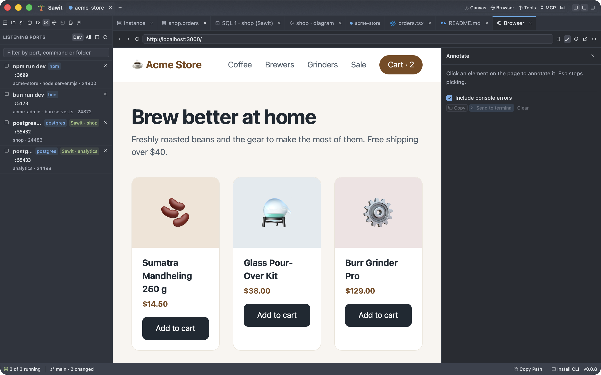

- Click **Browser** in the title bar for the project's web browser tab (WebKit; each project has its own). With
  nothing typed, it opens the project's running dev server. The toolbar has back, forward, reload, an address
  field (text that isn't a URL is searched), the device menu, **Annotate**, **Design**, **Open in Default Browser**
  and the Web Inspector.
- Cookies and storage are kept per project, so being signed in to one app doesn't leak into another.
- A link to another app (`mailto:`, `zoommtg:`, …) asks before it opens. After **Cancel**, the page's links to other
  apps do nothing until you reload it or open another page.
- **Keys**: once you click the page (or press Enter in the address field), <kbd>⌘</kbd><kbd>C</kbd>,
  <kbd>⌘</kbd><kbd>X</kbd>, <kbd>⌘</kbd><kbd>V</kbd> and <kbd>⌘</kbd><kbd>A</kbd> act in the page, through the
  **Edit** menu. Sawit's own shortcuts (<kbd>⌘</kbd><kbd>W</kbd>, <kbd>⌘</kbd><kbd>T</kbd>,
  <kbd>⌘</kbd><kbd>1</kbd>–<kbd>⌘</kbd><kbd>9</kbd>…) still work there, before the page sees them.
- **Device sizes**: the device menu lays the page out as an iPhone 15, Pixel 8, iPad mini, iPad Pro 11″, Laptop or
  Desktop, scaled to fit the tab. **Rotate** turns the device, and **Responsive** fills the tab again.
- **Annotate** (<kbd>⇧</kbd><kbd>⌘</kbd><kbd>.</kbd>): click elements on the page and write what should change. Each
  note carries the element's selector, styles, a screenshot and, in a dev build, its source file. **Copy** the notes
  as Markdown, or **Send to terminal** to paste them into Claude Code (or a shell) without pressing Enter: the
  project's own terminals first, never an SSH session. Both can add the page's console errors. Screenshots go to
  `.nyawit/annotations/`.
- **Design**: inspect any element (box model, typography, colors with contrast, hover and focus states) and copy it
  as CSS, Tailwind or HTML. The panel also lists the page's colors, fonts and assets, and derives its design system:
  palette ramps, type scale, spacing, radius and shadows. **Export** writes `DESIGN.md`, DTCG tokens, a Tailwind v4
  theme, shadcn/ui variables, sample components and the assets to `.nyawit/design/<host>/` (with no project, to
  `~/Downloads/sawit-design/<host>/`); a dev server's folder keeps its port, as `localhost-5173`.
- AI agents drive it through the `browser_*` MCP tools: open pages, read the page as an accessibility outline,
  click, type, pick options, press keys, scroll, wait for text, run JavaScript, and read the console, failed
  requests and screenshots. They can also set a device size, read your annotations, and inspect, read or export
  the page's design. An agent uses its own project's browser (the project it names, else the one it runs in),
  even while you look at another project of the window, and in the background: only opening a page, a
  screenshot or a device size brings it forward.
- The requests an agent reads keep no secrets: what you type into a password field, and the values of fields named
  like secrets (password, token, API key, authorization, cookie, session, …) in URLs and bodies, read `[redacted]`.

### Canvas

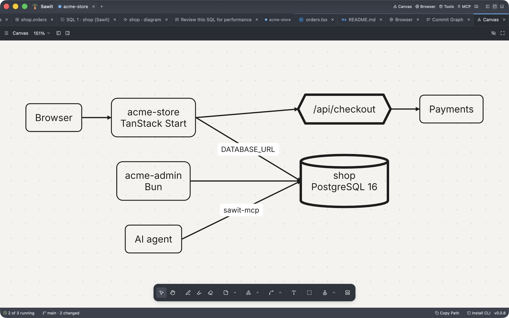
<br><sub>This screenshot still shows the old Excalidraw canvas until the media is recorded again.</sub>

- Click **Canvas** in the title bar, or press <kbd>⌃</kbd><kbd>⌘</kbd><kbd>C</kbd>, for a native whiteboard and
  design canvas on the [FigCraft](https://github.com/storytold/figcraft) engine. It saves by itself.
- **Boards and design files**: the project's canvas is a board, for sticky notes, shapes with text, connectors,
  marker drawing, stamps and sections. A `.figcraft` file opened from the **Files** tab gets its own canvas tab,
  as a board or as a design file (frames, vectors, auto layout and components), and saves back to the same file.
- **Tools and the toolbar**: the toolbar floats at the bottom of the canvas, and each tool's tooltip shows its key when it has one.
  - A board has Move and Hand, Marker, Highlighter and Eraser, Sticky notes in eight colours, Shapes, Connectors
    (straight, elbow or curved), Text, Section, Stamps, and a picker for templates and tables. A bar over the
    selection offers its colour, shape, text size and connector style and ends.
  - A design file has Move, Scale and Hand, Frame, Section and Slice, Rectangle, Line, Arrow, Ellipse, Polygon and
    Star, Pen and Pencil, and Text.
- **Layers and Design panels**: the layers panel on the left (<kbd>⌥</kbd><kbd>1</kbd>) lists the pages and layers.
  Click to select, double-click to rename, hide or lock a layer, drag layers to reorder or nest them, and filter by
  name. The Design panel on the right (<kbd>⌥</kbd><kbd>8</kbd>) edits the selection: position and size, auto layout,
  appearance, fill, stroke, effects, typography and export. A board opens with both panels hidden and a design file
  with both shown, and the top bar toggles them.
- **Menus and shortcuts**: the ≡ button opens the main menu, and a right-click opens the context menu.
  <kbd>⌘</kbd><kbd>K</kbd> (or <kbd>⌘</kbd><kbd>/</kbd>) opens the **Actions** palette, which finds any menu command
  by name, and <kbd>⌃</kbd><kbd>⇧</kbd><kbd>?</kbd> lists every shortcut. While the canvas has the keyboard,
  <kbd>⌘</kbd><kbd>K</kbd> belongs to the palette, so the chords that start with it (the tab chords,
  <kbd>⌘</kbd><kbd>K</kbd> <kbd>⌘</kbd><kbd>S</kbd> for the Keymap Editor, and any you add) don't work there. The
  same goes for a chord you add that starts with another key the canvas uses alone.
- **Where files live**: the project's canvas is `.nyawit/canvas.figcraft` in its folder. With no project it is
  `canvas.figcraft` in Sawit's data folder. Exports go to `.nyawit/exports/`, or to `exports/` in the data folder
  with no project or for a canvas file outside a project's `.nyawit/` (a `.figcraft` opened from the Files tab, say),
  and Sawit shows them in Finder. **Save as…** (<kbd>⇧</kbd><kbd>⌘</kbd><kbd>S</kbd>) writes a `.figcraft` copy
  anywhere. `.nyawit/` has its own `.gitignore`, so nothing in it is committed until you delete that file.
- **Copies it keeps beside the file**:
  - A save that leaves the canvas empty, or puts another canvas in its place (an agent's `canvas_clear` or
    `canvas_load`), first keeps the board the file held as `<name>.bak`. The four before it move along to
    `<name>.bak.1` … `<name>.bak.4`, and the oldest goes. `canvas_load` reads any of them back.
  - A file that opens with something the canvas can't save back (it says what) is first copied to
    `<name>.lossy.bak`.
  - A save that would replace what another app or window wrote to the file since is refused, and the canvas says
    why. If the tab then closes, or Sawit quits, with edits it couldn't save, they're kept in
    `<name> (unsaved <date>).figcraft` beside the file (`-2`, `-3`… when that name is taken), or in `unsaved/` in
    Sawit's data folder when nothing can be written there. The canvas doesn't announce these copies, so look for
    them there.
  - Outside `.nyawit/` (a `.figcraft` opened from the Files tab in a repository, say), these files show in
    `git status`.
- **From the old canvas**: a project that has only its old `.nyawit/canvas.excalidraw` opens it imported the first
  time. The `.excalidraw` file is never changed, and the canvas says what the import left out (the hand-drawn look
  doesn't carry over). An `.excalidraw` file in the Files tab opens the same way and saves as `<name>.figcraft`
  beside it.
- Agents draw on it through the `canvas_*` MCP tools. `canvas_add_mermaid` turns Mermaid into **editable shapes**:
  boxes, connectors joined to them, and labels. Charts (pie, Gantt, XY, quadrant, journey, Sankey, architecture) are
  placed as one picture. Pele, the renderer the rest of the app uses, lays the diagram out. `canvas_command` runs any
  other canvas command by its id.

### Git

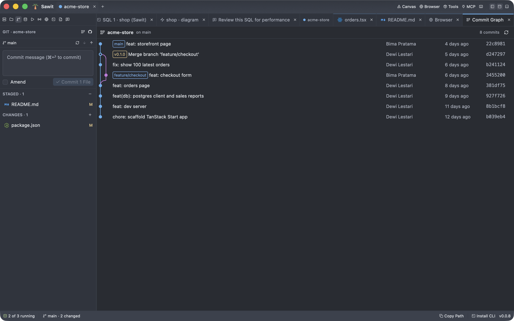

- The **Git** tab shows the branch with fetch, pull and push, a commit message box (<kbd>⌘</kbd><kbd>↩</kbd>
  commits, **Amend** rewrites the last commit), and staged, changed and conflicted files. Click a file for its diff.
- The **Commit Graph** page draws branches, merges and tags with their authors and dates. On the **GitHub** page,
  sign in to read and comment on the repository's pull requests and issues, merge or close them, open new ones,
  and clone your repositories.
- Agents get the same through `git_status`, `git_diff`, `git_commit` and the other git tools.

### Listening ports

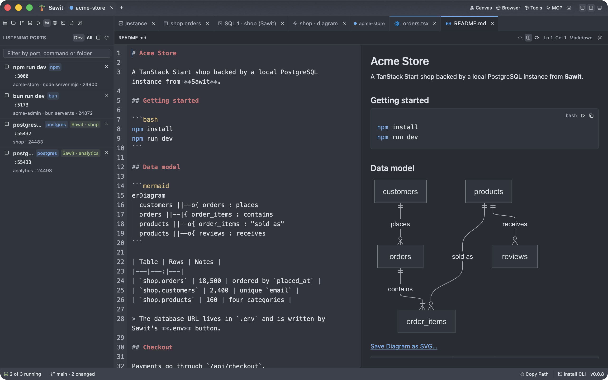

- One row per command you started (`npm run dev`, `bun run dev`, `pnpm dev`, a database, …), with its ports
  and project folder. **Dev** shows the servers you started; **All** shows every app that listens on a port.
- Click a port (`:5173`) to open it in the **Browser** tab; <kbd>⌘</kbd>-click opens it in your default browser.
- **Stop** a row to stop the whole command, launcher and children, so nothing respawns. Select several rows to
  stop them together. Anything still running after a moment can be **force-stopped**.
- Filter by port, command or folder. The list refreshes every few seconds.
- From the terminal, `sawit list ports` lists them and `sawit bakar ports` stops the dev servers
  (see [Databases, ports and instances from the terminal](#databases-ports-and-instances-from-the-terminal)).

### Network diagnosis

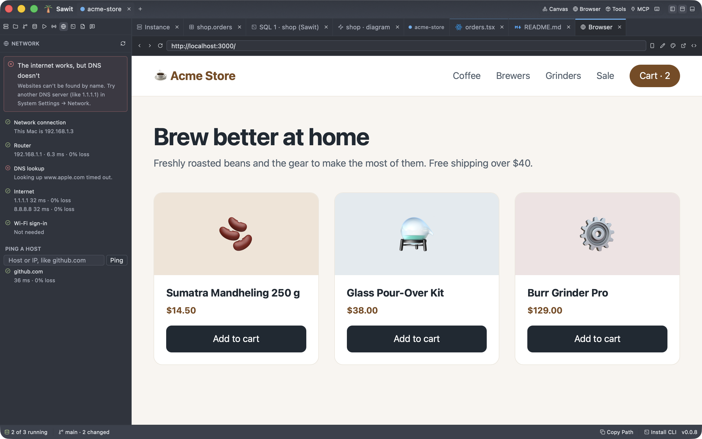

- **Run Diagnosis** checks, in order: your network connection, your router, DNS, the internet (1.1.1.1 and 8.8.8.8),
  and whether a Wi-Fi sign-in page (hotels, cafés, airports) is blocking traffic.
- Each check shows its result and latency, and the verdict says in plain words what's wrong and what to do,
  for example "Connected to the network, but not the internet" or "The internet works, but DNS doesn't".
- **Ping a host**: type a host name or IP address to send 4 pings and see the reply time and packet loss.
- Uses the system `ping` and `route`; no admin rights needed.

### Prompt library

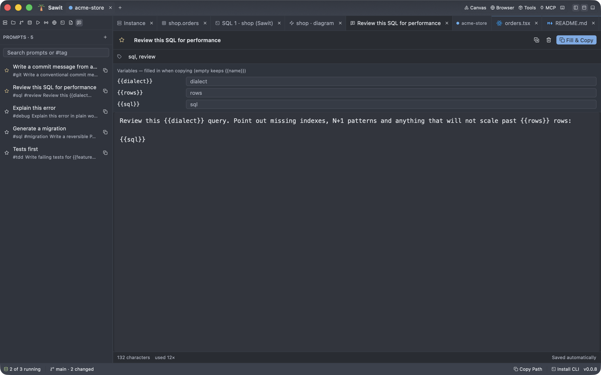

- Save the prompts you reuse with a title, tags and a body. Everything saves automatically.
- Search by text or `#tag`. Favorites and the prompts you use most come first.
- Write `{{variables}}` in a prompt, fill them in its tab, and **Fill & Copy**. Copy a prompt as is from the list.
- Stored in `prompts.json` in Sawit's data folder.

### Config files

- The **Config Files** tab lists the shell startup files on this Mac (`~/.zshrc`, `/etc/profile`, …), dimming the
  ones your login shell doesn't read.
- It also lists the config files of every coding agent installed (Claude Code and Codex with each of their
  profiles, Gemini CLI, Qwen Code, opencode, Amp, GitHub Copilot CLI, Cursor, Windsurf, Kiro, Goose, Crush and
  Claude Desktop), on this Mac and in the window's projects: `~/.claude/settings.json`, `.codex/config.toml`,
  `AGENTS.md`, … Each agent's files come highest priority first, saying where they apply (managed, project,
  user, …) and what they hold. Each other profile (`~/.claude-work`, a `CLAUDE_CONFIG_DIR` or `CODEX_HOME`
  elsewhere) is a group of its own, "Claude Code · work": profiles are alternatives, not layers.
- Search by file, path, description or agent. Click a file to edit it.
- Right-click a file to reveal it in Finder, open it in its default app, duplicate it (`.zshrc copy`, a quick
  backup), copy its path, move it to the Trash or delete it. The Files tab's shortcuts work here too.
- **Save Shell Files to GitHub** commits your own startup files to a private repository (`sawit-shell-config`). Each
  save that would send a line that looks like a secret (an API key, a token, a password, in any shell's syntax)
  names those lines and asks first.

### Tabs & layout

- Right-click a tab for Close, Close Others, Close Left/Right, Close Clean, Close All, Make Tab
  Read-Only, and Pin Tab. A read-only tab takes no typing and <kbd>⌘</kbd><kbd>S</kbd> doesn't save it, but
  **Save** in the question on closing it or quitting does.
- Bulk close leaves pinned and unsaved tabs alone. Closing an unsaved file
  asks for confirmation.
- Quitting, closing a window and **Restart to Update** ask too, and offer to save every unsaved file first
  (**Save All**, **Don't Save**, **Cancel**). A quit that can't ask (the Dock's Quit, logging out, the install script)
  keeps the unsaved changes instead, and the next launch reopens those files with the changes back in, unsaved. If a
  file changed on disk in the meantime, Sawit warns you that saving would overwrite it. If it can't be edited any more
  (it became binary or unreadable, say), its tab says where the changes are kept.
- The instance tab can be closed, and it reappears when an instance is selected.
- The sidebar, terminal, and tab area can be hidden or shown from the title bar buttons or
  with shortcuts (see below).
- Every panel has a designed empty state that says what goes there and offers the next step, and every
  error says what happened with a way to try again or copy the message.

### Updates & changelog

- Click the version in the status bar for the **Changelog** page: the running version, update status,
  notes of a newer release, and the full history.
- Sawit checks [GitHub Releases](https://github.com/bahrulbangsawan/sawit.dev/releases) on launch and
  every hour. New versions download in the background. Once ready, a **Restart to Update** button appears in the
  title bar: the app quits, `Sawit.app` is replaced, and it reopens. It asks first while a terminal runs something,
  a file has unsaved changes or Dev Tools installs something, since quitting ends, closes or stops them. A downloaded
  update also installs when you quit. Builds from `cargo` only open the releases page.
- AI agents keep the `sawit-mcp` they started with until their session ends, so after an update, restart their
  sessions (or reconnect their Sawit MCP server) to give them the new version's tools. An older server can't name
  the panes of a split terminal, for one.

## Keyboard shortcuts

These are the defaults. Most shortcuts can be changed in the **Keymap Editor**
(<kbd>⌘</kbd><kbd>K</kbd> <kbd>⌘</kbd><kbd>S</kbd>, the keyboard button in the title bar,
Sawit ▸ Keymap Editor, or an agent's `app_open_page` with `keymap`). It lists each binding of every
feature, including the workspace, panels, editors, terminal, Git, inputs, and the native canvas's
commands, with its action, arguments, keys, context and source. From it you can change, add, remove
or restore a binding, find bindings by their keys, and see which ones clash. Your changes go to
`~/Library/Application Support/sawit/keymap.json` in Zed's keymap format (*Edit in JSON*,
<kbd>⌘</kbd><kbd>E</kbd> in the editor). You can also edit that file by hand: Sawit applies it within a
second of saving. A change made in the editor writes the whole file again, without your comments.

A few keys aren't bindings, so the editor can't change them: the terminal's <kbd>⌘</kbd><kbd>C</kbd> and
<kbd>⌘</kbd><kbd>V</kbd>, the video viewer's <kbd>Space</kbd>, and on the canvas <kbd>Space</kbd> to pan, the
arrows and the number keys, and the keys of the text it edits (<kbd>⎋</kbd>, <kbd>↩</kbd>,
<kbd>⌘</kbd><kbd>Z</kbd>, <kbd>⌘</kbd><kbd>A</kbd> and <kbd>⌘</kbd><kbd>↩</kbd> among them). The editor's
Keystrokes field records every key but a plain <kbd>↩</kbd>, which saves, and a plain <kbd>⎋</kbd>, which
stops recording: bind those two in keymap.json. On a keyboard layout that types some keys elsewhere (German,
French…), the defaults move where macOS menus put them.

| Action | Shortcut |
|---|---|
| Keymap Editor | <kbd>⌘</kbd><kbd>K</kbd> <kbd>⌘</kbd><kbd>S</kbd> |
| Open folder | <kbd>⌘</kbd><kbd>O</kbd> |
| New window | <kbd>⇧</kbd><kbd>⌘</kbd><kbd>N</kbd> |
| Run SQL (selection or all) | <kbd>⌘</kbd><kbd>↩</kbd> |
| Save file | <kbd>⌘</kbd><kbd>S</kbd> |
| Format document | <kbd>⇧</kbd><kbd>⌘</kbd><kbd>I</kbd> |
| Show/hide sidebar | <kbd>⌘</kbd><kbd>B</kbd> |
| Show/hide terminal | <kbd>⌘</kbd><kbd>J</kbd> |
| Show/hide tabs & tables | <kbd>⇧</kbd><kbd>⌘</kbd><kbd>J</kbd> |
| Close active tab | <kbd>⌘</kbd><kbd>W</kbd> |
| Close Others | <kbd>⌥</kbd><kbd>⌘</kbd><kbd>T</kbd> |
| Close Left / Close Right | <kbd>⌘</kbd><kbd>K</kbd> <kbd>E</kbd> / <kbd>⌘</kbd><kbd>K</kbd> <kbd>T</kbd> |
| Close Clean (tabs without changes) | <kbd>⌘</kbd><kbd>K</kbd> <kbd>U</kbd> |
| Close All | <kbd>⌘</kbd><kbd>K</kbd> <kbd>W</kbd> |
| Pin Tab | <kbd>⌘</kbd><kbd>K</kbd> <kbd>⇧</kbd><kbd>↩</kbd> |
| Files / Config Files: reveal in Finder | <kbd>⌥</kbd><kbd>⌘</kbd><kbd>R</kbd> |
| Files / Config Files: open in default app | <kbd>⌃</kbd><kbd>⇧</kbd><kbd>↩</kbd> |
| Files / Config Files: duplicate | <kbd>⌘</kbd><kbd>D</kbd> |
| Files / Config Files: copy path | <kbd>⌥</kbd><kbd>⌘</kbd><kbd>C</kbd> |
| Files / Config Files: move to Trash (asks first) / without asking / delete | <kbd>⌫</kbd> / <kbd>⌘</kbd><kbd>⌫</kbd> / <kbd>⌥</kbd><kbd>⌘</kbd><kbd>⌫</kbd> |
| Files: new file / new folder | <kbd>⌘</kbd><kbd>N</kbd> / <kbd>⌥</kbd><kbd>⌘</kbd><kbd>N</kbd> |
| Files: rename | <kbd>F2</kbd> |
| Files: cut / copy / paste | <kbd>⌘</kbd><kbd>X</kbd> / <kbd>⌘</kbd><kbd>C</kbd> / <kbd>⌘</kbd><kbd>V</kbd> |
| Files: undo / redo | <kbd>⌘</kbd><kbd>Z</kbd> / <kbd>⇧</kbd><kbd>⌘</kbd><kbd>Z</kbd> |
| Files: copy relative path | <kbd>⌥</kbd><kbd>⇧</kbd><kbd>⌘</kbd><kbd>C</kbd> |
| Files: find in folder | <kbd>⌥</kbd><kbd>⇧</kbd><kbd>⌘</kbd><kbd>F</kbd> |
| Quit | <kbd>⌘</kbd><kbd>Q</kbd> |

## The `sawit` command

Like `zed`, Sawit can be opened from the terminal. Install the command with the **Install CLI** button in the status bar
(shown only while the command is not installed) or the **Sawit → Install ‘sawit’ Command in PATH…** menu item.
Both create a symlink `/usr/local/bin/sawit` to the app and ask for an admin password if that folder is owned by
root.

Besides opening files, the command can query databases like `psql`, export, back up and import tables, list
instances, databases, ports and dev tools, stop dev servers or instances, and install or upgrade dev tools, all without the app (see
[below](#databases-ports-and-instances-from-the-terminal)).

```bash
sawit                    # open/activate Sawit
sawit .                  # open this folder as a project
sawit src/main.rs:42:5   # open a file at line 42, column 5 (grep/rustc output format is also accepted)
sawit new.sql            # a file that doesn't exist opens empty; ⌘S creates it
sawit -n ~/code/other    # always in a new window
sawit -r ~/code/other    # replace the project in the frontmost window
ls -la | sawit -         # open stdin as a file
git config --global core.editor "sawit --wait"   # wait until the file tab is closed
```

- If Sawit is already running, paths are sent to it over a Unix socket and the command returns right away.
  If not, Sawit is launched first, detached from the terminal.
- A folder that is already open is just focused. A new folder fills a window that has no project yet, or
  opens a new window. Files go to the window whose project contains them, or to the frontmost window.
- `--wait` returns after all opened files are closed (or the app quits).
- `--foreground` runs the app in that terminal itself (for debugging). `sawit --help` lists
  all options.

### Databases, ports and instances from the terminal

These work without the app (the output is in Indonesian and pokes fun at karhutla, the forest fires behind the palm-oil
plantations Sawit is named after):

```bash
sawit kyzn                                   # list the tables
sawit kyzn leads                             # first 100 rows
sawit kyzn leads "phone is null"             # filter: SELECT * FROM leads WHERE phone is null
sawit kyzn leads "select * from leads where phone is null"   # any SQL, like psql (writes too)
sawit list                                   # instances, databases, ports and saved connections
sawit list db                                # or: instances, ports, connections, tools
sawit bakar ports                            # "burn" dev servers: confirm, SIGTERM, then SIGKILL
sawit bakar ports 3000 5173 -y               # whatever listens on these ports, without asking
sawit bakar instances                        # stop running Sawit instances (data is kept)
sawit panen kyzn leads leads.xlsx            # "harvest": export a table to Excel (or .csv)
sawit panen kyzn "select * from leads where phone is null" nophone.csv   # export a query (read-only)
sawit backup kyzn kyzn.dump                  # pg_dump the database (.dump/.backup for pg_restore, else SQL)
sawit backup kyzn crm.leads leads.sql        # one schema or one table
sawit tanam kyzn leads leads.csv             # "plant": load a CSV file into a table, all rows or none
sawit list tools                             # dev tools and whether they're installed
sawit pasang bun uv                          # "plant": install dev tools, prerequisites first (asks; -y skips)
sawit pupuk                                  # "fertilize": upgrade every tool with a newer release (asks; -y skips)
sawit pupuk bun -y                           # upgrade one tool without asking
```

- `<db>` is looked up in this order: a Sawit instance or saved connection with that name, a database with that name in
  a saved connection, `DATABASE_URL` in `.env` in the current folder or one above it, then the databases of every
  Postgres running locally. A unique prefix also works (`kyzn` finds `kyzn_crm`). If a file or folder with that name
  exists, it's opened instead. To open a folder named after a subcommand (`list`, `bakar`, `panen`, `backup`,
  `tanam`, `pasang`, `pupuk`, …), use `sawit ./list`.
- Every word has an English and an Indonesian name: `list`/`ls`, `panen`/`export`/`ekspor`,
  `backup`/`dump`/`cadangkan`, `tanam`/`import`/`impor`, `pasang`/`install`, `pupuk`/`upgrade`, and for `list`: `db`/`blok`,
  `ports`/`lahan`, `instances`/`kebun`, `connections`/`konsesi`, `tools`/`alat`/`perkakas`.
- `panen` and `backup` ask before replacing an existing file; `-y` replaces it without asking. Without a terminal
  they refuse instead of prompting. `panen` with SQL runs it read-only.
- Table output goes to stdout, while the "connected to" line and timing go to stderr, so `sawit kyzn leads | less`
  stays clean. Up to 10,000 rows are printed per result.
- `bakar ports` with no ports only takes dev servers (tools such as `npm run dev`, `vite` or `bun`). It skips databases,
  Docker, Sawit's instances and protected tools (Claude, MCP servers, language servers, Electron), the same rules as
  the `kill-dev` script. Without a terminal it asks for `-y` instead of prompting.
- `pasang` runs each tool's official install script, the same as the app's **Tools** page. It lists what will run and
  asks first (`-y` skips the question; without a terminal it needs `-y`). Homebrew asks for a password, so `pasang`
  prints its command for you to run instead.
- `list tools` marks a tool with a newer release as `terpasang 0.12.1 → 0.13.6`. `pupuk` with no tools upgrades all
  of those, the same as **Upgrade All**; named tools are upgraded unless they're already the latest. It asks first
  like `pasang`, and without a terminal it needs `-y`.

## MCP for AI agents

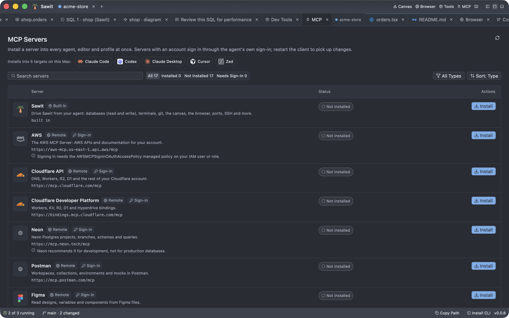

The `sawit-mcp` binary (stdio) lets AI agents do what a person can do in Sawit. Its 117 tools work **without the app**,
except the app-control ones, which drive the running app (`launch_app` starts it). Those act on the window that has
the agent's project open (or the one `project` names), else the frontmost window.

| Area | Tools |
|---|---|
| Instances | `list_instances`, `create_instance`, `start_instance` (refused with an explanation when the port is in use), `stop_instance`, `restart_instance`, `remove_instance`, `instance_logs`, `check_port`, `list_postgres_binaries` |
| Databases | `list_connections`, `detect_databases`, `list_databases`, `create_database`, `drop_database`, `describe_schema`, `describe_table`, `query` (**always read-only**, up to 500 rows), `execute_sql` (read-write), `save_connection`, `remove_connection`, `write_env` |
| Export, backup, import | `export_table`, `export_query` (CSV or Excel), `backup_database` (`pg_dump`), `import_csv`, `drop_relation`, `truncate_table`, `refresh_materialized_view` |
| Diagrams | `render_mermaid` (SVG), `schema_diagram` (Mermaid, DBML or SVG) |
| Ports | `list_ports`, `stop_processes` |
| Network | `diagnose_network`, `ping` |
| SSH | `list_ssh_hosts`, `add_ssh_host`, `update_ssh_host`, `remove_ssh_host`, `probe_ssh_host`, `ssh_exec` |
| Run commands | `list_scripts`, `save_command`, `remove_command` |
| Git | `git_status`, `git_log`, `git_diff`, `git_show`, `git_branches`, `git_stage`, `git_unstage`, `git_commit`, `git_switch` |
| Prompts | `list_prompts`, `get_prompt`, `create_prompt`, `update_prompt`, `delete_prompt`, `fill_prompt` |
| Files | `search_files` |
| Dev tools | `list_dev_tools` (with newer releases), `install_dev_tools`, `upgrade_dev_tools` |
| MCP servers | `list_mcp_servers`, `install_mcp_server`, `uninstall_mcp_server` |
| App control (app running) | `launch_app`, `app_state`, `app_open`, `app_focus`, `app_show_panel`, `app_layout`, `app_maximize_terminal`, `app_open_page` (canvas, browser, mcp, tools, changelog, git_graph, github, instance, keymap), `app_activate_tab`, `app_close_tab`, `app_run_list`, `app_run_script`, `app_stop_script`, `app_ssh_connect`, `app_open_table`, `app_open_sql` (with `run`), `app_open_diagram`, `app_open_prompt`, `app_instance` (select, start, stop, restart), `app_network_diagnose` |
| Terminal (app running) | `terminal_run`, `terminal_read`, `terminal_input`, `terminal_close` (`terminal_run`, `app_run_script` and `app_ssh_connect` return the tab and `pane` they used; `terminal_input` needs the tab, and a split tab needs its pane) |
| Browser (app running) | `browser_navigate` (with no URL: the project's dev server), `browser_snapshot`, `browser_click`, `browser_type`, `browser_select_option`, `browser_press_key`, `browser_hover`, `browser_scroll`, `browser_wait_for`, `browser_evaluate`, `browser_console`, `browser_network`, `browser_screenshot`, `browser_resize` (a device or a size), `browser_annotations` (what the user annotated), `browser_inspect` (one element's design), `browser_design` (the page's colors, fonts, assets and tokens), `browser_export_design` (to `.nyawit/design/<host>/`) |
| Canvas | `canvas_get`, `canvas_add_elements`, `canvas_add_mermaid`, `canvas_update`, `canvas_delete`, `canvas_clear`, `canvas_load`, `canvas_export`, `canvas_command` (any command of the canvas engine, by id), `canvas_commands` (lists them; pass a `filter` to see what each takes). All of them work on the saved canvas file when the app is closed; then each call starts from that file, so no undo or selection carries over to the next: pass `canvas_command` the ids, or its steps in one `command.batch` |

Destructive tools say so and need an explicit confirmation: `drop_database`, `drop_relation`, `truncate_table`
and `uninstall_mcp_server` take the name again as `confirm` (so does `remove_instance` when it deletes the data), and `install_dev_tools` and `upgrade_dev_tools` need
`confirm: true` because they run install scripts from the internet. Passwords never appear in a result. Every tool
also carries MCP's hints (`readOnlyHint`, `destructiveHint`, `openWorldHint`), for clients that let read-only tools
through or ask before destructive ones.

Click **MCP** in the title bar to install it, along with a catalog of other servers: AWS, Cloudflare, Neon, Postman,
Figma, Mobbin, Exa and more. Search the catalog, narrow it with the **Installed**, **Not Installed** and **Needs
Sign-In** tabs or by where a server runs (built in, remote, on this Mac), and sort it. From the keyboard: ⌘F
searches, ↩ in the search moves to the first server, ↑ and ↓ select, ↩ opens the server's sheet, and ↩ there
installs. Servers that need an account sign in through the client's own sign-in, which the page can start for Claude
Code and Codex. The page finds the AI clients on this Mac: Claude Code (every profile, including `CLAUDE_CONFIG_DIR`
folders), Codex (and `CODEX_HOME` profiles), Claude Desktop, Cursor, Windsurf, Gemini CLI, Zed, opencode and VS
Code. It installs into each with one click and shows where each config lives. The AWS server shows the Region your
clients have it in, and an install in another Region reads as installed there. It finds `claude`, `codex` and `npx`
where the Dev Tools page finds them (`~/.local/bin`, nvm's Node.js, …), not only on the PATH apps get. Claude Code
and Codex are changed through their own CLI when it's installed. Claude Desktop and LM Studio start without your
shell's PATH, so their `npx` entries say which folder has `node` (VS Code, Cursor, Zed and the like read your shell's
PATH, and their entries leave it alone); clients that reach remote servers only through
`npx` (Claude Desktop, LM Studio and others) say so when Node.js isn't installed. Other configs are edited in place,
keeping other settings, their order and the file's indentation (a TOML file keeps its comments too; a JSON file with
comments is left for you to edit, with the entry to paste), and each file is copied next to it (`.sawit-backup`)
before every change. Updating an entry changes only where it points: what you added to it (Cline's auto-approved
tools, `env`, timeouts, …) stays. **Remove from N** in a server's sheet asks first, like its row's trash button.

To add it by hand:

```bash
claude mcp add sawit -- /Applications/Sawit.app/Contents/MacOS/sawit-mcp
```

## Build & run

Prerequisites:

- Rust. The version is pinned in `rust-toolchain.toml` (1.99.1) and installed automatically by rustup.
- Xcode **Command Line Tools** only. Full Xcode is not needed because Metal shaders are compiled at runtime
  (`runtime_shaders`).
- Docker and Homebrew are not required.

```bash
cargo run -p sawit -- --foreground             # the app, with logs in the terminal
cargo run -p sawit -- --foreground ~/code/app  # open a project folder directly
cargo build --release                          # target/release/sawit and target/release/sawit-mcp
scripts/bundle-macos.sh                        # target/release/Sawit.app (with icon) for /Applications;
                                               # its sawit-mcp is a symlink to sawit (one binary)
```

App data is stored in `~/Library/Application Support/sawit/`:

- `instances.toml`, `profiles.toml`, `prompts.json` and `recent.toml`
- `keymap.json`, your key bindings over the defaults (the Keymap Editor writes it)
- `clusters/` and `logs/`
- `bin/` for downloaded binaries
- `run/` for sockets
- `sawit.sock`, where the `sawit` command talks to the running app

Set `SAWIT_HOME=/path` to use a different folder (development/test).

**Coming from PG Desk?** Sawit was called PG Desk before v0.0.3. On first launch it moves
`~/Library/Application Support/pgdesk/` to `…/sawit/`, along with your instances and connections. Saved
passwords move to the new Keychain entry the first time they are used. Installing the MCP server
from the MCP page replaces the old `pgdesk` entry in each client. Run **Install CLI** again to get the
`sawit` command, and delete the old `/usr/local/bin/pgdesk` link. Updating from PG Desk 0.0.2 can't
happen in the app: download `Sawit.dmg` once from Releases.

## Versions & releases

- Versions start at **0.0.1** and bump one patch on **every push to `main`**. The history is in
  [`CHANGELOG.md`](CHANGELOG.md) and on the in-app **Changelog** page.

Release flow (enable once per clone with `git config core.hooksPath .githooks`; the relative path has each
worktree run its own checkout's hook):

1. `git push` of `main`, from a checkout of `main`, runs `.githooks/pre-push` → `scripts/release.sh`: the
   version in `Cargo.toml` is bumped (the first release stays 0.0.1), a new `CHANGELOG.md` section is written
   from commit messages (grouped as `feat`/`fix`/`perf`/other; `docs`, `test`, `chore`, `ci`, `build`, `style`
   and `refactor` commits, and any with a `docs` or `site` scope (the sawit.dev website, which deploys on its
   own), are left out unless they are all there is), then a `chore(release): vX` commit and a `vX` tag are
   created. `scripts/release.sh --dry-run` prints that section without changing anything.
2. Once that push has gone through, the release commit and tag are pushed too, in the background, with any
   earlier release tag a failed push left behind. A push of `main` with nothing new to release takes such a tag
   along as well. The log is the main checkout's `.git/sawit-release.log`, whichever worktree pushed
   (`$(git rev-parse --git-common-dir)/sawit-release.log`). A failure shows a notification. Git runs the hook
   for `git push --dry-run` too: a dry run of `main` cuts the release in the checkout and pushes nothing, and
   the next push of `main` takes it along. To read the notes first, use `scripts/release.sh --dry-run`.
3. The tag triggers `.github/workflows/release.yml`: the app is built on a macOS runner and published as a
   GitHub Release (`Sawit-X-macos-arm64.zip` for the updater, `Sawit.dmg`, notes from `CHANGELOG.md`).

The release is cut on `HEAD`, so `main` is pushed from a checkout of `main`. A push of `main` from anywhere else
(another branch, a detached `HEAD`) would release nothing, so the hook refuses it and prints, with full paths,
the steps to push from a worktree of `main` instead. From the checkout's root, they are
`git worktree add ../sawit-main main` and `git -C ../sawit-main push origin main`, then, once the release is out
(`git ls-remote --tags origin vX` lists its tag), `git worktree remove ../sawit-main`. Or set
`SAWIT_SKIP_RELEASE=1` to push without a release. `scripts/release.sh` runs on `main` only, too
(`SAWIT_RELEASE_ANY_BRANCH=1` cuts a release on another branch on purpose).

## Test

```bash
cargo test --workspace                    # unit + integration (starts a temporary Postgres cluster if binaries are available)
cargo test --workspace -- --include-ignored   # + real binary download, Keychain and live network checks
cargo clippy --workspace --all-targets -- -D warnings
```

Integration tests use whichever Postgres binaries are found (Homebrew, Postgres.app, `PATH`, or downloaded).
If no binaries are found, the tests are skipped with a message.

## Architecture & key decisions

```
crates/core   sawit-core — no GPUI, tested with plain cargo test
  ports, owners, probe   lsof/ps/docker → conflict analysis & explanation, listening dev servers
  pgctl, control         status/initdb/start/stop/restart + log tail
  binaries, download     binary detection + download via postgresql_archive
  instances, recent      TOML registry, app paths, validation, recent folders
  nyawit                 a project's .nyawit/ folder: its canvas, exports, diagrams, annotations and design exports
  db                     profiles, DATABASE_URL/.env, TLS, schema, paging, SQL, read-only, diagrams,
                         bulk edits, CSV/Excel export, pg_dump backups, CSV import
  keychain               passwords in the macOS Keychain
  mermaid                Mermaid → SVG with Pele in embedded QuickJS
  files, format, media, pdf   folder listing, safe reads, atomic saves, formatters, image & PDF rendering
  terminal               PTY + alacritty_terminal → snapshot, keyboard/mouse encoding
  network                connection diagnosis and ping
  prompts                prompt library and {{variables}}
  git, github            status, diff, log graph, commits, branches; GitHub pull requests and checks
  ssh, shell_config      saved SSH hosts and ~/.ssh/config; shell startup files
  agent_config           coding agents' config files on this Mac and in projects
  scripts, search        a project's run scripts and saved commands; text search in a folder
  dev_tools              the Tools page catalog, detection, latest releases, install and upgrade
  browser                the browser tab's agent ops and page scripts, device sizes, console and network logs
  annotations, date      Annotate's notes, their Markdown and screenshot names; calendar dates
  site_design            the Design panel's colors (OKLCH, contrast, ramps), tokens, Tailwind classes and export files
  mcp_clients, mcp_catalog, mcp_auth   MCP install into AI clients, the server catalog, client sign-in
  app_control, update, cli    control socket for agents, self-update, the sawit command
  kebun                  sawit <db>, list, bakar, panen, backup, tanam, pasang, pupuk (no app needed)
  rt                     Tokio runtime on its own thread
crates/board  sawit-board — the canvas's document logic around the FigCraft engine; no GPUI, tested with
              plain cargo test (its GPUI views are in crates/app/src/board)
crates/app    sawit — GPUI UI only (draws & forwards input)
crates/mcp    sawit-mcp — stdio MCP server on top of core and board
```

<details>
<summary><b>Technical decisions and their reasons</b></summary>

| Decision | Reason |
|---|---|
| `gpui-kit =0.8.1` (not `gpui` 0.2.2 on crates.io) | gpui-component 0.8.1 is built on the `gpui-pre =0.3.10` snapshot; gpui-kit pins the matching set. All APIs were checked against the `v0.8.1` tag source (notes: `docs/notes/gpui-kit-0.8.1-api.md`). |
| Rust 1.99.1 pinned | `gpui-pre-macos 0.3.10` uses APIs that are not stable in 1.97. |
| Tokio on a separate thread + `futures` channels | The UI thread never waits on I/O; results are awaited in `cx.spawn`. Proven in a spike: 29 UI ticks & 33 frames during a 3-second query. |
| `tokio-postgres` (not `sqlx`) | Lighter, with `simple_query_raw` for streaming free-form SQL. |
| `postgresql_archive` (not `postgresql_embedded`) | Only download+extract is needed; `postgresql_embedded` pulls in `sqlx` and manages its own lifecycle. |
| `lsof -F` + `ps` + `docker ps` | No root needed; an IPv6 wildcard is treated as dual-stack (when in doubt, warn). |
| PATH from the login shell at startup | Apps opened from Finder get a minimal PATH; without this, `docker` and `brew` are not found. |
| Terminal: `alacritty_terminal` + canvas | Like Zed's terminal; core produces snapshots, the app only draws. `HERDR_*`/`TMUX`/`ZELLIJ*` variables from the parent process are dropped so programs don't refuse to run as "nested". |
| Highlighting: syntect | About 200 languages at a small size, without a tree-sitter grammar per language. |
| Diagrams: Pele in QuickJS | Mermaid and schema diagrams render offline, without a browser engine. |
| Network checks: system `ping` and `route` | No raw sockets, so no admin rights; a plain HTTP check detects Wi-Fi sign-in pages. |
| Keychain via `/usr/bin/security` | Sawit is ad-hoc signed, so each build is a new app to macOS and asked for the login password again; items the `security` tool saves, it reads back without asking. |
| Icons: only the ones used | The full Lucide bundle adds about 1 MiB. |
| TLS: rustls + `ring` | `ring` is already there for binary downloads, so no second crypto library is added. |
| Logo: hand-made SVG | An elephant (PostgreSQL) from two circles, one ear curve, and one trunk stroke, above a prompt cursor (editor + terminal); One Dark colors. `assets/logo/`. |

</details>

## Size & memory

Measured on an Apple Silicon MacBook (M3, macOS 26.6.1) on 2026-11-01, release build (`lto = "fat"`, `strip`):

| | |
|---|---|
| `sawit` | 59.8 MiB (single file, no JVM/Chromium/Node runtime; includes the MCP server, reached as `sawit-mcp` through a symlink, the FigCraft canvas engine and the canvas's Inter fonts) |
| `Sawit.app` installed · DMG · update zip | 62.8 MB · 22.6 MB · 29.6 MB |
| Idle memory (1 window, 1 terminal tab, 10 seconds after launch) | RSS 114 MB · physical footprint 73 MB (peak 121 MB during startup); the same a minute later |
| The same with an empty canvas open | Physical footprint 160 MB; up to 380 MB for about half a minute after the first canvas opens, which reads the system's fonts |
| Memory with a large canvas board open (776 layers, measured on 2026-10-31) | RSS 532 MiB |
| Clean release build | 14 min 7 s, on a busy machine |

Figures for other apps are not listed because they have not been measured on the same machine.

## Known limitations

- macOS only (depends on Keychain, `lsof`, AVPlayer, CoreGraphics, and Postgres.app).
- The grid changes rows in bulk (delete, or set one column); single cells are edited through the SQL editor.
- Paging uses `OFFSET/LIMIT`. Tables without a primary key (and views) use physical order, which is stable
  as long as the data doesn't change.
- With transaction-mode poolers, session settings (`SET`) are not guaranteed to persist. The table browser still only
  runs `SELECT`.
- Schema diagrams show tables only; views have no keys to relate.
- Commands typed into a shell for you (Run in Terminal, a preview's Run, an agent's `terminal_run`) go to a shell
  waiting at its prompt. Sawit can't tell that prompt from a question the shell asks itself, such as `read`, zsh's
  `rm *` confirmation or a plugin's update prompt while a new shell starts: the command then answers the question.

## Credits

- Sawit includes [FigCraft](https://github.com/storytold/figcraft), Copyright (c) 2026 ArtCraft Team and the FigCraft
  contributors, licensed under MIT OR Apache-2.0. See [`NOTICE`](NOTICE).
- Sawit includes four crates of [craft-libs](https://github.com/storytold/craft-libs), which FigCraft builds on,
  Copyright (c) 2026 ArtCraft Team and the craft-libs contributors, licensed under MIT OR Apache-2.0. See
  [`NOTICE`](NOTICE).
- Sawit embeds [Inter](https://github.com/rsms/inter), Copyright 2020 The Inter Project Authors, licensed under the
  SIL Open Font License 1.1. See [`NOTICE`](NOTICE).
- The browser tab's page picker adapts [Visual Annotator](https://github.com/wernerstrauch/visual-annotator),
  Copyright (c) 2026 wernerstrauch, licensed under MIT. See [`NOTICE`](NOTICE).

<sub>Screenshots and video in `docs/media/` were recorded from a release build with demo data (separate `SAWIT_HOME`,
Homebrew PostgreSQL 16). The canvas screenshot and the end of the demo show the Excalidraw canvas that the native
canvas replaced, and the browser screenshot predates the toolbar's device menu, Annotate and Design.</sub>
