<p align="center">
  <picture>
    <source media="(prefers-color-scheme: dark)" srcset="assets/logo/sawit-wordmark-dark.svg">
    
  </picture>
</p>

<p align="center">
  <b>Postgres, an editor, and a terminal in one native macOS app, without Docker.</b><br>
  Run local PostgreSQL instances, browse data, write SQL, edit project code, watch your dev servers,
  and open a terminal from a single window.
</p>

<p align="center">
  
  
  
  
  
</p>

<p align="center">
  <a href="#install">Install</a> ·
  <a href="#features">Features</a> ·
  <a href="#keyboard-shortcuts">Shortcuts</a> ·
  <a href="#the-sawit-command">CLI</a> ·
  <a href="#mcp-for-ai-agents">MCP</a> ·
  <a href="#build--run">Build</a> ·
  <a href="#architecture--key-decisions">Architecture</a>
</p>

<p align="center">
  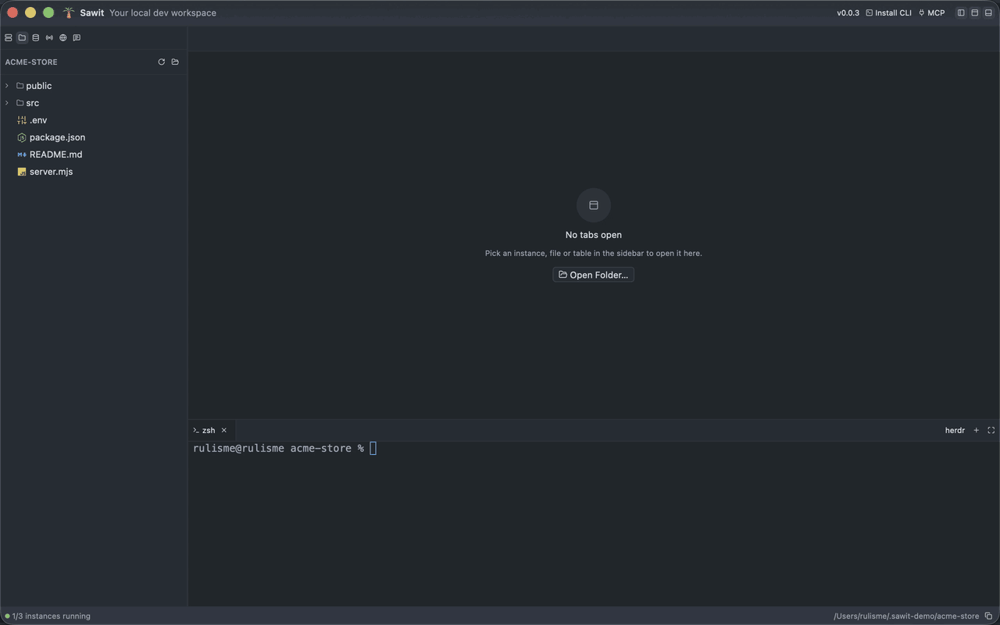
  <br>
  <sub>▶︎ <a href="docs/media/demo.mp4">Watch the demo video (MP4)</a>: instance → port conflict → table → SQL → schema diagram → code + terminal → ports → network</sub>
</p>

---

## Overview

Sawit is built for local development with PostgreSQL. This work usually needs Docker Desktop,
a database client, an editor, a terminal, and a few command-line tools as separate apps. In Sawit
they all live in a single Rust binary of about **24 MB** that uses **about 67 MB of memory** when idle.
The UI is GPU-rendered with [GPUI](https://gpui.rs), and its look follows Zed (the "One Dark" palette).

<p align="center">
  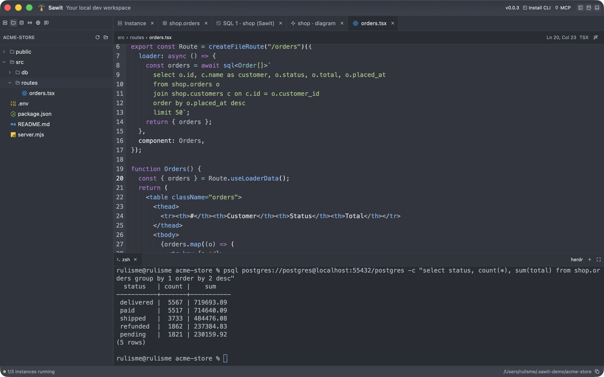
</p>

| | |
|---|---|
| 🐘 **Postgres without Docker** | Use binaries from Homebrew, Postgres.app, or `PATH`, or let Sawit download PostgreSQL 16/17/18. |
| 🛡️ **Port conflicts prevented** | Before starting, Sawit checks for processes already using the port, including Docker containers. |
| 🔍 **Safe data browsing** | The table grid uses a separate read-only connection. Passwords are stored in the macOS Keychain. |
| 🗺️ **Schema diagrams** | Tables and foreign keys drawn as a diagram, and exported as DBML or SVG. |
| ✍️ **Full editor** | Highlighting for about 200 languages, formatters, Markdown/HTML/SVG/Mermaid preview, and image, PDF, and video viewers. |
| 🖥️ **A real terminal** | Full `alacritty_terminal` emulation, fullscreen with one click, and it can run [herdr](https://herdr.dev). |
| 📡 **Ports & network** | See and stop every dev server you started, and diagnose your internet connection step by step. |
| 💬 **Prompt library** | Save the prompts you reuse, with tags and `{{variables}}` to fill in before copying. |
| ⌨️ **psql-style CLI** | `sawit kyzn leads "phone is null"` queries a database, `sawit list` shows everything, `sawit bakar ports` stops dev servers. |
| 🤖 **Ready for AI agents** | The `sawit-mcp` server, installed into Claude Code, Codex, Cursor, Zed and more with one click. |

## Install

On an Apple Silicon Mac, run:

```bash
curl -fsSL https://raw.githubusercontent.com/bahrulbangsawan/sawit.dev/main/scripts/install.sh | sh
```

This installs the latest release into `/Applications` (or `~/Applications`). Add `SAWIT_VERSION=v0.0.3` before `sh`
to pick a version. After that, the app updates itself.

The script also offers to install [herdr](https://herdr.dev) (optional, for split panes in Sawit's terminal). It asks
first; add `SAWIT_HERDR=1` before `sh` to install it without asking, or `SAWIT_HERDR=0` to skip it.

Sawit is not notarized yet, so if you open the `Sawit.dmg` from a browser download, macOS says it "could not verify
Sawit is free of malware." Use the script above, or right-click **Sawit.app → Open** once, or run
`xattr -dr com.apple.quarantine /Applications/Sawit.app`.

## Features

### Welcome screen

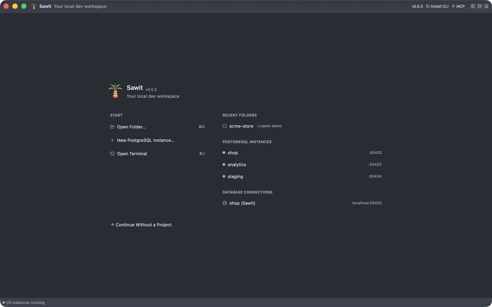

A new window opens on a welcome screen, like Zed's: **Open Folder…**, **New PostgreSQL Instance…** and
**Open Terminal** on the left, and your recent folders, instances and database connections on the right.
Picking anything lays the window out for that job. **Continue Without a Project** goes straight to the workspace.

The window is split into a sidebar with six tabs (**Instances**, **Files**, **Database**, **Ports**, **Network**,
**Prompts**), a tabbed center area, a terminal dock at the bottom, and a status bar. The status bar shows how many
instances are running and the project path, with a button that copies the path.

### Local PostgreSQL instances

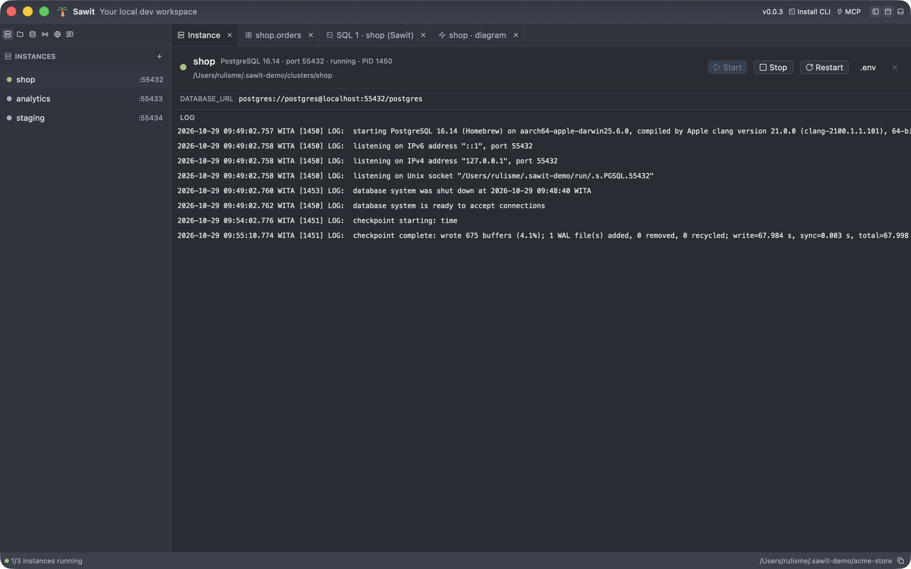

- A list of instances with name, version, port, data directory, and status. It has **Start / Stop / Restart**
  buttons (via `pg_ctl`) and a **live log**.
- Postgres binaries from Homebrew, Postgres.app, or `PATH` are **detected automatically**. They can also be
  **downloaded by Sawit** (PostgreSQL 16/17/18), so a project needs neither Docker nor Homebrew.
- Existing data directories (for example a Homebrew cluster) can be added with **Add Existing Data Directory…**.
- The **`.env`** button writes `DATABASE_URL=postgres://postgres@localhost:<port>/postgres` to the project's `.env`,
  so TanStack Start, Next.js, Rails, and other apps connect right away.
- New instances listen only on `localhost`, with the `postgres` superuser and `trust` authentication
  (local use only).

### Port conflict detection before start

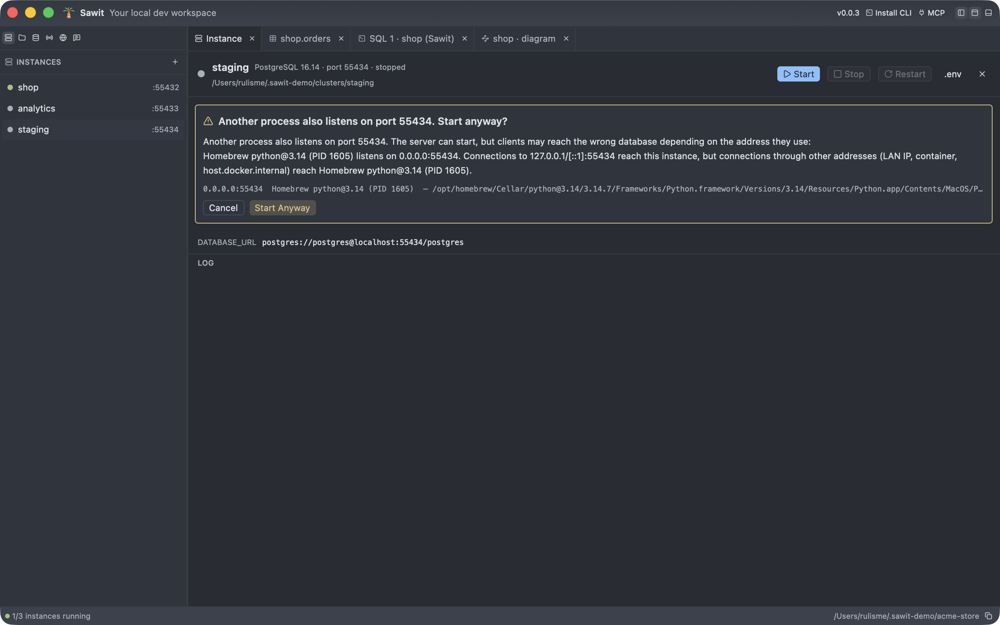

Before starting, Sawit checks who is already listening on the port: another process, a Homebrew service,
a Docker container (with its name), Postgres.app, or another Sawit instance. It also catches the hardest
case to track down, a **shadowed** port: one process binds `127.0.0.1:5433` while another binds
`*:5433`, so clients silently connect to the wrong database. Start is held and the cause is
explained. A conflict on the same address can't be forced.

### Database & table browser

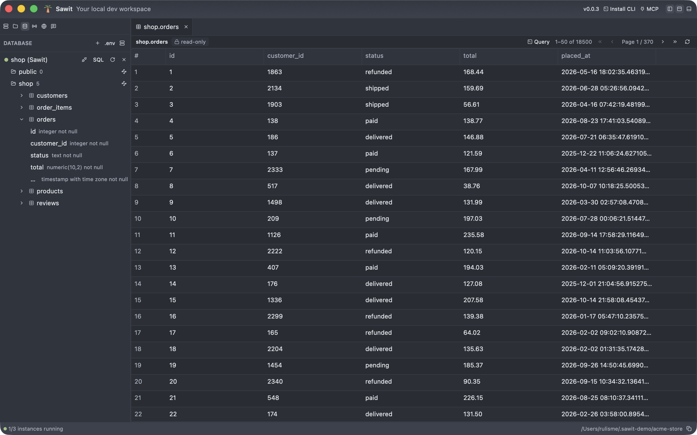

- **Connections** from a `DATABASE_URL`, a `.env` file, or a running Sawit instance (**Connect Instances**).
  Passwords are stored in the **macOS Keychain**, never in a file.
- **TLS** follows `sslmode` in the URL: `disable`/`prefer`/`require` behave like libpq, and
  `verify-ca`/`verify-full` check the certificate (`sslrootcert`, `sslcert` and `sslkey` are supported).
  Poolers (PgBouncer, Supavisor, Neon) work.
- Connections open when first used, **reconnect with backoff** after a drop, and close after a while unused or
  while the app is in the background. A wrong password is not retried.
- **Tree** of connection → schema → table/view → columns & types. The tree is virtual and stays smooth with
  thousands of tables. Tables without `SELECT` permission are disabled and say why.
- **Paged read-only grid**: 50 rows per page, ordered by primary key so pages stay stable,
  over a separate read-only connection. The first page shows before the row count finishes.
  Counting stops after 3 seconds; after that an estimate is shown.

### SQL editor

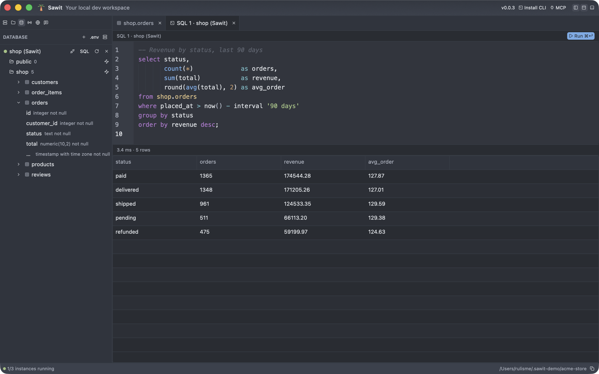

- <kbd>⌘</kbd><kbd>↩</kbd> runs the selected text, or the whole editor if nothing is selected.
- Shows results, duration, rows affected, and errors with `DETAIL`/`HINT`.
- At most 10,000 rows are shown. Results are streamed; remaining rows are not held in memory.
- A running query can be canceled with the **Cancel** button, in both the SQL editor and the table.

### Schema diagrams

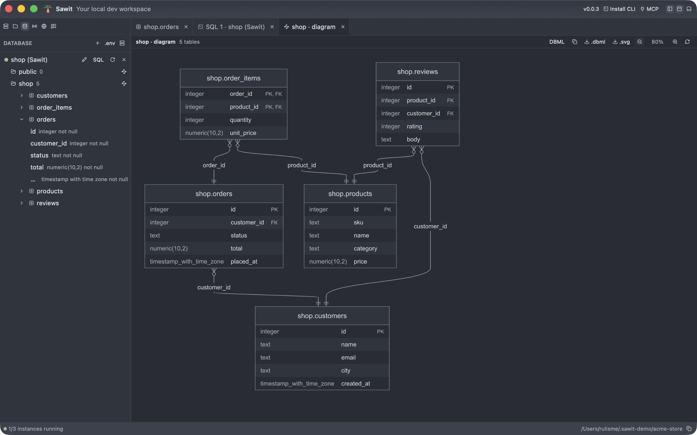

- Click the diagram icon next to a schema to see its tables, keys and foreign keys as a diagram.
- Zoom in and out, or switch to **DBML** to read the same schema as text (for dbdiagram.io and dbdocs).
- Copy the DBML, or save it as `.dbml` or the diagram as `.svg`.
- Diagrams are drawn by [Pele](https://pele.run), the renderer from Obsidian, running offline inside the app.

### Project code editor

- Open a project with `sawit <folder>`, the welcome screen, or the folder icon in the **Files** tab.
  See [The `sawit` command](#the-sawit-command).
- **Virtual file tree** with a logo per file type. The tree updates when files are created or deleted
  from the terminal.
- **Highlighting for about 200 languages** (syntect), including Dockerfile, Makefile, Vue, Svelte, Kotlin, and more.
- Soft wrap without horizontal scrolling, Zed-style toolbar (breadcrumb, `Ln, Col`, language).
- <kbd>⌘</kbd><kbd>S</kbd> saves atomically (symlinks stay symlinks). Files changed on disk are
  reloaded; if there are unsaved changes, Sawit warns you instead.
- **Formatter** <kbd>⇧</kbd><kbd>⌘</kbd><kbd>I</kbd>:
  - Prettier for JS/TS/JSON/CSS/SCSS/Less/HTML/Vue/Markdown/YAML/GraphQL.
  - sql-formatter (PostgreSQL dialect) for SQL.
  - Taplo for TOML; rustfmt, gofmt, Ruff, shfmt, and clang-format for other languages.
  - A copy in the project's `node_modules/.bin` is used first (so the project's version and config apply), then
    `PATH`, then `npx`/`bunx`.
  - Formatting can be reverted with a single undo.

### Previews & viewers

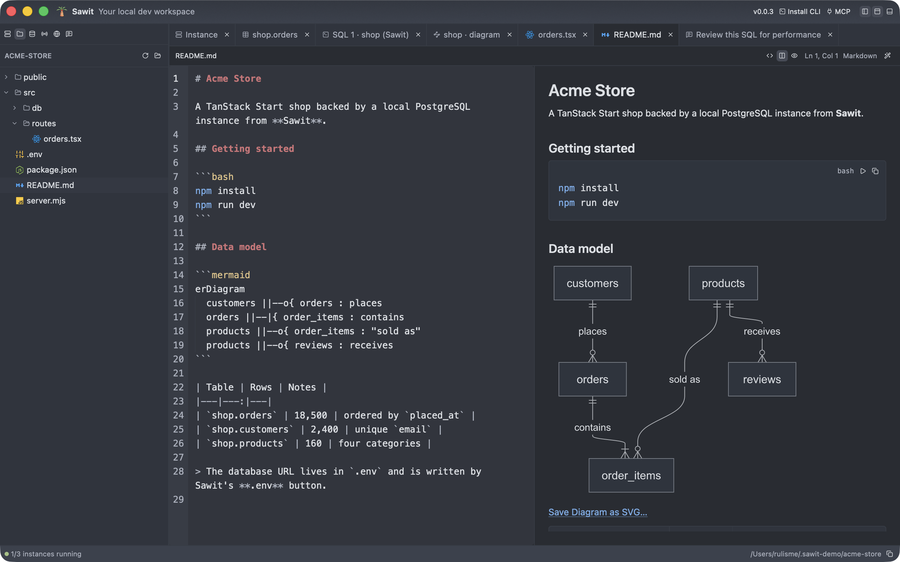

- **Markdown, HTML, and SVG**: Code / Split / Preview modes with a live preview. Relative
  images and tables are shown too.
- **Mermaid**: ` ```mermaid ` blocks in Markdown become diagrams, and `.mmd` files preview as their diagram.
  **Save Diagram as SVG…** exports one. Colors follow the app theme.
- **Code blocks** in previews get a **Copy** button. Shell blocks (`bash`, `zsh`, `sh`, …) also get **Run**,
  which types the commands into the terminal of the same window.
- **Images** in PNG/JPEG/WebP/GIF/HEIC/AVIF and more, with fit-to-screen or 100% mode, pixel size and file size.
- **PDF** rendered to fit the pane with CoreGraphics, zoom 50–300%. Only visible pages are rendered.
- **Video** via AVPlayer, with sound. <kbd>Space</kbd> to play/pause, plus seek and mute.

### Terminal

- Bottom dock with tabs. It can open a login shell or **herdr** (the **herdr** button appears when herdr is installed).
- The **Maximize Terminal** button fills the window with the terminal; click it again to restore the layout you had.
- Full emulation via `alacritty_terminal`: 256/truecolor, alt-screen, SGR mouse, bracketed paste,
  and resize.
- Drag to select text; it's copied when you release the mouse. Shift+drag selects even while a program
  (herdr, vim) uses the mouse.
- New terminals start in the project folder. Shells idle at their prompt follow when you open another project.

### Listening ports

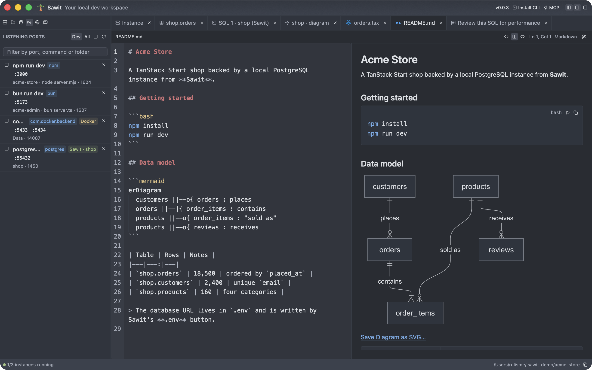

- One row per command you started (`npm run dev`, `bun run dev`, `pnpm dev`, a database, …), with its ports
  and project folder. **Dev** shows the servers you started; **All** shows every app that listens on a port.
- **Stop** a row to stop the whole command, launcher and children, so nothing respawns. Select several rows to
  stop them together. Anything still running after a moment can be **force-stopped**.
- Filter by port, command or folder. The list refreshes every few seconds.
- From the terminal, `sawit list ports` lists them and `sawit bakar ports` stops the dev servers
  (see [Databases, ports and instances from the terminal](#databases-ports-and-instances-from-the-terminal)).

### Network diagnosis

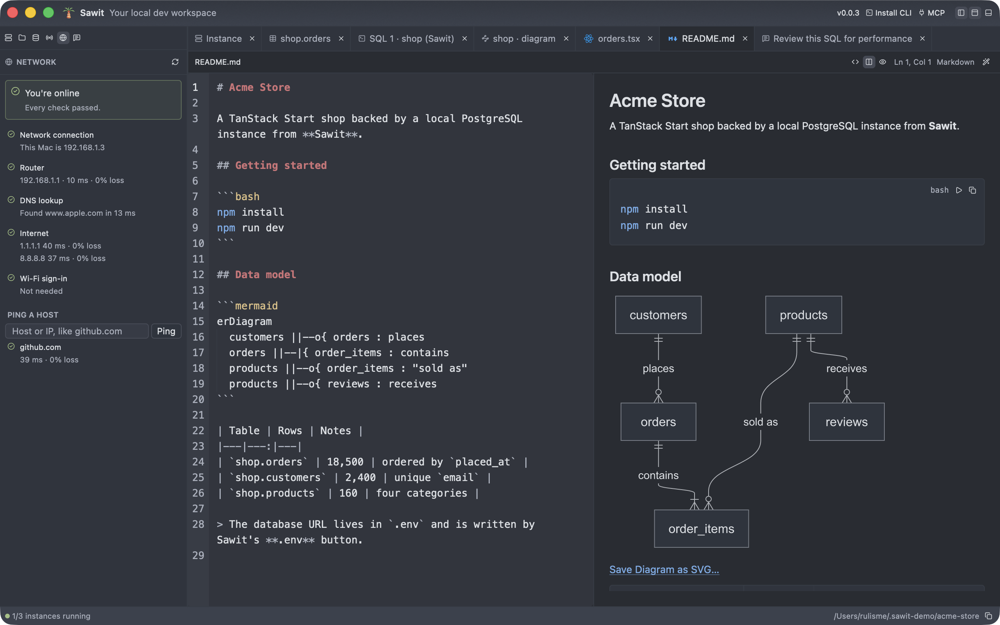

- **Run Diagnosis** checks, in order: your network connection, your router, DNS, the internet (1.1.1.1 and 8.8.8.8),
  and whether a Wi-Fi sign-in page (hotels, cafés, airports) is blocking traffic.
- Each check shows its result and latency, and the verdict says in plain words what's wrong and what to do,
  for example "Connected to the network, but not the internet" or "The internet works, but DNS doesn't".
- **Ping a host**: type a host name or IP address to send 4 pings and see the reply time and packet loss.
- Uses the system `ping` and `route`; no admin rights needed.

### Prompt library

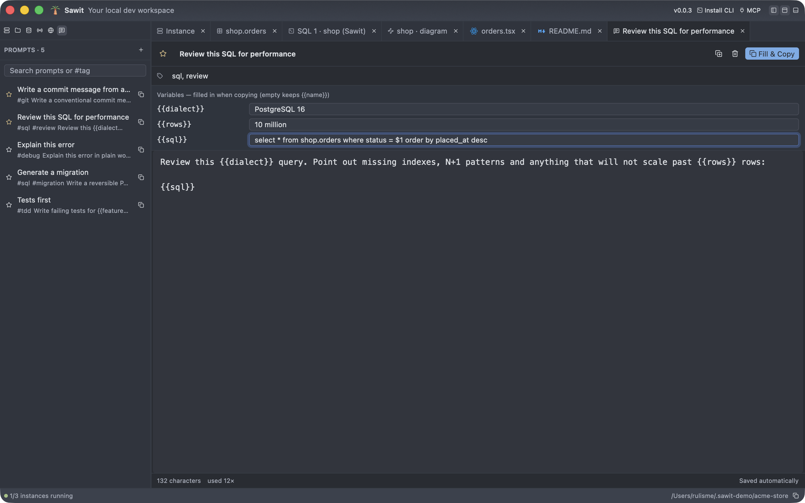

- Save the prompts you reuse with a title, tags and a body. Everything saves automatically.
- Search by text or `#tag`. Favorites and the prompts you use most come first.
- Write `{{variables}}` in a prompt, fill them in its tab, and **Fill & Copy**. Copy a prompt as is from the list.
- Stored in `prompts.json` in Sawit's data folder.

### Tabs & layout

- Right-click a tab for Close, Close Others, Close Left/Right, Close Clean, Close All, Make Tab
  Read-Only, and Pin Tab.
- Bulk close leaves pinned and unsaved tabs alone. Closing an unsaved file
  asks for confirmation.
- The instance tab can be closed, and it reappears when an instance is selected.
- The sidebar, terminal, and tab area can be hidden or shown from the title bar buttons or
  with shortcuts (see below).
- Every panel has a designed empty state that says what goes there and offers the next step, and every
  error says what happened with a way to try again or copy the message.

### Updates & changelog

- Click the version in the title bar for the **Changelog** page: the running version, update status,
  notes of a newer release, and the full history.
- Sawit checks [GitHub Releases](https://github.com/bahrulbangsawan/sawit.dev/releases) on launch and
  every 4 hours. New versions download in the background. Once ready, a **Restart to Update** button appears in the
  title bar: the app quits, `Sawit.app` is replaced, and it reopens. Builds from `cargo` only
  open the releases page.

## Keyboard shortcuts

| Action | Shortcut |
|---|---|
| Open folder | <kbd>⌘</kbd><kbd>O</kbd> |
| New window | <kbd>⇧</kbd><kbd>⌘</kbd><kbd>N</kbd> |
| Run SQL (selection or all) | <kbd>⌘</kbd><kbd>↩</kbd> |
| Save file | <kbd>⌘</kbd><kbd>S</kbd> |
| Format document | <kbd>⇧</kbd><kbd>⌘</kbd><kbd>I</kbd> |
| Show/hide sidebar | <kbd>⌘</kbd><kbd>B</kbd> |
| Show/hide terminal | <kbd>⌘</kbd><kbd>J</kbd> |
| Show/hide tabs & tables | <kbd>⇧</kbd><kbd>⌘</kbd><kbd>J</kbd> |
| Close active tab | <kbd>⌘</kbd><kbd>W</kbd> |
| Close Others | <kbd>⌥</kbd><kbd>⌘</kbd><kbd>T</kbd> |
| Close Left / Close Right | <kbd>⌘</kbd><kbd>K</kbd> <kbd>E</kbd> / <kbd>⌘</kbd><kbd>K</kbd> <kbd>T</kbd> |
| Close Clean (tabs without changes) | <kbd>⌘</kbd><kbd>K</kbd> <kbd>U</kbd> |
| Close All | <kbd>⌘</kbd><kbd>K</kbd> <kbd>W</kbd> |
| Pin Tab | <kbd>⌘</kbd><kbd>K</kbd> <kbd>⇧</kbd><kbd>↩</kbd> |
| Quit | <kbd>⌘</kbd><kbd>Q</kbd> |

## The `sawit` command

Like `zed`, Sawit can be opened from the terminal. Install the command with the **Install CLI** button in the title bar
(shown only while the command is not installed) or the **Sawit → Install ‘sawit’ Command in PATH…** menu item.
Both create a symlink `/usr/local/bin/sawit` to the app and ask for an admin password if that folder is owned by
root.

Besides opening files, the command can query databases like `psql`, list instances, databases and ports, and stop
dev servers or instances, all without the app (see
[below](#databases-ports-and-instances-from-the-terminal)).

```bash
sawit                    # open/activate Sawit
sawit .                  # open this folder as a project
sawit src/main.rs:42:5   # open a file at line 42, column 5 (grep/rustc output format is also accepted)
sawit new.sql            # a file that doesn't exist opens empty; ⌘S creates it
sawit -n ~/code/other    # always in a new window
sawit -r ~/code/other    # replace the project in the frontmost window
ls -la | sawit -         # open stdin as a file
git config --global core.editor "sawit --wait"   # wait until the file tab is closed
```

- If Sawit is already running, paths are sent to it over a Unix socket and the command returns right away.
  If not, Sawit is launched first, detached from the terminal.
- A folder that is already open is just focused. A new folder fills a window that has no project yet, or
  opens a new window. Files go to the window whose project contains them, or to the frontmost window.
- `--wait` returns after all opened files are closed (or the app quits).
- `--foreground` runs the app in that terminal itself (for debugging). `sawit --help` lists
  all options.

### Databases, ports and instances from the terminal

These work without the app (the output is in Indonesian and pokes fun at karhutla, the forest fires behind the palm-oil
plantations Sawit is named after):

```bash
sawit kyzn                                   # list the tables
sawit kyzn leads                             # first 100 rows
sawit kyzn leads "phone is null"             # filter: SELECT * FROM leads WHERE phone is null
sawit kyzn leads "select * from leads where phone is null"   # any SQL, like psql (writes too)
sawit list                                   # instances, databases, ports and saved connections
sawit list db                                # or: instances, ports, connections
sawit bakar ports                            # "burn" dev servers: confirm, SIGTERM, then SIGKILL
sawit bakar ports 3000 5173 -y               # whatever listens on these ports, without asking
sawit bakar instances                        # stop running Sawit instances (data is kept)
```

- `<db>` is looked up in this order: a Sawit instance or saved connection with that name, a database with that name in
  a saved connection, `DATABASE_URL` in `.env` in the current folder or one above it, then the databases of every
  Postgres running locally. A unique prefix also works (`kyzn` finds `kyzn_crm`). If a file or folder with that name
  exists, it's opened instead. To open a folder named `list` or `bakar`, use `sawit ./list`.
- Table output goes to stdout, while the "connected to" line and timing go to stderr, so `sawit kyzn leads | less`
  stays clean. Up to 10,000 rows are printed per result.
- `bakar ports` with no ports only takes dev servers (tools such as `npm run dev`, `vite` or `bun`). It skips databases,
  Docker, Sawit's instances and protected tools (Claude, MCP servers, language servers, Electron), the same rules as
  the `kill-dev` script. Without a terminal it asks for `-y` instead of prompting.

## MCP for AI agents

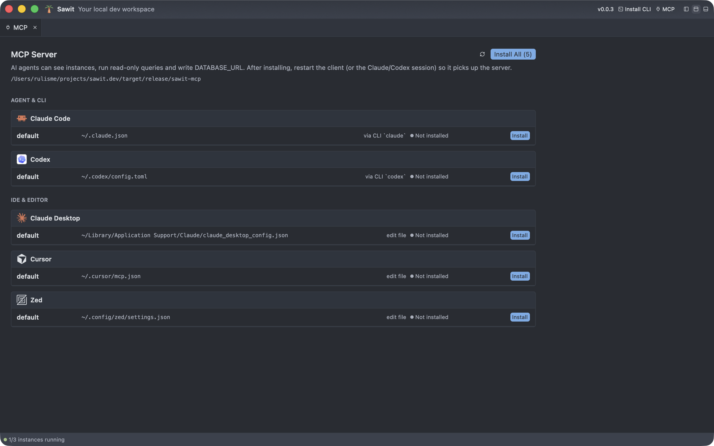

The `sawit-mcp` binary (stdio) gives AI agents access to local instances and databases:

| Tool | Purpose |
|---|---|
| `list_instances` | List instances with status, port, and `DATABASE_URL` |
| `start_instance` / `stop_instance` | Start an instance (refused with an explanation if the port is in use) or stop it |
| `list_connections` | List instances and saved connections usable by `describe_schema`/`query` |
| `describe_schema` | Schemas, tables, views, and columns |
| `query` | Run SQL, **always read-only**, up to 500 rows |
| `write_env` | Write `DATABASE_URL` to the project's `.env` |

Click **MCP** in the title bar to install it. The page finds the AI clients on this Mac: Claude Code (every
profile, including `CLAUDE_CONFIG_DIR` folders), Codex (and `CODEX_HOME` profiles), Claude Desktop, Cursor,
Windsurf, Gemini CLI, Zed, opencode and VS Code. It installs into each with one click and shows where each config
lives. Claude Code and Codex are changed through their own CLI when it's installed. Other configs are edited in
place, keeping other settings, key order and comments, with a one-time backup next to the original.

To add it by hand:

```bash
claude mcp add sawit -- /Applications/Sawit.app/Contents/MacOS/sawit-mcp
```

## Build & run

Prerequisites:

- Rust. The version is pinned in `rust-toolchain.toml` (1.99.1) and installed automatically by rustup.
- Xcode **Command Line Tools** only. Full Xcode is not needed because Metal shaders are compiled at runtime
  (`runtime_shaders`).
- Docker and Homebrew are not required.

```bash
cargo run -p sawit -- --foreground             # the app, with logs in the terminal
cargo run -p sawit -- --foreground ~/code/app  # open a project folder directly
cargo build --release                          # target/release/sawit and target/release/sawit-mcp
scripts/bundle-macos.sh                        # target/release/Sawit.app (with icon) for /Applications
```

App data is stored in `~/Library/Application Support/sawit/`:

- `instances.toml`, `profiles.toml`, `prompts.json` and `recent.toml`
- `clusters/` and `logs/`
- `bin/` for downloaded binaries
- `run/` for sockets
- `sawit.sock`, where the `sawit` command talks to the running app

Set `SAWIT_HOME=/path` to use a different folder (development/test).

**Coming from PG Desk?** Sawit was called PG Desk before v0.0.3. On first launch it moves
`~/Library/Application Support/pgdesk/` to `…/sawit/`, along with your instances and connections. Saved
passwords move to the new Keychain entry the first time they are used. Installing the MCP server
from the MCP page replaces the old `pgdesk` entry in each client. Run **Install CLI** again to get the
`sawit` command, and delete the old `/usr/local/bin/pgdesk` link. Updating from PG Desk 0.0.2 can't
happen in the app: download `Sawit.dmg` once from Releases.

## Versions & releases

- Versions start at **0.0.1** and bump one patch on **every push to `main`**. The history is in
  [`CHANGELOG.md`](CHANGELOG.md) and on the in-app **Changelog** page.

Release flow (enable once per clone with `git config core.hooksPath .githooks`):

1. `git push` to `main` runs `.githooks/pre-push` → `scripts/release.sh`: the version in `Cargo.toml`
   is bumped (the first release stays 0.0.1), a new `CHANGELOG.md` section is written from commit messages
   (grouped as `feat`/`fix`/`perf`/other), then a `chore(release): vX` commit and a `vX` tag are created.
2. After that push finishes, the release commit and tag are pushed too (log in `.git/sawit-release.log`).
3. The tag triggers `.github/workflows/release.yml`: the app is built on a macOS runner and published as a
   GitHub Release (`Sawit-X-macos-arm64.zip` for the updater, `Sawit.dmg`, notes from `CHANGELOG.md`).

## Test

```bash
cargo test --workspace                    # unit + integration (starts a temporary Postgres cluster if binaries are available)
cargo test --workspace -- --include-ignored   # + real binary download, Keychain and live network checks
cargo clippy --workspace --all-targets -- -D warnings
```

Integration tests use whichever Postgres binaries are found (Homebrew, Postgres.app, `PATH`, or downloaded).
If no binaries are found, the tests are skipped with a message.

## Architecture & key decisions

```
crates/core   sawit-core — no GPUI, tested with plain cargo test
  ports, owners, probe   lsof/ps/docker → conflict analysis & explanation, listening dev servers
  pgctl, control         status/initdb/start/stop/restart + log tail
  binaries, download     binary detection + download via postgresql_archive
  instances, recent      TOML registry, app paths, validation, recent folders
  db                     profiles, DATABASE_URL/.env, Keychain, TLS, schema, paging, SQL, read-only, diagrams
  mermaid                Mermaid → SVG with Pele in embedded QuickJS
  files, format, media, pdf   folder listing, safe reads, atomic saves, formatters, image & PDF rendering
  terminal               PTY + alacritty_terminal → snapshot, keyboard/mouse encoding
  network                connection diagnosis and ping
  prompts                prompt library and {{variables}}
  mcp_clients, update, cli    MCP install into AI clients, self-update, the sawit command
  kebun                  sawit <db> [table] ["sql"], sawit list, sawit bakar (no app needed)
  rt                     Tokio runtime on its own thread
crates/app    sawit — GPUI UI only (draws & forwards input)
crates/mcp    sawit-mcp — stdio MCP server on top of core
```

<details>
<summary><b>Technical decisions and their reasons</b></summary>

| Decision | Reason |
|---|---|
| `gpui-kit =0.8.1` (not `gpui` 0.2.2 on crates.io) | gpui-component 0.8.1 is built on the `gpui-pre =0.3.10` snapshot; gpui-kit pins the matching set. All APIs were checked against the `v0.8.1` tag source (notes: `docs/notes/gpui-kit-0.8.1-api.md`). |
| Rust 1.99.1 pinned | `gpui-pre-macos 0.3.10` uses APIs that are not stable in 1.97. |
| Tokio on a separate thread + `futures` channels | The UI thread never waits on I/O; results are awaited in `cx.spawn`. Proven in a spike: 29 UI ticks & 33 frames during a 3-second query. |
| `tokio-postgres` (not `sqlx`) | Lighter, with `simple_query_raw` for streaming free-form SQL. |
| `postgresql_archive` (not `postgresql_embedded`) | Only download+extract is needed; `postgresql_embedded` pulls in `sqlx` and manages its own lifecycle. |
| `lsof -F` + `ps` + `docker ps` | No root needed; an IPv6 wildcard is treated as dual-stack (when in doubt, warn). |
| PATH from the login shell at startup | Apps opened from Finder get a minimal PATH; without this, `docker`/`brew`/`herdr` are not found. |
| Terminal: `alacritty_terminal` + canvas | Like Zed's terminal; core produces snapshots, the app only draws. `HERDR_*`/`TMUX`/`ZELLIJ*` variables from the parent process are dropped so herdr doesn't refuse to run as "nested". |
| Highlighting: syntect | About 200 languages at a small size, without a tree-sitter grammar per language. |
| Diagrams: Pele in QuickJS | Mermaid and schema diagrams render offline, without a browser engine. |
| Network checks: system `ping` and `route` | No raw sockets, so no admin rights; a plain HTTP check detects Wi-Fi sign-in pages. |
| Keychain via `/usr/bin/security` | Sawit is ad-hoc signed, so each build is a new app to macOS and asked for the login password again; items the `security` tool saves, it reads back without asking. |
| Icons: only the ones used | The full Lucide bundle adds about 1 MiB. |
| TLS: rustls + `ring` | `ring` is already there for binary downloads, so no second crypto library is added. |
| Logo: hand-made SVG | An elephant (PostgreSQL) from two circles, one ear curve, and one trunk stroke, above a prompt cursor (editor + terminal); One Dark colors. `assets/logo/`. |

</details>

## Size & memory

Measured on an Apple Silicon MacBook (macOS 26.6), release build (`lto = "thin"`, `strip`):

| | |
|---|---|
| `sawit` | 24.0 MB (single file, no JVM/Chromium/Node runtime) |
| `sawit-mcp` | 4.5 MB (including TLS) |
| Idle memory (1 window, 1 terminal tab, 10 seconds after launch) | RSS 85 MB · physical footprint 67 MB (peak 115 MB during startup) |
| Clean release build | About 4 minutes |

Figures for other apps are not listed because they have not been measured on the same machine.

## Known limitations

- macOS only (depends on Keychain, `lsof`, AVPlayer, CoreGraphics, and Postgres.app).
- The grid is read-only; data is edited through the SQL editor.
- Paging uses `OFFSET/LIMIT`. Tables without a primary key (and views) use physical order, which is stable
  as long as the data doesn't change.
- With transaction-mode poolers, session settings (`SET`) are not guaranteed to persist. The table browser still only
  runs `SELECT`.
- Schema diagrams show tables only; views have no keys to relate.

<sub>Screenshots and video in `docs/media/` were recorded from a release build with demo data (separate `SAWIT_HOME`,
Homebrew PostgreSQL 16).</sub>
