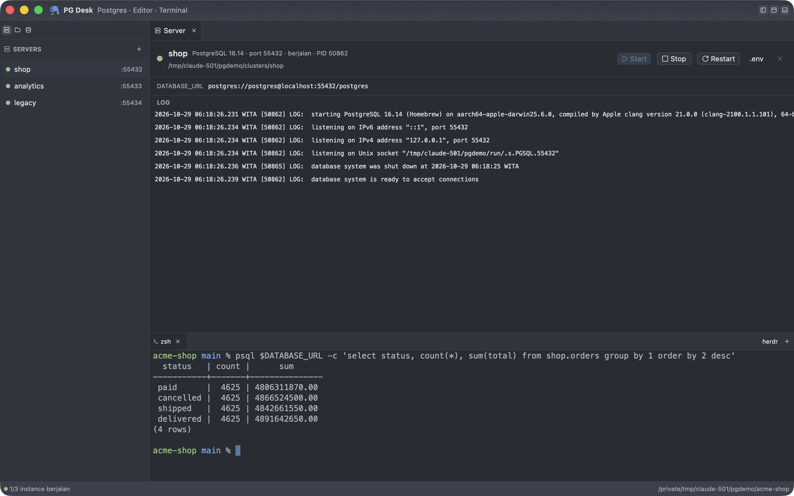

<p align="center"></p>

<h1 align="center">PG Desk</h1>

<p align="center">
  <b>Postgres, an editor, and a terminal in one native macOS app, without Docker.</b><br>
  Run a local PostgreSQL server, browse data, write SQL, edit project code, and open a terminal
  from a single window.
</p>

<p align="center">
  
  
  
  
  
</p>

<p align="center">
  <a href="#features">Features</a> ·
  <a href="#build--run">Build</a> ·
  <a href="#mcp-for-ai-agents">MCP</a> ·
  <a href="#keyboard-shortcuts">Shortcuts</a> ·
  <a href="#architecture--key-decisions">Architecture</a>
</p>

<p align="center">
  
  <br>
  <sub>▶︎ <a href="docs/media/demo.mp4">Watch the demo video (MP4, 40 seconds)</a>: server → port conflict → table → SQL → code + terminal → Markdown preview</sub>
</p>

---

## Overview

PG Desk is built for local development with PostgreSQL. This work usually needs Docker Desktop,
a database client, an editor, and a terminal as separate apps. In PG Desk they all live in a single
**24 MB** Rust binary that uses **±67 MB of memory** when idle. The UI is GPU-rendered with
[GPUI](https://gpui.rs), and its look follows Zed (the "One Dark" palette).

<p align="center">
  
</p>

| | |
|---|---|
| 🐘 **Postgres without Docker** | Use binaries from Homebrew, Postgres.app, or `PATH`, or let PG Desk download PostgreSQL 16/17/18. |
| 🛡️ **Port conflicts prevented** | Before starting, PG Desk checks for processes already using the port, including Docker containers. |
| 🔍 **Safe data browsing** | The table grid uses a separate read-only connection. Passwords are stored in the macOS Keychain. |
| ✍️ **Full editor** | Highlighting for ±200 languages, formatters, Markdown/HTML/SVG preview, and image, PDF, and video viewers. |
| 🖥️ **A real terminal** | Full `alacritty_terminal` emulation, and it can run [herdr](https://herdr.dev). |
| 🤖 **Ready for AI agents** | The `pgdesk-mcp` MCP server: queries are always read-only, plus tools to start/stop instances and write `.env`. |

## Features

### Local PostgreSQL servers



- A list of instances with name, version, port, data dir, and status. It has **Start / Stop / Restart**
  buttons (via `pg_ctl`) and a **live log**.
- Postgres binaries from Homebrew, Postgres.app, or `PATH` are **detected automatically**. They can also be
  **downloaded by PG Desk** (PostgreSQL 16/17/18), so a project needs neither Docker nor Homebrew.
- Existing data dirs (e.g. a Homebrew cluster) can be added.
- The **`.env`** button writes `DATABASE_URL=postgres://postgres@localhost:<port>/postgres` to the project's `.env`,
  so TanStack, Next.js, Rails, and other apps connect right away.
- New instances listen only on `localhost`, with the `postgres` superuser and `trust` authentication
  (local use only).

### Port conflict detection before start


Before starting, PG Desk checks who is already listening on the port: another process, a Homebrew service,
a Docker container (with its name), Postgres.app, or another PG Desk instance. It also catches the hardest
case to track down, a **shadowed** port: one process binds `127.0.0.1:5433` while another binds
`*:5433`, so clients silently connect to the wrong database. Start is blocked and the cause is
explained. A conflict on the same address cannot be forced.

### Database & table browser


- **Connections** from `DATABASE_URL`, a `.env` file, or a running PG Desk instance. Passwords are stored in the
  **macOS Keychain**, never in a file.
- **TLS** follows the `sslmode` in the URL: `disable`/`prefer`/`require` behave like libpq, and
  `verify-full` checks the certificate against the system trust store. Dropped connections reconnect
  automatically. Poolers (PgBouncer, Supavisor, Neon) are supported.
- **Tree** of database → schema → table/view → columns & types. The tree is virtual and stays smooth with
  thousands of tables. Tables without `SELECT` permission are disabled and get a tooltip.
- **Paged read-only grid**: 50 rows per page, ordered by primary key so pages stay stable,
  over a separate read-only connection. The first page shows before the row count finishes.
  Counting is capped at 3 seconds; after that an estimate (`±`) is used.

### SQL editor


- <kbd>⌘</kbd><kbd>↩</kbd> runs the selected text, or the whole editor if nothing is selected.
- Shows results, duration, and errors with `DETAIL`/`HINT`.
- At most 10,000 rows are shown. Results are streamed; remaining rows are not held in memory.
- A running query can be cancelled with the **Cancel** button, in both the SQL editor and the table.

### Project code editor

- Open a project with `pgdesk <folder>` or the folder icon. See [The `pgdesk` command](#the-pgdesk-command).
- **Virtual file tree** with per-file-type icons. The tree updates when files are created or deleted
  from the terminal.
- **Highlighting for ±200 languages** (syntect), including Dockerfile, Makefile, Vue, Svelte, Kotlin, and more.
- Soft wrap without horizontal scrolling, Zed-style toolbar (breadcrumb, `Ln, Col`, language).
- <kbd>⌘</kbd><kbd>S</kbd> saves atomically (symlinks stay symlinks). Files changed on disk are
  reloaded; if there are unsaved changes, PG Desk shows a warning.
- **Formatter** <kbd>⇧</kbd><kbd>⌘</kbd><kbd>I</kbd>:
  - Prettier for JS/TS/JSON/CSS/SCSS/Less/HTML/Vue/Markdown/YAML/GraphQL.
  - sql-formatter (PostgreSQL dialect) for SQL.
  - Taplo for TOML; rustfmt, gofmt, Ruff, shfmt, and clang-format for other languages.
  - A copy in the project's `node_modules/.bin` is used first (the project's version and config apply), then
    `PATH`, then `npx`/`bunx`.
  - Formatting can be reverted with a single undo.

### Previews & viewers


- **Markdown, HTML, and SVG**: Code / Split / Preview modes with a live preview. Relative
  images and tables are shown too.
- **Images** in PNG/JPEG/WebP/GIF/HEIC/AVIF and more, with fit-to-screen or 100% mode.
- **PDF** rendered to fit the screen with CoreGraphics, zoom 50–300%.
- **Video** via AVPlayer, with sound. <kbd>Space</kbd> to play/pause, plus seek and mute.

### Terminal

- Bottom dock with tabs. It can open a login shell or **herdr** (the `herdr` button appears when herdr is installed).
- Full emulation via `alacritty_terminal`: 256/truecolor, alt-screen, SGR mouse, bracketed paste,
  and resize.

### Tabs & layout

- Right-click a tab for Close, Close Others, Close Left/Right, Close Clean, Close All, Make Tab
  Read-Only, and Pin Tab.
- Bulk close leaves pinned and unsaved tabs alone. Closing an unsaved file
  asks for confirmation.
- The Server tab can be closed, and it reappears when a server is selected.
- The sidebar, terminal, and tab area can be hidden or shown from the title bar buttons or
  with shortcuts (see below).

## Keyboard shortcuts

| Action | Shortcut |
|---|---|
| Run SQL (selection or all) | <kbd>⌘</kbd><kbd>↩</kbd> |
| Save file | <kbd>⌘</kbd><kbd>S</kbd> |
| Format document | <kbd>⇧</kbd><kbd>⌘</kbd><kbd>I</kbd> |
| Sidebar | <kbd>⌘</kbd><kbd>B</kbd> |
| Terminal / herdr | <kbd>⌘</kbd><kbd>J</kbd> |
| Tab & table area | <kbd>⇧</kbd><kbd>⌘</kbd><kbd>J</kbd> |
| Close active tab | <kbd>⌘</kbd><kbd>W</kbd> |
| Close Others | <kbd>⌥</kbd><kbd>⌘</kbd><kbd>T</kbd> |
| Close Left / Close Right | <kbd>⌘</kbd><kbd>K</kbd> <kbd>E</kbd> / <kbd>⌘</kbd><kbd>K</kbd> <kbd>T</kbd> |
| Close Clean (tabs without changes) | <kbd>⌘</kbd><kbd>K</kbd> <kbd>U</kbd> |
| Close All | <kbd>⌘</kbd><kbd>K</kbd> <kbd>W</kbd> |
| Pin Tab | <kbd>⌘</kbd><kbd>K</kbd> <kbd>⇧</kbd><kbd>↩</kbd> |

## Build & run

Prerequisites:

- Rust. The version is pinned in `rust-toolchain.toml` (1.99.1) and installed automatically by rustup.
- Xcode **Command Line Tools** only. Full Xcode is not needed because Metal shaders are compiled at runtime
  (`runtime_shaders`).
- Docker and Homebrew are not required.

```bash
cargo run -p pgdesk -- --foreground             # the app, with logs in the terminal
cargo run -p pgdesk -- --foreground ~/code/app  # open a project folder directly
cargo build --release               # target/release/pgdesk and target/release/pgdesk-mcp
scripts/bundle-macos.sh             # target/release/PG Desk.app (with icon) for /Applications
```

App data is stored in `~/Library/Application Support/pgdesk/`:

- `instances.toml` and `profiles.toml`
- `clusters/` and `logs/`
- `bin/` for downloaded binaries
- `run/` for sockets
- `pgdesk.sock`, where the `pgdesk` command talks to the running app

Set `PGDESK_HOME=/path` to use a different folder (development/test).

## The `pgdesk` command

Like `zed`, PG Desk can be opened from the terminal. Install the command with the **Install CLI** button in the title bar
(shown only while the command is not installed) or the **PG Desk → Install ‘pgdesk’ Command in PATH…** menu item.
Both create a symlink `/usr/local/bin/pgdesk` to the app and ask for an admin password if that folder is owned by
root.

```bash
pgdesk                    # open/activate PG Desk
pgdesk .                  # open this folder as a project
pgdesk src/main.rs:42:5   # open a file at line 42, column 5 (grep/rustc output format is also accepted)
pgdesk new.sql           # a file that doesn't exist opens empty; ⌘S creates it
pgdesk -n ~/code/other     # always in a new window
pgdesk -r ~/code/other     # replace the project in the frontmost window
ls -la | pgdesk -         # open stdin as a file
git config --global core.editor "pgdesk --wait"   # wait until the file tab is closed
```

- If PG Desk is already running, paths are sent to it over a Unix socket and the command returns right away.
  If not, PG Desk is launched first, detached from the terminal.
- A folder that is already open is just focused. A new folder fills a window that has no project yet, or
  opens a new window. Files go to the window whose project contains them, or to the frontmost window.
- `--wait` returns after all opened files are closed (or the app quits).
- `--foreground` runs the app in that terminal itself (for debugging). `pgdesk --help` lists
  all options.

## MCP for AI agents

The `pgdesk-mcp` binary (stdio) gives AI agents access to local instances and databases:

| Tool | Purpose |
|---|---|
| `list_instances` | List instances with status, port, and `DATABASE_URL` |
| `start_instance` / `stop_instance` | Start an instance (refused with an explanation if the port is in use) or stop it |
| `list_connections` | List instances and saved connections usable by `describe_schema`/`query` |
| `describe_schema` | Schemas, tables, views, and columns |
| `query` | Run SQL, **always read-only**, up to 500 rows |
| `write_env` | Write `DATABASE_URL` to the project's `.env` |

```bash
claude mcp add pgdesk -- /path/to/target/release/pgdesk-mcp
```

## Versions, changelog & updates

- Versions start at **0.0.1** and bump one patch on **every push to `main`**. The history is in
  [`CHANGELOG.md`](CHANGELOG.md) and on the **Changelog** page in the app (click the version label in the title bar).
- PG Desk checks [GitHub Releases](https://github.com/bahrulbangsawan/pgdesk/releases) on launch and
  every 4 hours. New versions download in the background. Once ready, a **Restart for Update** button appears in the
  title bar: the app quits, `PG Desk.app` is replaced, and it reopens. Builds from `cargo` only
  open the releases page.

Release flow (enable once per clone with `git config core.hooksPath .githooks`):

1. `git push` to `main` runs `.githooks/pre-push` → `scripts/release.sh`: the version in `Cargo.toml`
   is bumped (the first release stays 0.0.1), a new `CHANGELOG.md` section is written from commit messages
   (grouped as `feat`/`fix`/`perf`/other), then a `chore(release): vX` commit and a `vX` tag are created.
2. After that push finishes, the release commit and tag are pushed too (log in `.git/pgdesk-release.log`).
3. The tag triggers `.github/workflows/release.yml`: the app is built on a macOS runner and published as a
   GitHub Release (`PG-Desk-X-macos-arm64.zip` for the updater, `PG-Desk.dmg`, notes from `CHANGELOG.md`).

## Test

```bash
cargo test --workspace                    # unit + integration (starts a temporary Postgres cluster if binaries are available)
cargo test --workspace -- --include-ignored   # + real binary download & Keychain
cargo clippy --workspace --all-targets -- -D warnings
```

Integration tests use whichever Postgres binaries are found (Homebrew, Postgres.app, `PATH`, or downloaded).
If no binaries are found, the tests are skipped with a message.

## Architecture & key decisions

```
crates/core   pgdesk-core — no GPUI, tested with plain cargo test
  ports, owners, probe   lsof/ps/docker → conflict analysis & explanation
  pgctl, control         status/initdb/start/stop/restart + log tail
  binaries, download     binary detection + download via postgresql_archive
  instances              TOML registry, app paths, validation
  db                     profiles, DATABASE_URL/.env, Keychain, schema, paging, SQL, read-only
  files                  folder listing, safe reads, atomic saves
  terminal               PTY + alacritty_terminal → snapshot, keyboard/mouse encoding
  rt                     Tokio runtime on its own thread
crates/app    pgdesk — GPUI UI only (draws & forwards input)
crates/mcp    pgdesk-mcp — stdio MCP server on top of core
```

<details>
<summary><b>Technical decisions and their reasons</b></summary>

| Decision | Reason |
|---|---|
| `gpui-kit =0.8.1` (not `gpui` 0.2.2 on crates.io) | gpui-component 0.8.1 is built on the `gpui-pre =0.3.10` snapshot; gpui-kit pins the matching set. All APIs were checked against the `v0.8.1` tag source (notes: `docs/notes/gpui-kit-0.8.1-api.md`). |
| Rust 1.99.1 pinned | `gpui-pre-macos 0.3.10` uses APIs that are not stable in 1.97. |
| Tokio on a separate thread + `futures` channels | The UI thread never waits on I/O; results are awaited in `cx.spawn`. Proven in a spike: 29 UI ticks & 33 frames during a 3-second query. |
| `tokio-postgres` (not `sqlx`) | Lighter, with `simple_query_raw` for streaming free-form SQL. |
| `postgresql_archive` (not `postgresql_embedded`) | Only download+extract is needed; `postgresql_embedded` pulls in `sqlx` and manages its own lifecycle. |
| `lsof -F` + `ps` + `docker ps` | No root needed; an IPv6 wildcard is treated as dual-stack (when in doubt, warn). |
| PATH from the login shell at startup | Apps opened from Finder get a minimal PATH; without this, `docker`/`brew`/`herdr` are not found. |
| Terminal: `alacritty_terminal` + canvas | Like Zed's terminal; core produces snapshots, the app only draws. `HERDR_*`/`TMUX`/`ZELLIJ*` variables from the parent process are dropped so herdr doesn't refuse to run as "nested". |
| Highlighting: syntect | ±200 languages at a small size, without a tree-sitter grammar per language. |
| Keychain via `security-framework` | macOS target; smaller than `keyring` 4.x. |
| Icons: only the ones used | The full Lucide bundle adds ±1 MiB. |
| TLS: rustls + `ring` | `ring` is already there for binary downloads, so no second crypto library is added. |
| Logo: hand-made SVG | An elephant (PostgreSQL) from two circles, one ear curve, and one trunk stroke, above a prompt cursor (editor + terminal); One Dark colors. `assets/logo/`. |

</details>

## Size & memory

Measured on an Apple Silicon MacBook (macOS 26.6), release build (`lto = "thin"`, `strip`):

| | |
|---|---|
| `pgdesk` | 24.0 MB (single file, no JVM/Chromium/Node runtime) |
| `pgdesk-mcp` | 4.5 MB (including TLS) |
| Idle memory (1 window, 1 terminal tab, 10 seconds after launch) | RSS 85 MB · physical footprint 67 MB (peak 115 MB during startup) |
| Clean release build | ±4 minutes |

Figures for other apps are not listed because they have not been measured on the same machine.

## Known limitations

- macOS only (depends on Keychain, `lsof`, and Postgres.app).
- The grid is read-only; data is edited through the SQL editor.
- Paging uses `OFFSET/LIMIT`. Tables without a primary key (and views) use physical order, which is stable
  as long as the data doesn't change.
- With transaction-mode poolers, session settings (`SET`) are not guaranteed to persist. The table browser still only
  runs `SELECT`.
- The terminal does not yet support mouse text selection for copying. Programs inside it (e.g. herdr)
  still receive mouse input.

<sub>Screenshots and video in `docs/media/` were recorded from a release build with demo data (separate `PGDESK_HOME`,
Homebrew PostgreSQL 16 cluster).</sub>
